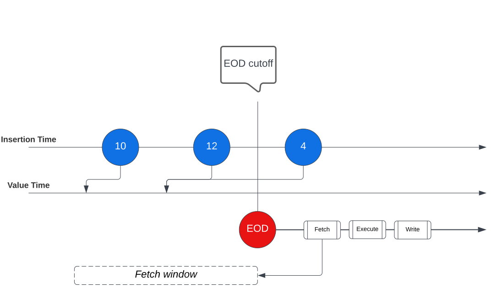

:status: hidden
= Financial Consistency

== Behaviour of the Post-Posting code

When a `post_posting_code` execution fails, it is marked as a failure in the database. Subsequent
post-posting executions for that Account or Plan require this failure to be handled before they can
continue.

The link:{baseURL}/api/core_api#post_posting_republisher[Post Posting Republisher] provides
functionality to access, delete, and republish `post_posting_code` failures (as link:{baseURL}/api/core_api#postpostingfailure[PostPostingFailure] objects) for one or more Accounts
or Plans.

[CAUTION]
====
Handle these endpoints with care and be fully aware of their functionality before republishing or
deleting Post-Posting Failures. Using these endpoints incorrectly could lead to missing Hook
Directives, potentially affecting the financial state of the accounts.
====

There are some cases where the Post-Posting Failure cannot be resolved through republishing. In
these cases, a post-posting failure can be deleted to unblock successive requests. In most cases,
this means manual remediation of the side effects that should have been produced by the Hook
Execution.

== Ensuring Consistency of Hook Executions

To ensure this consistency is maintained between sequential executions, such as post postings or
schedules, it is important to consider the value and insertion timestamp of each
PostingInstructionBatch you instruct.

If you do not explicitly set the value timestamp, it will be set as the insertion timestamp of the
postings. If the hook execution that instructs the postings is delayed, then the value timestamp of
the postings will be delayed past the effective time of the hook. Any sequential hook executions may
exclude those postings from balance calculations if their fetchers have not been correctly
configured.

To mitigate against unexpected balances caused by the default behaviour of timestamps, depending on
the use case you are operating on, you can do either of the following:

* Set the value timestamp of the PostingInstructionBatches instructed from contract hooks to be the `effective_datetime` provided
in the hook arguments, so that Vault treats the postings as being in the correct window.
* If you are using the scheduled code hook, fetch data using the live modifier to ensure you see all the
postings/balances you intended to see in the hook execution window. If this is done, the contract
code should then apply logic to filter out the postings and make adjustments to balances to get an
appropriate representation of the state of the account at the effective time of hook execution.

== Handling Race conditions between Hook Executions

Design product configurations with race conditions in mind. Use an informed view of data to be
preventative rather than reactive. For example, consider a racing post posting and scheduled code
execution. The hook executions can be designed such that they are aware of one another:

* The scheduled code can be aware there is a post posting in flight by fetching data from the ledger, for
example where some addresses are in a state they expect a pre_posting to have left them.
* The post posting can be aware if a schedule code has run by using its effective_time and fetching the last
execution time of the schedule in order to understand if it has already completed or if it is likely
to be in flight.
