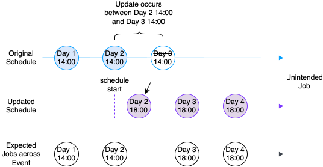

:status: hidden
= Schedule Management

On-demand/one-off schedules are not currently natively supported by Vault Core as a first class
feature. If you want to have a single schedule that is executed in the future, refer to the
link:{baseURL}/reference/contracts/contracts_api_4xx/common_examples#creating_skipped_schedules[common example of skipping schedules].

Because on-demand schedules are not currently natively supported, there are some important
considerations with handling schedules to be aware of.

== Reducing a schedule start time

=== Caveat

You cannot update a schedule's start time, including from within the `conversion_hook`, if the
schedule being modified is an existing schedule. All modifications to a schedule, including that
within the `conversion_hook`, or returned via `UpdateAccountEventTypeDirective`, will be effective
as of the last run time of the schedule. You cannot specify a new schedule `start_datetime` before
the account creation date (for account activation) or the account conversion date (for product
upgrade/account conversion).

=== Recommendation

If you want to modify the schedule with a different start time, we recommend you convert to a new
contract with a different schedule (with a different `event_type` name), where the new intended
`start_datetime` can be used. Note that this is still limited by the fact that start datetime cannot
be before the account conversion datetime.

== Additional Jobs when updating schedules

=== Caveat

The system applies Schedule updates based on the last run time of the original schedule.
This behaviour can result in additional Job executions.

Consider the following example:

* On day 1, you create a schedule which is set to run daily at 14:00
* On Day 2, you update the schedule with a new expression so that the schedule runs daily at 18:00

If the request to update the Schedule occurs between 14:00 on day 2 and 14:00 on day 3, vault will trigger an additional job at 18:00 on day 2. This means two jobs are triggered on day 2, one at 14:00 and another at 18:00.

=== Recommendation
When updating a Schedule, add a skip to the Schedule with the `skip_end_time` set to the next desired run time according
to the updated schedule. You can do this using `skip=ScheduleSkip(end=expected_next_run_time_minus_1_second)`,
where `expected_next_run_time_minus_1_second` is one second before the next desired run. This will prevent any additional Jobs from being executed.

For example: if you update a daily schedule from 14:00 to 18:00 at 16:00, you would set
`skip=ScheduleSkip(end=datetime.datetime(YEAR, MONTH, 3, 17, 59))` to prevent the Job from running twice.

[NOTE]
====
Additional Jobs are not necessarily backdated Jobs, and not all backdated Jobs are undesirable.
Therefore, using `skip=ScheduleSkip(end=hook_arguments.effective_datetime)` is not advised, as it may skip intended backdated Jobs.
====
