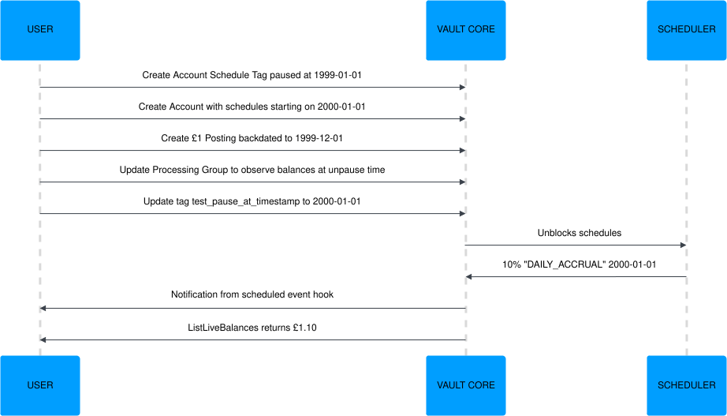

:status: hidden
= How to conduct Accelerated Testing

To carry out Accelerated Testing, you will first need to set up the backdated Accounts you want to test,
before using Processing Groups and Account Schedule Tags to speed up time and see the resulting side effects that occur.

== 1. Set up Accounts for Accelerated Testing

. Create an link:{baseURL}/api/core_api#account_schedule_tags[Account Schedule Tag] (AST) with a `test_pause_at_timestamp` set to a time in the past, relative to the first schedule execution timestamp to test.
. Create a Smart Contract. Include the Account Schedule Tag’s ID in the `scheduler_tag_ids` of the `SmartContractEventType` to be accelerated.
. Create a Customer.
. Create a backdated Account:

* If using the /v2/accounts API:

** Set the `smart_contract_version_id` to match the Smart Contract ID.
** Set the `activation_timestamp` to a time later than the `test_pause_at_timestamp`. This is used as the `hook_arguments.effective_datetime` in the Smart Contract’s activation hook, and sets the minimum for its `ScheduledEvents`’ start times.

* If using the /v1/accounts API:

** Set the `product_version_id` to match the Smart Contract ID.
** Set the `opening_timestamp` to a time later than the `test_pause_at_timestamp`. This is used as the `hook_arguments.effective_datetime` in the Smart Contract’s activation hook, and sets the minimum for its `ScheduledEvents`’ start times.

== 2. Optional: Set up supervised Accounts for Accelerated Testing

You have the option to conduct Accelerated Testing of Accounts supervised by plans. To set this up, after creating a backdated Account:

. Create a Smart Contract:

* Include the Account Schedule Tag’s ID in the `scheduler_tag_ids` of the `SupervisorContractEventType` to be accelerated.
* Override the `SmartContractEventType`, for example `overrides_event_types=[("smart_contract_alias", "SMART_CONTRACT_EVENT_TYPE")]`

. Create a backdated Plan using the Data Loader API. Set the `opening_timestamp` to a time later than the `test_pause_at_timestamp`.
This is used as the `hook_arguments.effective_datetime` in the Smart Contract’s activation hook, and sets the minimum for its `ScheduledEvents`’ start times.
. Create a backdated Account Plan Association using the Data Loader API. Set the `start_timestamp` to the Plan’s `opening_timestamp`.

== 3. Optional: Create backdated resources

Once you have set up the backdated Accounts, you can create backdated Postings, Parameter Values, and/or Flags to mimic events that occur during an Account's lifecycle (such as transactions and interest rate changes):

* Create backdated Postings: Set their `value_timestamp` to a realistic value relative to the account’s `activation_timestamp`/`opening_timestamp`.

* Create backdated Parameter Values: Set their `effective_from_timestamp` to a realistic value relative to the account’s `activation_timestamp`/`opening_timestamp`.

* Create backdated Flags: Set their `effective_timestamp` to a realistic value relative to the account’s `activation_timestamp`/`opening_timestamp`.

== 4. Speed up time progression

To control time progression, you will need to repeat the following steps until you reach the end time:

. Update the default Processing Group to the active status (this can be done even if it is already in active status) and with `minimum_observation_timestamp_update_options.schedules_observe_balances_at_unpause_time` set to `true`.
. Update the `test_pause_at_timestamp` of the AST to a value equal or greater than the time that scheduled event(s) would be published. This will cause those events to be published.
. It will take up to a minute for schedules to execute and for their side effects (such as Postings) to become visible. To verify this has occurred, consume notifications from the `scheduled_event_hook`, or check for completed jobs using the link:{baseURL}/api/core_api#_core_api_v1_scheduler_ListJobsResponse_ListJobs[GET /v1/jobs endpoint].
.. This can be sped up by reducing `scheduler.update_interval_secs` in `values.yaml` to a low number such as 2. This should only be done on test environments.
. Repeat these steps, advancing the `test_pause_at_timestamp` each time until the end time is reached. If desired, the link:{baseURL}/reference/contracts/contracts_api_4xx/development_and_testing#3_optional_create_backdated_resources[optional steps for creating backdated resources] can be carried out prior to each repeat.

Below is an illustration of the overall flow:

