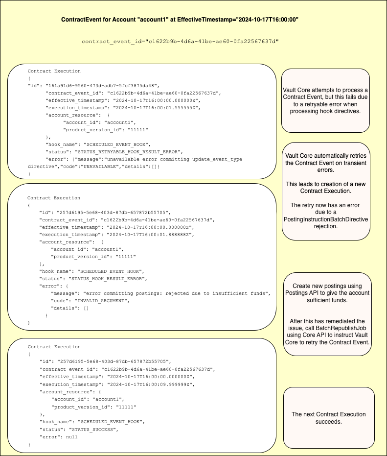

:status: hidden
= Contract Events and the Contract Executions API

A *Contract Event*:

* Is the occurrence of a logical business journey in Vault Core that may require Contract hook
execution
* Is defined by a unique Contract Event ID for the journey
* Comprises a sequence of Contract Executions

Examples of Contract Events include:

* A scheduled event for `Account1` at `2024-01-01T00:00:00`
* A post-posting hook for an account due to it being targeted in a `PostingInstructionBatch`
* A post-parameter change hook for an account due to the creation of a new `ParameterValue` owned by that account

A *Contract Execution* resource occurs for a Contract Event when Vault Core attempts to execute a Smart or Supervisor Contract hook and process any hook results contained in the results object that was returned by that Contract hook.

Each Contract Execution has:

- An `execution_timestamp`, which is the real system time at which Vault
Core executed the Contract hook
- Information about the execution: the Account or Plan IDs involved,
the Product Version IDs or Supervisor Contract Version ID involved, the Contract Event ID, the
`effective_timestamp` of the Contract Event, and the hook name
- A `status` field and an `error` field
that is set if the hook execution or processing of hook results encountered an error during code
execution or the processing of hook results

There may be multiple Contract Executions for a single Contract Event. This occurs when:

* A Supervisor Contract invokes the Smart Contract hooks of supervisee accounts. See section link:{baseURL}/reference/contracts/contracts_api_4xx/running_contracts_in_production#contract_execution_supervision_model[Contract Execution supervision model].
* Vault Core retries a Contract Event after an error, either automatically, or due to a manually-triggered retry. See section link:{baseURL}/reference/contracts/contracts_api_4xx/running_contracts_in_production#creation_of_contract_execution_data_on_retryable_errors[Creation of Contract Execution data on retryable errors].
* Vault Core processes an idempotent request multiple times. You should expect no duplicate effects, but Vault Core provides observability that this scenario has occurred.

The following diagram shows an example of a Contract Event in progress:

