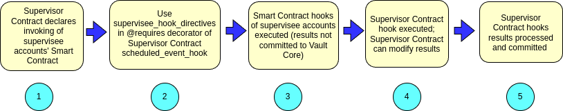

:status: hidden
= Contract Execution Supervision model

A Contract Execution has:

* A single Account ID or Plan ID
* A single Product Version ID or Supervisor Contract Version ID whose code was executed and is
associated to the above Account or Plan

You can configure a Supervisor Contract to invoke the Smart Contract hooks of the supervised
accounts.

The progress is as follows:

[arabic]
. The Supervisor Contract declares that hooks of supervisee accounts' Smart Contract be invoked.
. One way to configure this is to use the
link:{baseURL}/reference/contracts/contracts_api_4xx/supervisor_contracts_api_reference4xx/hook_requirements#supervisee_hook_directives[`supervisee_hook_directives`]
keyword in the
link:{baseURL}/reference/contracts/contracts_api_4xx/common_types_4xx/decorators#requires[`@requires`]
decorator of a Supervisor Contract `scheduled_event_hook`.
. The Smart Contract hooks of supervisee accounts are executed. Results are not committed to Vault
Core.
. The Supervisor Contract hook is executed, receiving the results of supervisee accounts' Smart
Contract hooks as input. The Supervisor Contract can modify the results, discard those results, and
also return additional results.
. Vault Core processes the Supervisor Contract hook results to commit the instructed changes.

There is a Contract Execution resource created for each invoked supervisee Smart Contract hook, and
a Contract Execution for the Supervisor Contract hook. See link:{baseURL}/api/core_api#contractexecution[Contract Execution].

The Contract Executions for Smart Contract hooks that were invoked as supervisees have a non-nil
`invoking_resource` field. This declares that this Contract Execution was an invoked hook, and
therefore that the hook results were not processed by Vault but only passed to the invoking hook as
an input. The `invoking_resource` field references:

* The ID of the Plan that supervised the Account
* The ID of the Supervisor Contract Version that supervised the Product Version
* The ID of the ContractExecution for the above Plan, and the Supervisor Contract Version that
received the hook results of this execution as an input to its hook execution.

If the supervisee executions encounter an error, then that execution will have one of the error
statuses, and no Contract Execution resource will be created for the plan execution. In this case,
Vault Core sets the fields `invoking_resource.invoking_plan.plan_id` and
`invoking_resource.invoking_plan.supervisor_contract_version_id`; however, as the plan execution did not
occur, the field `invoking_resource.invoking_contract_execution_id` is not set.

If the supervisee executions succeed, they will have a status
`STATUS_HOOK_RESULTS_RETURNED_TO_PARENT`.
