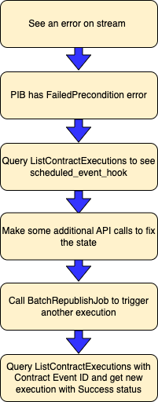
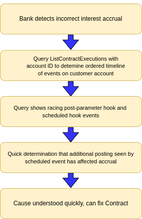

:status: hidden
= Monitoring examples

Here are two monitoring examples for Contract Events:

== Example 1: A scheduled event has an error; detect and fix

== Example 2: Incorrect interest accrual: determine timeline after racing events detected

