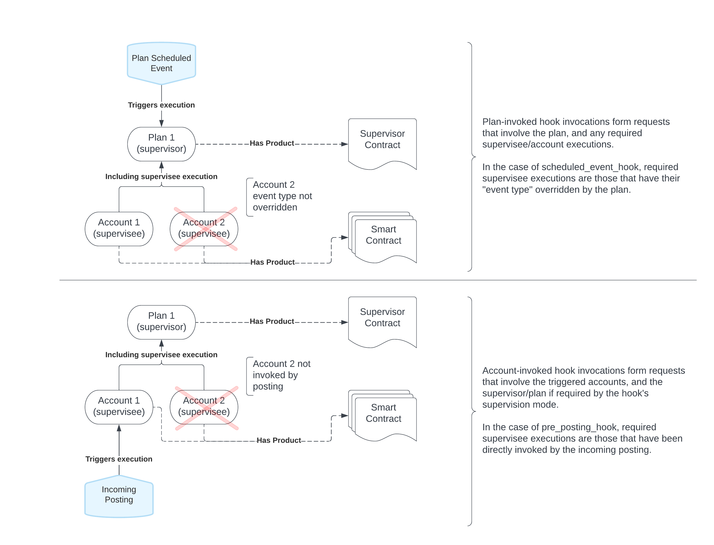
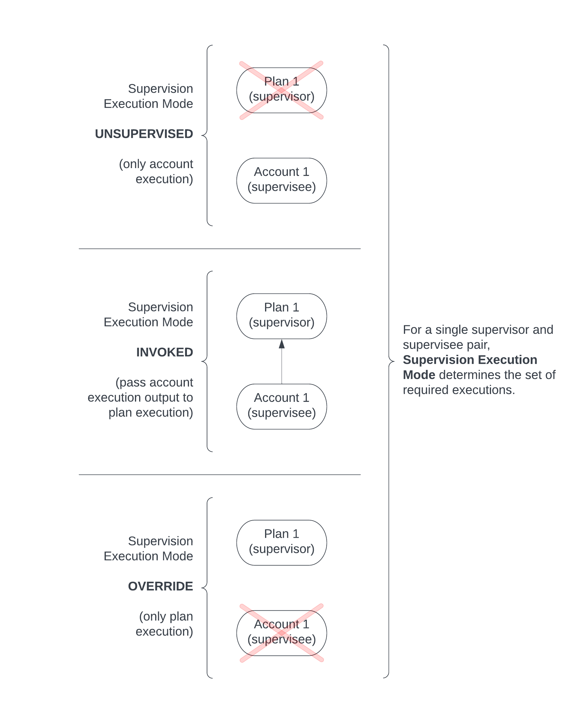
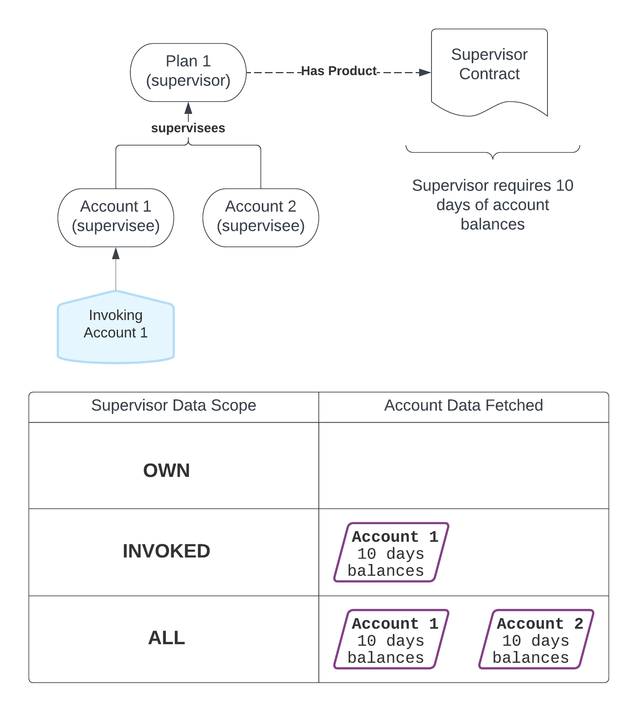

:status: hidden
= Supervisor Contract responsibilities

Where a Smart Contract contains the "complete" definition of a given Product with regards to its
financial behaviour within Vault, a Supervisor Contract can alter this behaviour to represent
complex relationships between standalone accounts.

In the
link:{baseURL}/reference/contracts/contracts_api_4xx/common_examples#example_usage_of_supervisor_contracts_for_rebalancing[supervisor rebalancing example], we move the fund between two separate and otherwise independent accounts as
new postings get accepted on one of the supervised accounts. These accounts are not aware of each
other, and are not even aware that they are being supervised.

When a Smart Contract is supervised, its hook directives are not immediately instructed as they
would otherwise be. Instead the hook directives are passed to the Supervisor Contract and it is the
responsibility of this Supervisor Contract to instruct all of the necessary hook directives, whether
it altered them or not.

== Supervision Entry Points

There are two general entry points into a Supervisor Contract/Plan. A Supervisor Contract execution
can either be invoked directly via the Plan, or invoked by a supervision association with an Account
(see _Supervision Execution Modes_ for details). This differs per hook/journey:

* `activation_hook`: via *Plan* (cannot execute supervisees)
* `conversion_hook`: via *Plan* (cannot execute supervisees)
* `pre_posting_hook`: via *Account*
* `post_posting_hook`: via *Account*
* `scheduled_event_hook`: via *Plan*

The following diagram provides a visual representation of these entry points:

== Supervision Execution Mode

Supervision Execution Mode describes the behaviour of how a given Account/Plan relationship will be
executed. There are three possible values:

* *UNSUPERVISED*: Only the account's hook is executed, and the Plan is ignored. This is only
possible if the triggering event targets an account ("account invoked" from _Supervision Entry
Points_).
* *INVOKED*: First, the account's hook is executed, and the results are passed into the Plan hook,
which is then executed. This is most relevant if the triggering event targets an account ("account invoked"
from _Supervision Entry Points_), however for the Supervisor `scheduled_event_hook`, if
`supervisee_hook_directives` is required then all overridden accounts are considered *INVOKED*.
* *OVERRIDE*: Only the Plan's hook is executed, and the account is ignored.

== Supervisor Data Scope

Supervisor Data Scope allows the Supervisor Contract writer to filter the supervisee (Account) data
available to the Supervisor, to improve performance of critical journeys. There are three possible
values:

* *OWN*: Only Plan/global data is available for the Supervisor hook execution. No supervisee /
Account data can be accessed within the Supervisor hook execution.
* *INVOKED*: Alongside Plan/global data, all targeted (invoked) supervisee Account data is also
fetched and made available within the Supervisor hook execution.
* *ALL*: Alongside Plan/global data, all supervisee Account data is also fetched and made available
within the Supervisor hook execution. For example, if the Plan supervises two accounts [A1, A2], and
the Supervisor hook requires one day of Account balances, then regardless of which Account invokes
the Plan, one day of balances for accounts [A1, A2] will be fetched.

Note that the requirements to fetch for each Account are specified by the Supervisor Contract. If
the Plan's Supervisor Contract asks for *one day* of balances, but the Account's Smart Contract
specifies *three days* of balances, *only one day* of balances will be provided to the Supervisor
hook execution.

