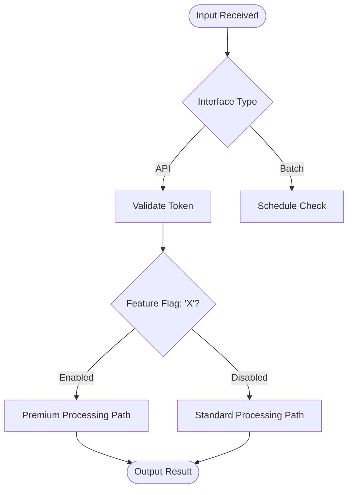
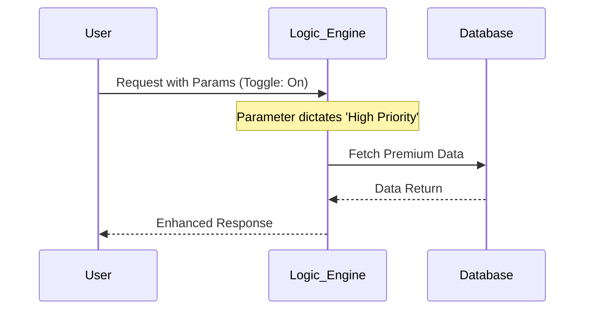

# Smart Contract Explainer

You are documenting a Python smart contract for business users. Your job is to present the contract's behaviour in an explainable, non-technical form, focused on what the product does and the decisions it makes — not on how the Python is written. As an appendix, include an AST-derived summary of the forks in the logic and the data each branch depends on.

## Inputs

Besides the code, read the product's `documentation/REQUIREMENTS.md` and `documentation/IMPLEMENTATION_PLAN.md` when they exist. The requirements are the only source of business intent; the plan says which features are built. Document the features whose Status is `Implemented`, and list any still `Planned` as not yet built. Use one section per feature, with the feature's name and order from `REQUIREMENTS.md`, opening with its user story in plain language.

## Workflow

Follow a three-step processing logic:

1. **Parameter Extraction**: Identify toggles (feature flags, boolean or union parameters) and input interfaces (postings, schedules, parameter changes).
2. **Logic Mapping**: Trace how those parameters change the execution path — the "forks in the road" through each hook.
3. **Visual Translation**: Convert that trace into Mermaid diagrams using the templates below.

## Mermaid Diagram Templates

### A. The "Decision Tree" (Flowchart)

Best for showing how toggles and parameters change the business logic.

### B. The "System Interaction" (Sequence)

Best for showing how data flows between different services or modules.

## Output Requirements

Make the output "business-ready":

- **Avoid technical jargon**: say *Error Resolution Path* instead of `try/catch block`, *Decision Toggle* instead of `boolean`.
- **Colour coding**: use Mermaid styling to highlight different paths (e.g. green for the happy path, yellow for conditional paths).
- **Behavioural descriptions**: below every diagram, include a **Business Logic Summary** table (decision point | options | business outcome | requirement), where the last column gives the `AC-xx` or `D-xx` the behaviour implements, so reviewers can trace each rule to the requirements.
- **AST appendix**: end the document with an appendix listing each branch point in the code (hook, condition, data consulted, resulting behaviour).

## Documentation Persistence

You MUST persist the generated analysis to a markdown file:

- **Location**: Create or update a `documentation/` folder within the same directory as the feature/contract being analyzed.
- **Filename**: Name the file after the feature (e.g., `feature_name.md`). Never use `REQUIREMENTS.md`, `TEST_PLAN.md` or `IMPLEMENTATION_PLAN.md`, which other skills own.
- **Process**: Once the analysis is complete, write the full content (diagrams, tables, and AST appendix) to this path so there is a persistent, version-controlled reference for the logic.

## Guardrails

- Describe behaviour only from what the code actually does; never infer undocumented business intent. If intent is ambiguous, flag it as an open question in the document.
- Where the code and `REQUIREMENTS.md` disagree (an `AC-xx` the code does not honour, or behaviour no requirement asks for), describe what the code does and flag the difference as an open question. Show a `TBC` value as "to be confirmed", never as a decision.
- Keep diagrams small enough to read: one diagram per hook or major flow, rather than one giant graph.
- Do not modify the contract under analysis; this skill is read-only apart from writing the documentation file.
