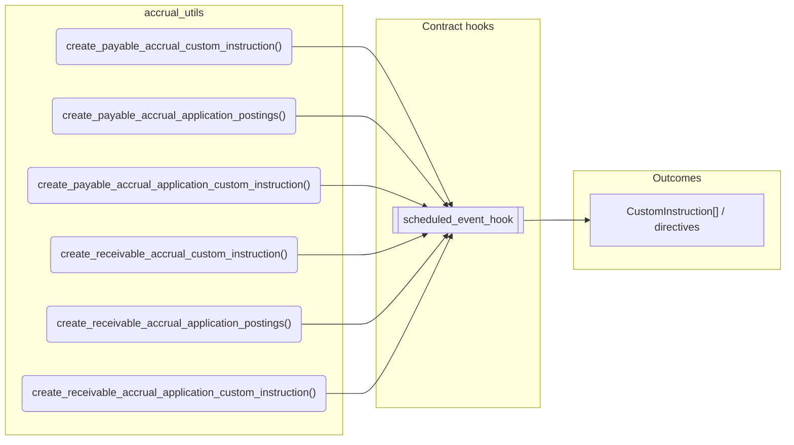

```mermaid
graph BT
  me_accrual_utils["accrual_utils"]:::self
  dep_common_posting_utils["common.posting_utils"] --> me_accrual_utils
  me_accrual_utils --> use_deposit_fees_unarranged_overdraft_fee["deposit.fees.unarranged_overdraft_fee"]
  me_accrual_utils --> use_deposit_interest_deposit_interest_accrual_utils["deposit.interest.deposit_interest_accrual_utils"]
  me_accrual_utils --> use_deposit_interest_interest_accrual["deposit.interest.interest_accrual"]
  me_accrual_utils --> use_deposit_interest_interest_application["deposit.interest.interest_application"]
  me_accrual_utils --> use_deposit_interest_secondary_overdraft_interest["deposit.interest.secondary.overdraft_interest"]
  me_accrual_utils --> use_lending_interest_credit_card_interest_accrual["lending.interest.credit_card_interest_accrual"]
  me_accrual_utils --> use_lending_interest_interest_accrual["lending.interest.interest_accrual"]
  me_accrual_utils --> use_lending_interest_interest_application["lending.interest.interest_application"]
  me_accrual_utils --> use_lending_interest_interest_capitalisation["lending.interest.interest_capitalisation"]
  me_accrual_utils --> use_lending_repayments_minimum_payment["lending.repayments.minimum_payment"]
  classDef self fill:#dbeafe,stroke:#1d4ed8,stroke-width:2px;
  classDef product fill:#dcfce7,stroke:#15803d,stroke-width:2px;
```

# Accrual Utils

> Generated by `python3 -m fl docs`. Curated prose comes from `feature_library/src/feature_library/common/accrual_utils.okf.yaml`; everything else is derived from the module source. Do not edit by hand.

| Property | Value |
|---|---|
| Module | `feature_library.common.accrual_utils` |
| Domain | common |
| Status | undeclared |
| Version | — |
| Hooks | — |
| Source | `feature_library/src/feature_library/common/accrual_utils.py` |

## What it does

_Not yet described._

## Traceability: configuration to outcome

Every input below is a value a bank configures. The diagram shows which function consumes it and which hook turns it into an outcome.

## Public API

| Function | Returns | Purpose |
|---|---|---|
| `create_payable_accrual_custom_instruction(customer_account, customer_address, denomination, amount, internal_account, instruction_details, reversal)` | `list[CustomInstruction]` | Create a Custom Instruction for accruing a charge. |
| `create_payable_accrual_application_postings(customer_account, denomination, application_amount, accrual_amount, accrual_customer_address, accrual_internal_account, application_customer_address, application_internal_account)` | `list[Posting]` | Create a list of Postings for applying an accrued charge. |
| `create_payable_accrual_application_custom_instruction(customer_account, denomination, application_amount, accrual_amount, instruction_details, accrual_customer_address, accrual_internal_account, application_customer_address, application_internal_account)` | `list[CustomInstruction]` | Create a Custom Instruction for applying an accrued charge. |
| `create_receivable_accrual_custom_instruction(customer_account, denomination, amount, internal_account, customer_address, reversal, instruction_details)` | `list[CustomInstruction]` | Create a Custom Instruction for a receivable accrual (customer pays). |
| `create_receivable_accrual_application_postings(customer_account, denomination, application_amount, accrual_amount, accrual_customer_address, accrual_internal_account, application_customer_address, application_internal_account)` | `list[Posting]` | Create a list of Postings for applying a receivable accrued charge. |
| `create_receivable_accrual_application_custom_instruction(customer_account, denomination, application_amount, accrual_amount, instruction_details, accrual_customer_address, accrual_internal_account, application_customer_address, application_internal_account)` | `list[CustomInstruction]` | Create a Custom Instruction for applying a receivable accrued charge. |

## Where it sits in the library

## Requirement traceability

_No business requirement is linked to this feature yet, so it cannot be traced back to a stated need._

## Products using it

_None. A feature that no product composes is not yet a proven building block._

## Testing

| Tier | Status | Test modules |
|---|---|---|
| Unit | yes | 2 |
| Simulation | **missing** | 0 |
| End-to-end | **missing** | 0 |

<!-- generated:end -->

## Authored notes

_Written by hand before this page was generated; kept verbatim._

# Accrual Utils

> Generated by `python3 -m fl docs`. Curated prose comes from `feature_library/src/feature_library/common/accrual_utils.okf.yaml`; everything else is derived from the module source. Do not edit by hand.

| Property | Value |
|---|---|
| Module | `feature_library.common.accrual_utils` |
| Domain | common |
| Status | undeclared |
| Version | — |
| Hooks | — |
| Source | `feature_library/src/feature_library/common/accrual_utils.py` |

## What it does

_Not yet described._

## Traceability: configuration to outcome

Every input below is a value a bank configures. The diagram shows which function consumes it and which hook turns it into an outcome.

## Public API

| Function | Returns | Purpose |
|---|---|---|
| `create_payable_accrual_custom_instruction(customer_account, customer_address, denomination, amount, internal_account, instruction_details, reversal)` | `list[CustomInstruction]` | Create a Custom Instruction for accruing a charge. |
| `create_payable_accrual_application_postings(customer_account, denomination, application_amount, accrual_amount, accrual_customer_address, accrual_internal_account, application_customer_address, application_internal_account)` | `list[Posting]` | Create a list of Postings for applying an accrued charge. |
| `create_payable_accrual_application_custom_instruction(customer_account, denomination, application_amount, accrual_amount, instruction_details, accrual_customer_address, accrual_internal_account, application_customer_address, application_internal_account)` | `list[CustomInstruction]` | Create a Custom Instruction for applying an accrued charge. |
| `create_receivable_accrual_custom_instruction(customer_account, denomination, amount, internal_account, customer_address, reversal, instruction_details)` | `list[CustomInstruction]` | Create a Custom Instruction for a receivable accrual (customer pays). |
| `create_receivable_accrual_application_postings(customer_account, denomination, application_amount, accrual_amount, accrual_customer_address, accrual_internal_account, application_customer_address, application_internal_account)` | `list[Posting]` | Create a list of Postings for applying a receivable accrued charge. |
| `create_receivable_accrual_application_custom_instruction(customer_account, denomination, application_amount, accrual_amount, instruction_details, accrual_customer_address, accrual_internal_account, application_customer_address, application_internal_account)` | `list[CustomInstruction]` | Create a Custom Instruction for applying a receivable accrued charge. |

## Where it sits in the library

## Requirement traceability

_No business requirement is linked to this feature yet, so it cannot be traced back to a stated need._

## Products using it

_None. A feature that no product composes is not yet a proven building block._

## Testing

| Tier | Status | Test modules |
|---|---|---|
| Unit | yes | 2 |
| Simulation | **missing** | 0 |
| End-to-end | **missing** | 0 |
