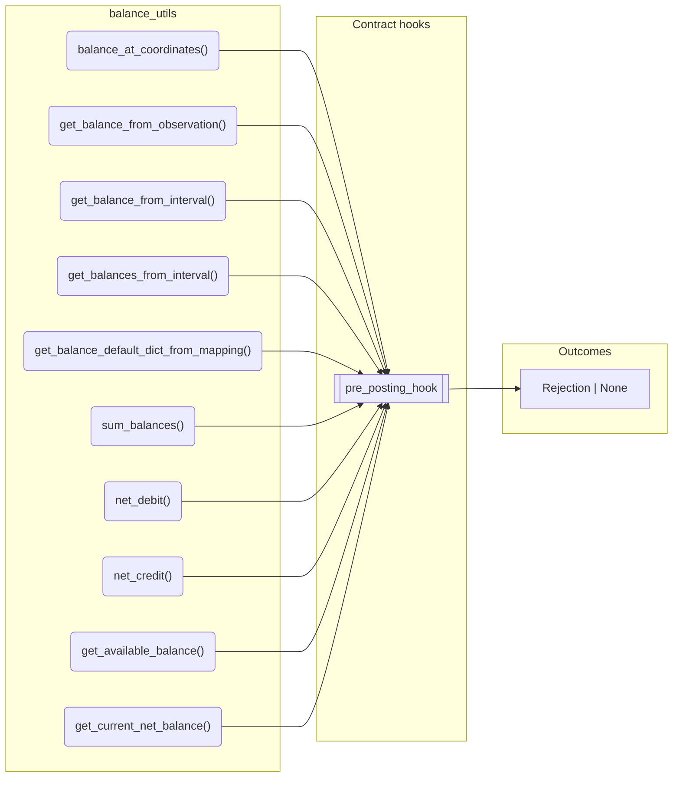

```mermaid
graph BT
  me_balance_utils["balance_utils"]:::self
  dep_common_posting_utils["common.posting_utils"] --> me_balance_utils
  dep_common_utils["common.utils"] --> me_balance_utils
  me_balance_utils --> use_common_state_utils["common.state_utils"]
  me_balance_utils --> use_deposit_fees_minimum_monthly_balance["deposit.fees.minimum_monthly_balance"]
  me_balance_utils --> use_deposit_fees_overdraft_limit["deposit.fees.overdraft_limit"]
  me_balance_utils --> use_deposit_fees_partial_fee["deposit.fees.partial_fee"]
  me_balance_utils --> use_deposit_fees_unarranged_overdraft_fee["deposit.fees.unarranged_overdraft_fee"]
  me_balance_utils --> use_deposit_fees_withdrawal_early_withdrawal_fees["deposit.fees.withdrawal.early_withdrawal_fees"]
  me_balance_utils --> use_deposit_fees_withdrawal_payment_type_flat_fee["deposit.fees.withdrawal.payment_type_flat_fee"]
  me_balance_utils --> use_deposit_fees_withdrawal_payment_type_threshold_fee["deposit.fees.withdrawal.payment_type_threshold_fee"]
  me_balance_utils --> use_deposit_interest_deposit_interest_accrual_utils["deposit.interest.deposit_interest_accrual_utils"]
  me_balance_utils --> use_deposit_interest_interest_accrual["deposit.interest.interest_accrual"]
  me_balance_utils --> use_deposit_interest_interest_application["deposit.interest.interest_application"]
  me_balance_utils --> use_deposit_interest_secondary_flat_interest["deposit.interest.secondary.flat_interest"]
  classDef self fill:#dbeafe,stroke:#1d4ed8,stroke-width:2px;
  classDef product fill:#dcfce7,stroke:#15803d,stroke-width:2px;
```

# Balance Utils

> Generated by `python3 -m fl docs`. Curated prose comes from `feature_library/src/feature_library/common/balance_utils.okf.yaml`; everything else is derived from the module source. Do not edit by hand.

| Property | Value |
|---|---|
| Module | `feature_library.common.balance_utils` |
| Domain | common |
| Status | undeclared |
| Version | — |
| Hooks | `pre_posting_hook` |
| Source | `feature_library/src/feature_library/common/balance_utils.py` |

## What it does

_Not yet described._

## Traceability: configuration to outcome

Every input below is a value a bank configures. The diagram shows which function consumes it and which hook turns it into an outcome.

## Public API

| Function | Returns | Purpose |
|---|---|---|
| `balance_at_coordinates(balances, denomination, address, asset, phase, decimal_places)` | `Decimal` | Retrieves the balance net for the specified coordinates. |
| `get_balance_from_observation(vault, balance_coordinate, fetcher_id)` | `Decimal` | Retrieves the balance net from a vault observation. |
| `get_balance_from_interval(vault, balance_coordinate, fetcher_id, effective_datetime)` | `Decimal` | Get the net balance at a particular effective datetime from a balance coordinate using a |
| `get_balances_from_interval(vault, fetcher_id, effective_datetime)` | `BalanceDefaultDict` | Get all the balances from an interval fetcher at a particular effective datetime. |
| `get_balance_default_dict_from_mapping(mapping, effective_datetime)` | `BalanceDefaultDict` | Converts the balances mapping fetched from `vault.get_balances_timeseries()` into a |
| `sum_balances(balances, denomination, addresses, asset, phases)` | `Balance` | Aggregates balances across a specific set of coordinates. |
| `net_debit(bal)` | `Decimal` | Calculates the net debit value of a Balance object. |
| `net_credit(bal)` | `Decimal` | Calculates the net credit value of a Balance object. |
| `get_available_balance(balances, denomination, address, asset, phase)` | `Balance` | Returns the sum of net balances including COMMITTED and PENDING_OUT only. |
| `get_current_net_balance(balances, denomination, address, asset, phase)` | `Balance` | Returns the sum of net balances for COMMITTED and PENDING_IN only. |
| `get_current_balance_coordinates(denomination, address, asset)` | `tuple[BalanceCoordinate, BalanceCoordinate]` | Returns the COMMITTED and PENDING_IN balance coordinates. |
| `get_coordinates(addresses, denomination, asset, phases)` | `set[BalanceCoordinate]` | Returns a list of Balance coordinates based on provided address names, denomination, asset and |
| `validate_ready_for_closure(balances)` | `Rejection \| None` | Validates if an account is ready for closure by checking if all balances are zero. |
| `update_inflight_balances(account_id, tside, current_balances, posting_instructions)` | `BalanceDefaultDict` | Returns a new BalanceDefaultDict, merging the current balances with the posting balances |

## Where it sits in the library

## Requirement traceability

_No business requirement is linked to this feature yet, so it cannot be traced back to a stated need._

## Products using it

_None. A feature that no product composes is not yet a proven building block._

## Testing

| Tier | Status | Test modules |
|---|---|---|
| Unit | yes | 4 |
| Simulation | yes | 4 |
| End-to-end | yes | 2 |

<!-- generated:end -->

## Authored notes

_Written by hand before this page was generated; kept verbatim._

# Balance Utils

> Generated by `python3 -m fl docs`. Curated prose comes from `feature_library/src/feature_library/common/balance_utils.okf.yaml`; everything else is derived from the module source. Do not edit by hand.

| Property | Value |
|---|---|
| Module | `feature_library.common.balance_utils` |
| Domain | common |
| Status | undeclared |
| Version | — |
| Hooks | `pre_posting_hook` |
| Source | `feature_library/src/feature_library/common/balance_utils.py` |

## What it does

_Not yet described._

## Traceability: configuration to outcome

Every input below is a value a bank configures. The diagram shows which function consumes it and which hook turns it into an outcome.

## Public API

| Function | Returns | Purpose |
|---|---|---|
| `balance_at_coordinates(balances, denomination, address, asset, phase, decimal_places)` | `Decimal` | Retrieves the balance net for the specified coordinates. |
| `get_balance_from_observation(vault, balance_coordinate, fetcher_id)` | `Decimal` | Retrieves the balance net from a vault observation. |
| `get_balance_from_interval(vault, balance_coordinate, fetcher_id, effective_datetime)` | `Decimal` | Get the net balance at a particular effective datetime from a balance coordinate using a |
| `get_balances_from_interval(vault, fetcher_id, effective_datetime)` | `BalanceDefaultDict` | Get all the balances from an interval fetcher at a particular effective datetime. |
| `get_balance_default_dict_from_mapping(mapping, effective_datetime)` | `BalanceDefaultDict` | Converts the balances mapping fetched from `vault.get_balances_timeseries()` into a |
| `sum_balances(balances, denomination, addresses, asset, phases)` | `Balance` | Aggregates balances across a specific set of coordinates. |
| `net_debit(bal)` | `Decimal` | Calculates the net debit value of a Balance object. |
| `net_credit(bal)` | `Decimal` | Calculates the net credit value of a Balance object. |
| `get_available_balance(balances, denomination, address, asset, phase)` | `Balance` | Returns the sum of net balances including COMMITTED and PENDING_OUT only. |
| `get_current_net_balance(balances, denomination, address, asset, phase)` | `Balance` | Returns the sum of net balances for COMMITTED and PENDING_IN only. |
| `get_current_balance_coordinates(denomination, address, asset)` | `tuple[BalanceCoordinate, BalanceCoordinate]` | Returns the COMMITTED and PENDING_IN balance coordinates. |
| `get_coordinates(addresses, denomination, asset, phases)` | `set[BalanceCoordinate]` | Returns a list of Balance coordinates based on provided address names, denomination, asset and |
| `validate_ready_for_closure(balances)` | `Rejection \| None` | Validates if an account is ready for closure by checking if all balances are zero. |
| `update_inflight_balances(account_id, tside, current_balances, posting_instructions)` | `BalanceDefaultDict` | Returns a new BalanceDefaultDict, merging the current balances with the posting balances |

## Where it sits in the library

## Requirement traceability

_No business requirement is linked to this feature yet, so it cannot be traced back to a stated need._

## Products using it

_None. A feature that no product composes is not yet a proven building block._

## Testing

| Tier | Status | Test modules |
|---|---|---|
| Unit | yes | 4 |
| Simulation | yes | 4 |
| End-to-end | yes | 2 |
