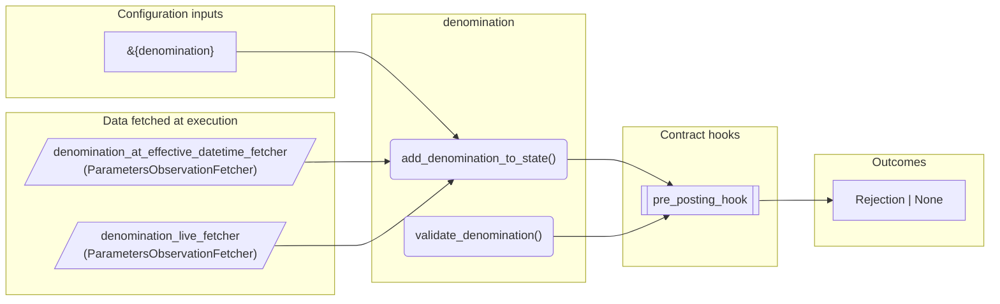

```mermaid
graph BT
  me_denomination["denomination"]:::self
  dep_common_posting_utils["common.posting_utils"] --> me_denomination
  dep_common_state_utils["common.state_utils"] --> me_denomination
  me_denomination --> use_deposit_fees_early_closure_fee["deposit.fees.early_closure_fee"]
  me_denomination --> use_deposit_fees_inactivity_fee["deposit.fees.inactivity_fee"]
  me_denomination --> use_deposit_fees_maintenance_fees["deposit.fees.maintenance_fees"]
  me_denomination --> use_deposit_fees_minimum_monthly_balance["deposit.fees.minimum_monthly_balance"]
  me_denomination --> use_deposit_fees_overdraft_limit["deposit.fees.overdraft_limit"]
  me_denomination --> use_deposit_fees_paper_statement_fee["deposit.fees.paper_statement_fee"]
  me_denomination --> use_deposit_fees_partial_fee["deposit.fees.partial_fee"]
  me_denomination --> use_deposit_fees_unarranged_overdraft_fee["deposit.fees.unarranged_overdraft_fee"]
  me_denomination --> use_deposit_fees_withdrawal_early_withdrawal_fees["deposit.fees.withdrawal.early_withdrawal_fees"]
  me_denomination --> use_deposit_fees_withdrawal_excess_fee["deposit.fees.withdrawal.excess_fee"]
  me_denomination --> use_deposit_fees_withdrawal_payment_type_flat_fee["deposit.fees.withdrawal.payment_type_flat_fee"]
  me_denomination --> use_deposit_fees_withdrawal_payment_type_monthly_limit_fee["deposit.fees.withdrawal.payment_type_monthly_limit_fee"]
  classDef self fill:#dbeafe,stroke:#1d4ed8,stroke-width:2px;
  classDef product fill:#dcfce7,stroke:#15803d,stroke-width:2px;
```

# Denomination

> Generated by `python3 -m fl docs`. Curated prose comes from `feature_library/src/feature_library/common/denomination.okf.yaml`; everything else is derived from the module source. Do not edit by hand.

| Property | Value |
|---|---|
| Module | `feature_library.common.denomination` |
| Domain | common |
| Status | undeclared |
| Version | — |
| Hooks | `pre_posting_hook` |
| Source | `feature_library/src/feature_library/common/denomination.py` |

## What it does

_Not yet described._

## Traceability: configuration to outcome

Every input below is a value a bank configures. The diagram shows which function consumes it and which hook turns it into an outcome.

## Inputs — parameters

| Reference | Meaning | Hierarchy level | Constraint | Required | CLU resource |
|---|---|---|---|---|---|
| `&{denomination}` | _undocumented_ | — | string_constraint | required | `feature_library/src/feature_library/common/parameter_resource_defs/denomination.resource.yaml` |

## Inputs — data fetched at execution

| Fetcher id | Type | Anchor | Filter |
|---|---|---|---|
| `denomination_at_effective_datetime_fetcher` | ParametersObservationFetcher | DefinedDateTime.EFFECTIVE_DATETIME | ParametersFilter(parameter_ids=[DENOMINATION_PARAM_ID]) |
| `denomination_live_fetcher` | ParametersObservationFetcher | DefinedDateTime.LIVE | ParametersFilter(parameter_ids=[DENOMINATION_PARAM_ID]) |

## Public API

| Function | Returns | Purpose |
|---|---|---|
| `get_parameters(vault, fetcher_id)` | `dict[str, str \| datetime \| Decimal \| None]` | Retrieves the denomination parameters from a vault parameter observation. |
| `add_denomination_to_state(state, param_fetcher_id)` | `state_utils.SmartContractState` | Updates the contract state with denomination parameters fetched from the vault. |
| `validate_denomination(state, posting_instructions, denomination_param_id)` | `Rejection \| None` | Validates a list of Posting Instructions for denomination. |

## Where it sits in the library

## Requirement traceability

_No business requirement is linked to this feature yet, so it cannot be traced back to a stated need._

## Products using it

_None. A feature that no product composes is not yet a proven building block._

## Testing

| Tier | Status | Test modules |
|---|---|---|
| Unit | yes | 42 |
| Simulation | yes | 41 |
| End-to-end | yes | 38 |

<!-- generated:end -->

## Authored notes

_Written by hand before this page was generated; kept verbatim._

# Denomination

> Generated by `python3 -m fl docs`. Curated prose comes from `feature_library/src/feature_library/common/denomination.okf.yaml`; everything else is derived from the module source. Do not edit by hand.

| Property | Value |
|---|---|
| Module | `feature_library.common.denomination` |
| Domain | common |
| Status | undeclared |
| Version | — |
| Hooks | `pre_posting_hook` |
| Source | `feature_library/src/feature_library/common/denomination.py` |

## What it does

_Not yet described._

## Traceability: configuration to outcome

Every input below is a value a bank configures. The diagram shows which function consumes it and which hook turns it into an outcome.

## Inputs — parameters

| Reference | Meaning | Hierarchy level | Constraint | Required | CLU resource |
|---|---|---|---|---|---|
| `&{denomination}` | _undocumented_ | — | string_constraint | required | `feature_library/src/feature_library/common/parameter_resource_defs/denomination.resource.yaml` |

## Inputs — data fetched at execution

| Fetcher id | Type | Anchor | Filter |
|---|---|---|---|
| `denomination_at_effective_datetime_fetcher` | ParametersObservationFetcher | DefinedDateTime.EFFECTIVE_DATETIME | ParametersFilter(parameter_ids=[DENOMINATION_PARAM_ID]) |
| `denomination_live_fetcher` | ParametersObservationFetcher | DefinedDateTime.LIVE | ParametersFilter(parameter_ids=[DENOMINATION_PARAM_ID]) |

## Public API

| Function | Returns | Purpose |
|---|---|---|
| `get_parameters(vault, fetcher_id)` | `dict[str, str \| datetime \| Decimal \| None]` | Retrieves the denomination parameters from a vault parameter observation. |
| `add_denomination_to_state(state, param_fetcher_id)` | `state_utils.SmartContractState` | Updates the contract state with denomination parameters fetched from the vault. |
| `validate_denomination(state, posting_instructions, denomination_param_id)` | `Rejection \| None` | Validates a list of Posting Instructions for denomination. |

## Where it sits in the library

## Requirement traceability

_No business requirement is linked to this feature yet, so it cannot be traced back to a stated need._

## Products using it

_None. A feature that no product composes is not yet a proven building block._

## Testing

| Tier | Status | Test modules |
|---|---|---|
| Unit | yes | 42 |
| Simulation | yes | 41 |
| End-to-end | yes | 38 |
