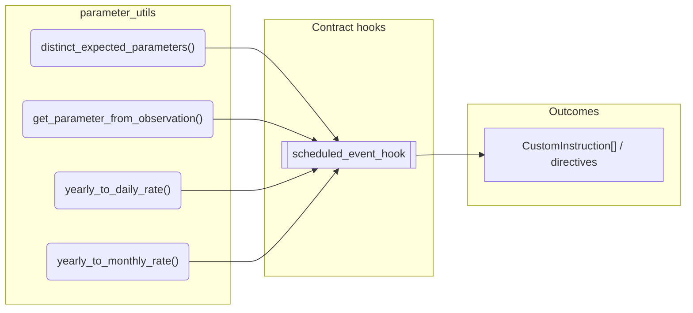

```mermaid
graph BT
  me_parameter_utils["parameter_utils"]:::self
  dep_common_utils["common.utils"] --> me_parameter_utils
  me_parameter_utils --> use_deposit_interest_secondary_flat_interest["deposit.interest.secondary.flat_interest"]
  me_parameter_utils --> use_deposit_interest_secondary_overdraft_interest["deposit.interest.secondary.overdraft_interest"]
  me_parameter_utils --> use_deposit_interest_secondary_tiered_interest["deposit.interest.secondary.tiered_interest"]
  me_parameter_utils --> use_lending_amortisations_amortisation_methods_declining_pri["lending.amortisations.amortisation_methods.declining_principal"]
  me_parameter_utils --> use_lending_amortisations_amortisation_methods_flat_interest["lending.amortisations.amortisation_methods.flat_interest"]
  me_parameter_utils --> use_lending_amortisations_amortisation_methods_rule_of_78["lending.amortisations.amortisation_methods.rule_of_78"]
  me_parameter_utils --> use_lending_interest_credit_card_interest_accrual["lending.interest.credit_card_interest_accrual"]
  me_parameter_utils --> use_lending_interest_interest_accrual["lending.interest.interest_accrual"]
  classDef self fill:#dbeafe,stroke:#1d4ed8,stroke-width:2px;
  classDef product fill:#dcfce7,stroke:#15803d,stroke-width:2px;
```

# Parameter Utils

> Generated by `python3 -m fl docs`. Curated prose comes from `feature_library/src/feature_library/common/parameter_utils.okf.yaml`; everything else is derived from the module source. Do not edit by hand.

| Property | Value |
|---|---|
| Module | `feature_library.common.parameter_utils` |
| Domain | common |
| Status | undeclared |
| Version | — |
| Hooks | — |
| Source | `feature_library/src/feature_library/common/parameter_utils.py` |

## What it does

_Not yet described._

## Traceability: configuration to outcome

Every input below is a value a bank configures. The diagram shows which function consumes it and which hook turns it into an outcome.

## Public API

| Function | Returns | Purpose |
|---|---|---|
| `distinct_expected_parameters(expected_parameters)` | `list[ExpectedParameter]` | Filter a list of expected parameters to ensure each parameter ID is unique. |
| `get_parameter_from_observation(vault, name, fetcher_id, is_json, is_boolean, is_optional, default_value)` | `Any` | Get the parameter value for a given parameter from a vault observation. |
| `yearly_to_daily_rate(effective_date, yearly_rate, days_in_year)` | `Decimal` | Calculate the daily rate from a yearly rate, for a given `days_in_year` convention and date. |
| `yearly_to_monthly_rate(yearly_rate)` | `Decimal` | Converts a yearly rate to a monthly rate. |

## Where it sits in the library

## Requirement traceability

_No business requirement is linked to this feature yet, so it cannot be traced back to a stated need._

## Products using it

_None. A feature that no product composes is not yet a proven building block._

## Testing

| Tier | Status | Test modules |
|---|---|---|
| Unit | yes | 1 |
| Simulation | yes | 40 |
| End-to-end | yes | 38 |

<!-- generated:end -->

## Authored notes

_Written by hand before this page was generated; kept verbatim._

# Parameter Utils

> Generated by `python3 -m fl docs`. Curated prose comes from `feature_library/src/feature_library/common/parameter_utils.okf.yaml`; everything else is derived from the module source. Do not edit by hand.

| Property | Value |
|---|---|
| Module | `feature_library.common.parameter_utils` |
| Domain | common |
| Status | undeclared |
| Version | — |
| Hooks | — |
| Source | `feature_library/src/feature_library/common/parameter_utils.py` |

## What it does

_Not yet described._

## Traceability: configuration to outcome

Every input below is a value a bank configures. The diagram shows which function consumes it and which hook turns it into an outcome.

## Public API

| Function | Returns | Purpose |
|---|---|---|
| `distinct_expected_parameters(expected_parameters)` | `list[ExpectedParameter]` | Filter a list of expected parameters to ensure each parameter ID is unique. |
| `get_parameter_from_observation(vault, name, fetcher_id, is_json, is_boolean, is_optional, default_value)` | `Any` | Get the parameter value for a given parameter from a vault observation. |
| `yearly_to_daily_rate(effective_date, yearly_rate, days_in_year)` | `Decimal` | Calculate the daily rate from a yearly rate, for a given `days_in_year` convention and date. |
| `yearly_to_monthly_rate(yearly_rate)` | `Decimal` | Converts a yearly rate to a monthly rate. |

## Where it sits in the library

## Requirement traceability

_No business requirement is linked to this feature yet, so it cannot be traced back to a stated need._

## Products using it

_None. A feature that no product composes is not yet a proven building block._

## Testing

| Tier | Status | Test modules |
|---|---|---|
| Unit | yes | 1 |
| Simulation | yes | 40 |
| End-to-end | yes | 38 |
