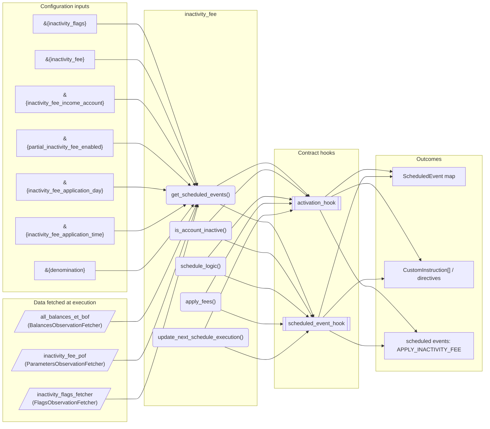

```mermaid
graph BT
  me_inactivity_fee["inactivity_fee"]:::self
  dep_common_date_and_time["common.date_and_time"] --> me_inactivity_fee
  dep_common_denomination["common.denomination"] --> me_inactivity_fee
  dep_common_fetchers["common.fetchers"] --> me_inactivity_fee
  dep_common_posting_utils["common.posting_utils"] --> me_inactivity_fee
  dep_common_schedule_utils["common.schedule_utils"] --> me_inactivity_fee
  dep_common_state_utils["common.state_utils"] --> me_inactivity_fee
  dep_common_tuples["common.tuples"] --> me_inactivity_fee
  dep_common_utils["common.utils"] --> me_inactivity_fee
  dep_deposit_fees_partial_fee["deposit.fees.partial_fee"] --> me_inactivity_fee
  dep_deposit_interfaces["deposit.interfaces"] --> me_inactivity_fee
  classDef self fill:#dbeafe,stroke:#1d4ed8,stroke-width:2px;
  classDef product fill:#dcfce7,stroke:#15803d,stroke-width:2px;
```

# Inactivity Fee

> Generated by `python3 -m fl docs`. Curated prose comes from `feature_library/src/feature_library/deposit/fees/inactivity_fee.okf.yaml`; everything else is derived from the module source. Do not edit by hand.

| Property | Value |
|---|---|
| Module | `feature_library.deposit.fees.inactivity_fee` |
| Domain | deposit |
| Status | undeclared |
| Version | — |
| Hooks | `activation_hook`, `scheduled_event_hook` |
| Source | `feature_library/src/feature_library/deposit/fees/inactivity_fee.py` |

## What it does

_Not yet described._

## Traceability: configuration to outcome

Every input below is a value a bank configures. The diagram shows which function consumes it and which hook turns it into an outcome.

## Inputs — parameters

| Reference | Meaning | Hierarchy level | Constraint | Required | CLU resource |
|---|---|---|---|---|---|
| `&{inactivity_flags}` | Triggers pre-parameter change hook? No.  Optional? No. | — | string_constraint | required | `feature_library/src/feature_library/deposit/fees/parameter_resource_defs/inactivity_flags.resource.yaml` |
| `&{inactivity_fee}` | Triggers pre-parameter change hook? No.  Optional? No. | — | decimal_constraint | required | `feature_library/src/feature_library/deposit/fees/parameter_resource_defs/inactivity_fee.resource.yaml` |
| `&{inactivity_fee_income_account}` | Triggers pre-parameter change hook? No.  Optional? No. | — | account_constraint | required | `feature_library/src/feature_library/deposit/fees/parameter_resource_defs/inactivity_fee_income_account.resource.yaml` |
| `&{partial_inactivity_fee_enabled}` | Triggers pre-parameter change hook? No.  Optional? No. | — | enumeration_constraint | required | `feature_library/src/feature_library/deposit/fees/parameter_resource_defs/partial_inactivity_fee_enabled.resource.yaml` |
| `&{inactivity_fee_application_day}` | Triggers pre-parameter change hook? No.  Optional? No. | — | decimal_constraint | required | `feature_library/src/feature_library/deposit/fees/parameter_resource_defs/inactivity_fee_application_day.resource.yaml` |
| `&{inactivity_fee_application_time}` | Format "HH:mm:ss".  Triggers pre-parameter change hook? No.  Optional? No. | — | string_constraint | required | `feature_library/src/feature_library/deposit/fees/parameter_resource_defs/inactivity_fee_application_time.resource.yaml` |
| `&{denomination}` | _undocumented_ | — | string_constraint | required | `feature_library/src/feature_library/common/parameter_resource_defs/denomination.resource.yaml` |

## Inputs — data fetched at execution

| Fetcher id | Type | Anchor | Filter |
|---|---|---|---|
| `all_balances_et_bof` | BalancesObservationFetcher | DefinedDateTime.EFFECTIVE_DATETIME | — |
| `inactivity_fee_pof` | ParametersObservationFetcher | DefinedDateTime.EFFECTIVE_DATETIME | ParametersFilter(parameter_ids=[p.id for p in expected_parameters]) |
| `inactivity_flags_fetcher` | FlagsObservationFetcher | DefinedDateTime.EFFECTIVE_DATETIME | — |

## Public API

| Function | Returns | Purpose |
|---|---|---|
| `get_parameters(vault, param_fetcher_id)` | `dict[str, datetime \| Decimal \| str \| None]` | Retrieves configuration parameters for the inactivity fee feature. |
| `get_scheduled_events(state, reference_datetime, fetchers_config)` | `dict[str, ScheduledEvent]` | Get scheduled event for inactivity fee application. Uses application schedule parameters. |
| `is_account_inactive(vault, inactivity_flags, flags_fetcher_id)` | `bool` | Checks if the account has any of the specified inactivity flags applied. |
| `schedule_logic(state, account_type, fetchers_config, available_balance_feature)` | `common_tuples.ScheduleLogicResult` | Consolidates inactivity fees and updates the schedule. |
| `apply_fees(state, account_type, fetchers_config, available_balance_feature)` | `list[CustomInstruction]` | Applies the inactivity fee if the account has an inactivity flag. |
| `update_next_schedule_execution(state)` | `UpdateAccountEventTypeDirective \| None` | Update next scheduled execution. |

## Outputs

| Kind | Values | Notes |
|---|---|---|
| Scheduled events | `APPLY_INACTIVITY_FEE` | static |

## Composition points

| Provides interface | As constant | Members |
|---|---|---|
| `PartialFeeCollection` | `PARTIAL_FEE_DETAILS` | `outstanding_fee_address`, `fee_type`, `internal_account_parameter_id` |

Accepts: `AvailableBalance`

## Where it sits in the library

## Requirement traceability

_No business requirement is linked to this feature yet, so it cannot be traced back to a stated need._

## Products using it

_None. A feature that no product composes is not yet a proven building block._

## Testing

| Tier | Status | Test modules |
|---|---|---|
| Unit | yes | 1 |
| Simulation | yes | 1 |
| End-to-end | yes | 2 |

<!-- generated:end -->

## Authored notes

_Written by hand before this page was generated; kept verbatim._

# Inactivity Fee

> Generated by `python3 -m fl docs`. Curated prose comes from `feature_library/src/feature_library/deposit/fees/inactivity_fee.okf.yaml`; everything else is derived from the module source. Do not edit by hand.

| Property | Value |
|---|---|
| Module | `feature_library.deposit.fees.inactivity_fee` |
| Domain | deposit |
| Status | undeclared |
| Version | — |
| Hooks | `activation_hook`, `scheduled_event_hook` |
| Source | `feature_library/src/feature_library/deposit/fees/inactivity_fee.py` |

## What it does

_Not yet described._

## Traceability: configuration to outcome

Every input below is a value a bank configures. The diagram shows which function consumes it and which hook turns it into an outcome.

## Inputs — parameters

| Reference | Meaning | Hierarchy level | Constraint | Required | CLU resource |
|---|---|---|---|---|---|
| `&{inactivity_flags}` | Triggers pre-parameter change hook? No.  Optional? No. | — | string_constraint | required | `feature_library/src/feature_library/deposit/fees/parameter_resource_defs/inactivity_flags.resource.yaml` |
| `&{inactivity_fee}` | Triggers pre-parameter change hook? No.  Optional? No. | — | decimal_constraint | required | `feature_library/src/feature_library/deposit/fees/parameter_resource_defs/inactivity_fee.resource.yaml` |
| `&{inactivity_fee_income_account}` | Triggers pre-parameter change hook? No.  Optional? No. | — | account_constraint | required | `feature_library/src/feature_library/deposit/fees/parameter_resource_defs/inactivity_fee_income_account.resource.yaml` |
| `&{partial_inactivity_fee_enabled}` | Triggers pre-parameter change hook? No.  Optional? No. | — | enumeration_constraint | required | `feature_library/src/feature_library/deposit/fees/parameter_resource_defs/partial_inactivity_fee_enabled.resource.yaml` |
| `&{inactivity_fee_application_day}` | Triggers pre-parameter change hook? No.  Optional? No. | — | decimal_constraint | required | `feature_library/src/feature_library/deposit/fees/parameter_resource_defs/inactivity_fee_application_day.resource.yaml` |
| `&{inactivity_fee_application_time}` | Format "HH:mm:ss".  Triggers pre-parameter change hook? No.  Optional? No. | — | string_constraint | required | `feature_library/src/feature_library/deposit/fees/parameter_resource_defs/inactivity_fee_application_time.resource.yaml` |
| `&{denomination}` | _undocumented_ | — | string_constraint | required | `feature_library/src/feature_library/common/parameter_resource_defs/denomination.resource.yaml` |

## Inputs — data fetched at execution

| Fetcher id | Type | Anchor | Filter |
|---|---|---|---|
| `all_balances_et_bof` | BalancesObservationFetcher | DefinedDateTime.EFFECTIVE_DATETIME | — |
| `inactivity_fee_pof` | ParametersObservationFetcher | DefinedDateTime.EFFECTIVE_DATETIME | ParametersFilter(parameter_ids=[p.id for p in expected_parameters]) |
| `inactivity_flags_fetcher` | FlagsObservationFetcher | DefinedDateTime.EFFECTIVE_DATETIME | — |

## Public API

| Function | Returns | Purpose |
|---|---|---|
| `get_parameters(vault, param_fetcher_id)` | `dict[str, datetime \| Decimal \| str \| None]` | Retrieves configuration parameters for the inactivity fee feature. |
| `get_scheduled_events(state, reference_datetime, fetchers_config)` | `dict[str, ScheduledEvent]` | Get scheduled event for inactivity fee application. Uses application schedule parameters. |
| `is_account_inactive(vault, inactivity_flags, flags_fetcher_id)` | `bool` | Checks if the account has any of the specified inactivity flags applied. |
| `schedule_logic(state, account_type, fetchers_config, available_balance_feature)` | `common_tuples.ScheduleLogicResult` | Consolidates inactivity fees and updates the schedule. |
| `apply_fees(state, account_type, fetchers_config, available_balance_feature)` | `list[CustomInstruction]` | Applies the inactivity fee if the account has an inactivity flag. |
| `update_next_schedule_execution(state)` | `UpdateAccountEventTypeDirective \| None` | Update next scheduled execution. |

## Outputs

| Kind | Values | Notes |
|---|---|---|
| Scheduled events | `APPLY_INACTIVITY_FEE` | static |

## Composition points

| Provides interface | As constant | Members |
|---|---|---|
| `PartialFeeCollection` | `PARTIAL_FEE_DETAILS` | `outstanding_fee_address`, `fee_type`, `internal_account_parameter_id` |

Accepts: `AvailableBalance`

## Where it sits in the library

## Requirement traceability

_No business requirement is linked to this feature yet, so it cannot be traced back to a stated need._

## Products using it

_None. A feature that no product composes is not yet a proven building block._

## Testing

| Tier | Status | Test modules |
|---|---|---|
| Unit | yes | 1 |
| Simulation | yes | 1 |
| End-to-end | yes | 2 |
