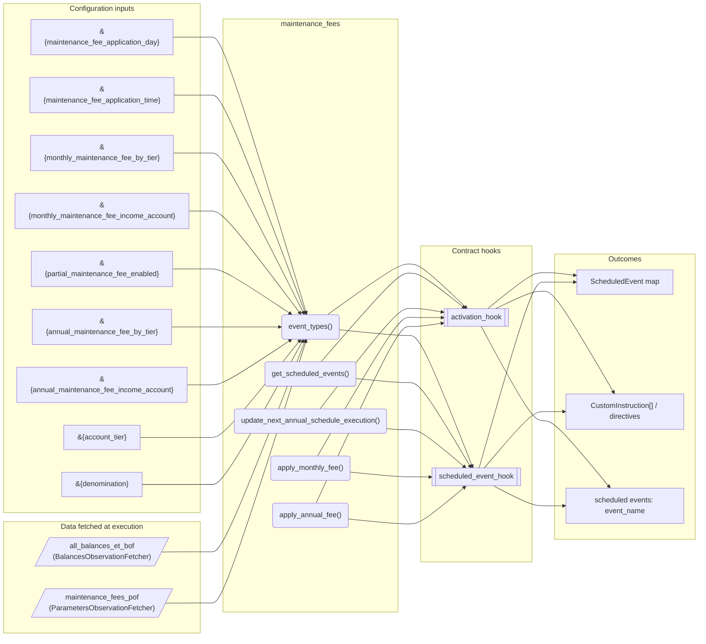
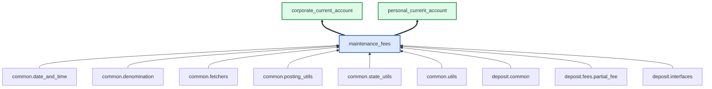

# Maintenance Fees

> Generated by `python3 -m fl docs`. Curated prose comes from `feature_library/src/feature_library/deposit/fees/maintenance_fees.okf.yaml`; everything else is derived from the module source. Do not edit by hand.

| Property | Value |
|---|---|
| Module | `feature_library.deposit.fees.maintenance_fees` |
| Domain | deposit |
| Status | undeclared |
| Version | — |
| Hooks | `activation_hook`, `scheduled_event_hook` |
| Source | `feature_library/src/feature_library/deposit/fees/maintenance_fees.py` |

## What it does

_Not yet described._

## Traceability: configuration to outcome

Every input below is a value a bank configures. The diagram shows which function consumes it and which hook turns it into an outcome.

## Inputs — parameters

| Reference | Meaning | Hierarchy level | Constraint | Required | CLU resource |
|---|---|---|---|---|---|
| `&{maintenance_fee_application_day}` | Triggers pre-parameter change hook? No.  Optional? No. | — | decimal_constraint | required | `feature_library/src/feature_library/deposit/fees/parameter_resource_defs/maintenance_fee_application_day.resource.yaml` |
| `&{maintenance_fee_application_time}` | Format "HH:mm:ss". Triggers pre-parameter change hook? No.  Optional? No. | — | string_constraint | required | `feature_library/src/feature_library/deposit/fees/parameter_resource_defs/maintenance_fee_application_time.resource.yaml` |
| `&{monthly_maintenance_fee_by_tier}` | Triggers pre-parameter change hook? No.  Optional? No. | — | string_constraint | required | `feature_library/src/feature_library/deposit/fees/parameter_resource_defs/monthly_maintenance_fee_by_tier.resource.yaml` |
| `&{monthly_maintenance_fee_income_account}` | Triggers pre-parameter change hook? No.  Optional? No. | — | account_constraint | required | `feature_library/src/feature_library/deposit/fees/parameter_resource_defs/monthly_maintenance_fee_income_account.resource.yaml` |
| `&{partial_maintenance_fee_enabled}` | Triggers pre-parameter change hook? No.  Optional? Yes. | — | enumeration_constraint | optional | `feature_library/src/feature_library/deposit/fees/parameter_resource_defs/partial_maintenance_fee_enabled.resource.yaml` |
| `&{annual_maintenance_fee_by_tier}` | Triggers pre-parameter change hook? No.  Optional? No. | — | string_constraint | required | `feature_library/src/feature_library/deposit/fees/parameter_resource_defs/annual_maintenance_fee_by_tier.resource.yaml` |
| `&{annual_maintenance_fee_income_account}` | Triggers pre-parameter change hook? No.  Optional? No. | — | account_constraint | required | `feature_library/src/feature_library/deposit/fees/parameter_resource_defs/annual_maintenance_fee_income_account.resource.yaml` |
| `&{account_tier}` | Triggers pre-parameter change hook? No.  Optional? No. | — | string_constraint | optional | `feature_library/src/feature_library/deposit/fees/parameter_resource_defs/account_tier.resource.yaml` |
| `&{denomination}` | _undocumented_ | — | string_constraint | required | `feature_library/src/feature_library/common/parameter_resource_defs/denomination.resource.yaml` |

## Inputs — data fetched at execution

| Fetcher id | Type | Anchor | Filter |
|---|---|---|---|
| `all_balances_et_bof` | BalancesObservationFetcher | DefinedDateTime.EFFECTIVE_DATETIME | — |
| `maintenance_fees_pof` | ParametersObservationFetcher | DefinedDateTime.EFFECTIVE_DATETIME | ParametersFilter(parameter_ids=[p.id for p in expected_parameters]) |

## Public API

| Function | Returns | Purpose |
|---|---|---|
| `event_types(product_name, frequency)` | `list[SmartContractEventType]` | Creates monthly or annual event to apply maintenance fees. |
| `get_parameters(vault, param_fetcher_id)` | `dict[str, datetime \| Decimal \| str \| None]` | Retrieves configuration parameters for the maintenance fees feature. |
| `get_scheduled_events(state, frequency, fetchers_config)` | `dict[str, ScheduledEvent]` | Create monthly or annual scheduled event to apply maintenance fees. |
| `update_next_annual_schedule_execution(state, fetchers_config)` | `UpdateAccountEventTypeDirective \| None` | Update next annual scheduled execution with intended month not february. |
| `apply_monthly_fee(state, account_type, fetchers_config, monthly_fee_waive_conditions, available_balance_feature)` | `list[CustomInstruction]` | Gets monthly maintenance fees and the account where it will be credited. |
| `apply_annual_fee(state, account_type, fetchers_config)` | `list[CustomInstruction]` | Gets annual maintenance fees and the account where it will be credited. |

## Outputs

| Kind | Values | Notes |
|---|---|---|
| Scheduled events | `event_name` | per-product factory |

## Composition points

| Provides interface | As constant | Members |
|---|---|---|
| `PartialFeeCollection` | `PARTIAL_FEE_DETAILS` | `outstanding_fee_address`, `fee_type`, `internal_account_parameter_id` |

Accepts: `AvailableBalance`, `WaiveFeeCondition`

## Where it sits in the library

## Requirement traceability

_No business requirement is linked to this feature yet, so it cannot be traced back to a stated need._

## Products using it

- `corporate_current_account`
- `personal_current_account`

## Testing

| Tier | Status | Test modules |
|---|---|---|
| Unit | yes | 1 |
| Simulation | yes | 1 |
| End-to-end | yes | 1 |

<!-- generated:end -->

## Authored notes

_Written by hand before this page was generated; kept verbatim._

# Maintenance Fees

> Generated by `python3 -m fl docs`. Curated prose comes from `feature_library/src/feature_library/deposit/fees/maintenance_fees.okf.yaml`; everything else is derived from the module source. Do not edit by hand.

| Property | Value |
|---|---|
| Module | `feature_library.deposit.fees.maintenance_fees` |
| Domain | deposit |
| Status | undeclared |
| Version | — |
| Hooks | `activation_hook`, `scheduled_event_hook` |
| Source | `feature_library/src/feature_library/deposit/fees/maintenance_fees.py` |

## What it does

_Not yet described._

## Traceability: configuration to outcome

Every input below is a value a bank configures. The diagram shows which function consumes it and which hook turns it into an outcome.

## Inputs — parameters

| Reference | Meaning | Hierarchy level | Constraint | Required | CLU resource |
|---|---|---|---|---|---|
| `&{maintenance_fee_application_day}` | Triggers pre-parameter change hook? No.  Optional? No. | — | decimal_constraint | required | `feature_library/src/feature_library/deposit/fees/parameter_resource_defs/maintenance_fee_application_day.resource.yaml` |
| `&{maintenance_fee_application_time}` | Format "HH:mm:ss". Triggers pre-parameter change hook? No.  Optional? No. | — | string_constraint | required | `feature_library/src/feature_library/deposit/fees/parameter_resource_defs/maintenance_fee_application_time.resource.yaml` |
| `&{monthly_maintenance_fee_by_tier}` | Triggers pre-parameter change hook? No.  Optional? No. | — | string_constraint | required | `feature_library/src/feature_library/deposit/fees/parameter_resource_defs/monthly_maintenance_fee_by_tier.resource.yaml` |
| `&{monthly_maintenance_fee_income_account}` | Triggers pre-parameter change hook? No.  Optional? No. | — | account_constraint | required | `feature_library/src/feature_library/deposit/fees/parameter_resource_defs/monthly_maintenance_fee_income_account.resource.yaml` |
| `&{partial_maintenance_fee_enabled}` | Triggers pre-parameter change hook? No.  Optional? Yes. | — | enumeration_constraint | optional | `feature_library/src/feature_library/deposit/fees/parameter_resource_defs/partial_maintenance_fee_enabled.resource.yaml` |
| `&{annual_maintenance_fee_by_tier}` | Triggers pre-parameter change hook? No.  Optional? No. | — | string_constraint | required | `feature_library/src/feature_library/deposit/fees/parameter_resource_defs/annual_maintenance_fee_by_tier.resource.yaml` |
| `&{annual_maintenance_fee_income_account}` | Triggers pre-parameter change hook? No.  Optional? No. | — | account_constraint | required | `feature_library/src/feature_library/deposit/fees/parameter_resource_defs/annual_maintenance_fee_income_account.resource.yaml` |
| `&{account_tier}` | Triggers pre-parameter change hook? No.  Optional? No. | — | string_constraint | optional | `feature_library/src/feature_library/deposit/fees/parameter_resource_defs/account_tier.resource.yaml` |
| `&{denomination}` | _undocumented_ | — | string_constraint | required | `feature_library/src/feature_library/common/parameter_resource_defs/denomination.resource.yaml` |

## Inputs — data fetched at execution

| Fetcher id | Type | Anchor | Filter |
|---|---|---|---|
| `all_balances_et_bof` | BalancesObservationFetcher | DefinedDateTime.EFFECTIVE_DATETIME | — |
| `maintenance_fees_pof` | ParametersObservationFetcher | DefinedDateTime.EFFECTIVE_DATETIME | ParametersFilter(parameter_ids=[p.id for p in expected_parameters]) |

## Public API

| Function | Returns | Purpose |
|---|---|---|
| `event_types(product_name, frequency)` | `list[SmartContractEventType]` | Creates monthly or annual event to apply maintenance fees. |
| `get_parameters(vault, param_fetcher_id)` | `dict[str, datetime \| Decimal \| str \| None]` | Retrieves configuration parameters for the maintenance fees feature. |
| `get_scheduled_events(state, frequency, fetchers_config)` | `dict[str, ScheduledEvent]` | Create monthly or annual scheduled event to apply maintenance fees. |
| `update_next_annual_schedule_execution(state, fetchers_config)` | `UpdateAccountEventTypeDirective \| None` | Update next annual scheduled execution with intended month not february. |
| `apply_monthly_fee(state, account_type, fetchers_config, monthly_fee_waive_conditions, available_balance_feature)` | `list[CustomInstruction]` | Gets monthly maintenance fees and the account where it will be credited. |
| `apply_annual_fee(state, account_type, fetchers_config)` | `list[CustomInstruction]` | Gets annual maintenance fees and the account where it will be credited. |

## Outputs

| Kind | Values | Notes |
|---|---|---|
| Scheduled events | `event_name` | per-product factory |

## Composition points

| Provides interface | As constant | Members |
|---|---|---|
| `PartialFeeCollection` | `PARTIAL_FEE_DETAILS` | `outstanding_fee_address`, `fee_type`, `internal_account_parameter_id` |

Accepts: `AvailableBalance`, `WaiveFeeCondition`

## Where it sits in the library

## Requirement traceability

_No business requirement is linked to this feature yet, so it cannot be traced back to a stated need._

## Products using it

- `corporate_current_account`
- `personal_current_account`

## Testing

| Tier | Status | Test modules |
|---|---|---|
| Unit | yes | 1 |
| Simulation | yes | 1 |
| End-to-end | yes | 1 |
