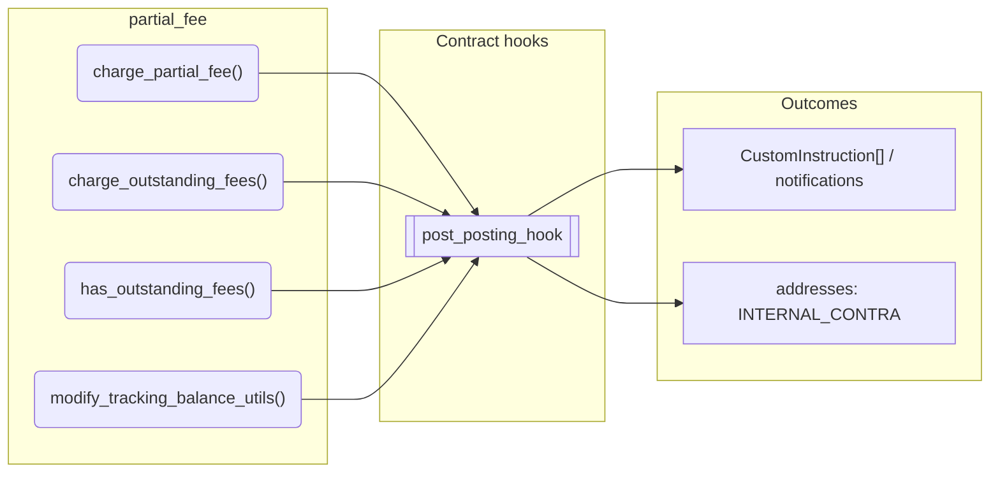
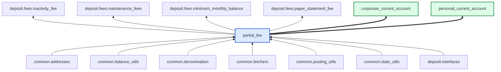

# Partial Fee

> Generated by `python3 -m fl docs`. Curated prose comes from `feature_library/src/feature_library/deposit/fees/partial_fee.okf.yaml`; everything else is derived from the module source. Do not edit by hand.

| Property | Value |
|---|---|
| Module | `feature_library.deposit.fees.partial_fee` |
| Domain | deposit |
| Status | undeclared |
| Version | — |
| Hooks | `post_posting_hook` |
| Source | `feature_library/src/feature_library/deposit/fees/partial_fee.py` |

## What it does

_Not yet described._

## Traceability: configuration to outcome

Every input below is a value a bank configures. The diagram shows which function consumes it and which hook turns it into an outcome.

## Public API

| Function | Returns | Purpose |
|---|---|---|
| `charge_partial_fee(state, fee_custom_instruction, fee_details, available_balance_feature, fetchers_config)` | `list[CustomInstruction]` | Charge a Partial fee, intended to wrap an existing fee custom instruction. |
| `charge_outstanding_fees(state, fee_collection, available_balance_feature, fetchers_config)` | `list[CustomInstruction]` | Charge outstanding fees from the post posting hook. |
| `has_outstanding_fees(state, fee_collection, fetchers_config)` | `bool` | Check for any outstanding fees. |
| `modify_tracking_balance_utils(account_id, denomination, tracking_address, value, payment_deduction, instruction_details)` | `list[CustomInstruction]` | Increase the tracking balance for a partial payment address. |

## Outputs

| Kind | Values | Notes |
|---|---|---|
| Balance addresses | `INTERNAL_CONTRA` | — |

## Composition points

Accepts: `AvailableBalance`, `PartialFeeCollection`

## Where it sits in the library

## Requirement traceability

_No business requirement is linked to this feature yet, so it cannot be traced back to a stated need._

## Products using it

- `corporate_current_account`
- `personal_current_account`

## Testing

| Tier | Status | Test modules |
|---|---|---|
| Unit | yes | 1 |
| Simulation | **missing** | 0 |
| End-to-end | **missing** | 0 |

<!-- generated:end -->

## Authored notes

_Written by hand before this page was generated; kept verbatim._

# Partial Fee

> Generated by `python3 -m fl docs`. Curated prose comes from `feature_library/src/feature_library/deposit/fees/partial_fee.okf.yaml`; everything else is derived from the module source. Do not edit by hand.

| Property | Value |
|---|---|
| Module | `feature_library.deposit.fees.partial_fee` |
| Domain | deposit |
| Status | undeclared |
| Version | — |
| Hooks | `post_posting_hook` |
| Source | `feature_library/src/feature_library/deposit/fees/partial_fee.py` |

## What it does

_Not yet described._

## Traceability: configuration to outcome

Every input below is a value a bank configures. The diagram shows which function consumes it and which hook turns it into an outcome.

## Public API

| Function | Returns | Purpose |
|---|---|---|
| `charge_partial_fee(state, fee_custom_instruction, fee_details, available_balance_feature, fetchers_config)` | `list[CustomInstruction]` | Charge a Partial fee, intended to wrap an existing fee custom instruction. |
| `charge_outstanding_fees(state, fee_collection, available_balance_feature, fetchers_config)` | `list[CustomInstruction]` | Charge outstanding fees from the post posting hook. |
| `has_outstanding_fees(state, fee_collection, fetchers_config)` | `bool` | Check for any outstanding fees. |
| `modify_tracking_balance_utils(account_id, denomination, tracking_address, value, payment_deduction, instruction_details)` | `list[CustomInstruction]` | Increase the tracking balance for a partial payment address. |

## Outputs

| Kind | Values | Notes |
|---|---|---|
| Balance addresses | `INTERNAL_CONTRA` | — |

## Composition points

Accepts: `AvailableBalance`, `PartialFeeCollection`

## Where it sits in the library

## Requirement traceability

_No business requirement is linked to this feature yet, so it cannot be traced back to a stated need._

## Products using it

- `corporate_current_account`
- `personal_current_account`

## Testing

| Tier | Status | Test modules |
|---|---|---|
| Unit | yes | 1 |
| Simulation | **missing** | 0 |
| End-to-end | **missing** | 0 |
