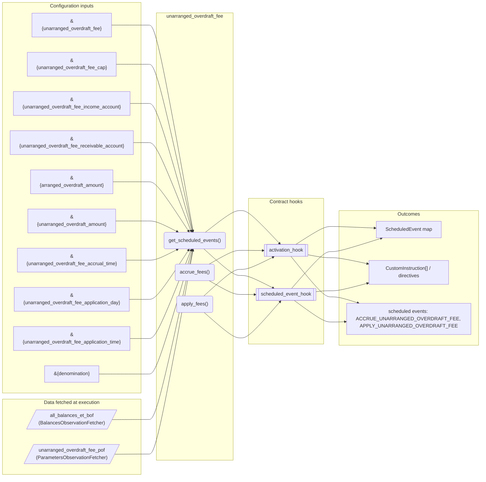
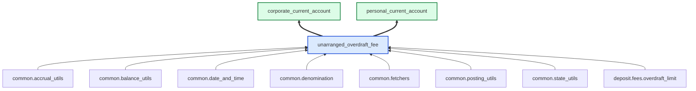

# Unarranged Overdraft Fee

> Generated by `python3 -m fl docs`. Curated prose comes from `feature_library/src/feature_library/deposit/fees/unarranged_overdraft_fee.okf.yaml`; everything else is derived from the module source. Do not edit by hand.

| Property | Value |
|---|---|
| Module | `feature_library.deposit.fees.unarranged_overdraft_fee` |
| Domain | deposit |
| Status | undeclared |
| Version | — |
| Hooks | `activation_hook`, `scheduled_event_hook` |
| Source | `feature_library/src/feature_library/deposit/fees/unarranged_overdraft_fee.py` |

## What it does

_Not yet described._

## Traceability: configuration to outcome

Every input below is a value a bank configures. The diagram shows which function consumes it and which hook turns it into an outcome.

## Inputs — parameters

| Reference | Meaning | Hierarchy level | Constraint | Required | CLU resource |
|---|---|---|---|---|---|
| `&{unarranged_overdraft_fee}` | Triggers pre-parameter change hook? No.  Optional? Yes. | — | decimal_constraint | optional | `feature_library/src/feature_library/deposit/fees/parameter_resource_defs/unarranged_overdraft_fee.resource.yaml` |
| `&{unarranged_overdraft_fee_cap}` | Triggers pre-parameter change hook? No.  Optional? Yes. | — | decimal_constraint | optional | `feature_library/src/feature_library/deposit/fees/parameter_resource_defs/unarranged_overdraft_fee_cap.resource.yaml` |
| `&{unarranged_overdraft_fee_income_account}` | Triggers pre-parameter change hook? No.  Optional? Yes. | — | account_constraint | optional | `feature_library/src/feature_library/deposit/fees/parameter_resource_defs/unarranged_overdraft_fee_income_account.resource.yaml` |
| `&{unarranged_overdraft_fee_receivable_account}` | Triggers pre-parameter change hook? No.  Optional? Yes. | — | account_constraint | optional | `feature_library/src/feature_library/deposit/fees/parameter_resource_defs/unarranged_overdraft_fee_receivable_account.resource.yaml` |
| `&{arranged_overdraft_amount}` | Triggers pre-parameter change hook? No.  Optional? Yes. | — | decimal_constraint | optional | `feature_library/src/feature_library/deposit/fees/parameter_resource_defs/arranged_overdraft_amount.resource.yaml` |
| `&{unarranged_overdraft_amount}` | Triggers pre-parameter change hook? No.  Optional? Yes. | — | decimal_constraint | optional | `feature_library/src/feature_library/deposit/fees/parameter_resource_defs/unarranged_overdraft_amount.resource.yaml` |
| `&{unarranged_overdraft_fee_accrual_time}` | Format "HH:mm:ss".  Triggers pre-parameter change hook? No.  Optional? No. | — | string_constraint | required | `feature_library/src/feature_library/deposit/fees/parameter_resource_defs/unarranged_overdraft_fee_accrual_time.resource.yaml` |
| `&{unarranged_overdraft_fee_application_day}` | Triggers pre-parameter change hook? No.  Optional? No. | — | decimal_constraint | required | `feature_library/src/feature_library/deposit/fees/parameter_resource_defs/unarranged_overdraft_fee_application_day.resource.yaml` |
| `&{unarranged_overdraft_fee_application_time}` | Format "HH:mm:ss".  Triggers pre-parameter change hook? No.  Optional? No. | — | string_constraint | required | `feature_library/src/feature_library/deposit/fees/parameter_resource_defs/unarranged_overdraft_fee_application_time.resource.yaml` |
| `&{denomination}` | _undocumented_ | — | string_constraint | required | `feature_library/src/feature_library/common/parameter_resource_defs/denomination.resource.yaml` |

## Inputs — data fetched at execution

| Fetcher id | Type | Anchor | Filter |
|---|---|---|---|
| `all_balances_et_bof` | BalancesObservationFetcher | DefinedDateTime.EFFECTIVE_DATETIME | — |
| `unarranged_overdraft_fee_pof` | ParametersObservationFetcher | DefinedDateTime.EFFECTIVE_DATETIME | ParametersFilter(parameter_ids=[p.id for p in expected_parameters]) |

## Public API

| Function | Returns | Purpose |
|---|---|---|
| `get_parameters(vault, param_fetcher_id)` | `dict[str, datetime \| Decimal \| str \| None]` | Retrieves configuration parameters for the unarranged overdraft fee feature. |
| `get_scheduled_events(state, fetchers_config)` | `dict[str, ScheduledEvent]` | Returns the scheduled events for accruing and applying unarranged overdraft fees. |
| `accrue_fees(state, account_type, fetchers_config)` | `list[CustomInstruction]` | Accrues the daily unarranged overdraft fee based on the previous day's end-of-day balance. |
| `apply_fees(state, account_type, fetchers_config)` | `list[CustomInstruction]` | Applies the total accrued unarranged overdraft fee to the account. |

## Outputs

| Kind | Values | Notes |
|---|---|---|
| Scheduled events | `ACCRUE_UNARRANGED_OVERDRAFT_FEE`, `APPLY_UNARRANGED_OVERDRAFT_FEE` | static |

## Where it sits in the library

## Requirement traceability

_No business requirement is linked to this feature yet, so it cannot be traced back to a stated need._

## Products using it

- `corporate_current_account`
- `personal_current_account`

## Testing

| Tier | Status | Test modules |
|---|---|---|
| Unit | yes | 1 |
| Simulation | yes | 1 |
| End-to-end | yes | 1 |

<!-- generated:end -->

## Authored notes

_Written by hand before this page was generated; kept verbatim._

# Unarranged Overdraft Fee

> Generated by `python3 -m fl docs`. Curated prose comes from `feature_library/src/feature_library/deposit/fees/unarranged_overdraft_fee.okf.yaml`; everything else is derived from the module source. Do not edit by hand.

| Property | Value |
|---|---|
| Module | `feature_library.deposit.fees.unarranged_overdraft_fee` |
| Domain | deposit |
| Status | undeclared |
| Version | — |
| Hooks | `activation_hook`, `scheduled_event_hook` |
| Source | `feature_library/src/feature_library/deposit/fees/unarranged_overdraft_fee.py` |

## What it does

_Not yet described._

## Traceability: configuration to outcome

Every input below is a value a bank configures. The diagram shows which function consumes it and which hook turns it into an outcome.

## Inputs — parameters

| Reference | Meaning | Hierarchy level | Constraint | Required | CLU resource |
|---|---|---|---|---|---|
| `&{unarranged_overdraft_fee}` | Triggers pre-parameter change hook? No.  Optional? Yes. | — | decimal_constraint | optional | `feature_library/src/feature_library/deposit/fees/parameter_resource_defs/unarranged_overdraft_fee.resource.yaml` |
| `&{unarranged_overdraft_fee_cap}` | Triggers pre-parameter change hook? No.  Optional? Yes. | — | decimal_constraint | optional | `feature_library/src/feature_library/deposit/fees/parameter_resource_defs/unarranged_overdraft_fee_cap.resource.yaml` |
| `&{unarranged_overdraft_fee_income_account}` | Triggers pre-parameter change hook? No.  Optional? Yes. | — | account_constraint | optional | `feature_library/src/feature_library/deposit/fees/parameter_resource_defs/unarranged_overdraft_fee_income_account.resource.yaml` |
| `&{unarranged_overdraft_fee_receivable_account}` | Triggers pre-parameter change hook? No.  Optional? Yes. | — | account_constraint | optional | `feature_library/src/feature_library/deposit/fees/parameter_resource_defs/unarranged_overdraft_fee_receivable_account.resource.yaml` |
| `&{arranged_overdraft_amount}` | Triggers pre-parameter change hook? No.  Optional? Yes. | — | decimal_constraint | optional | `feature_library/src/feature_library/deposit/fees/parameter_resource_defs/arranged_overdraft_amount.resource.yaml` |
| `&{unarranged_overdraft_amount}` | Triggers pre-parameter change hook? No.  Optional? Yes. | — | decimal_constraint | optional | `feature_library/src/feature_library/deposit/fees/parameter_resource_defs/unarranged_overdraft_amount.resource.yaml` |
| `&{unarranged_overdraft_fee_accrual_time}` | Format "HH:mm:ss".  Triggers pre-parameter change hook? No.  Optional? No. | — | string_constraint | required | `feature_library/src/feature_library/deposit/fees/parameter_resource_defs/unarranged_overdraft_fee_accrual_time.resource.yaml` |
| `&{unarranged_overdraft_fee_application_day}` | Triggers pre-parameter change hook? No.  Optional? No. | — | decimal_constraint | required | `feature_library/src/feature_library/deposit/fees/parameter_resource_defs/unarranged_overdraft_fee_application_day.resource.yaml` |
| `&{unarranged_overdraft_fee_application_time}` | Format "HH:mm:ss".  Triggers pre-parameter change hook? No.  Optional? No. | — | string_constraint | required | `feature_library/src/feature_library/deposit/fees/parameter_resource_defs/unarranged_overdraft_fee_application_time.resource.yaml` |
| `&{denomination}` | _undocumented_ | — | string_constraint | required | `feature_library/src/feature_library/common/parameter_resource_defs/denomination.resource.yaml` |

## Inputs — data fetched at execution

| Fetcher id | Type | Anchor | Filter |
|---|---|---|---|
| `all_balances_et_bof` | BalancesObservationFetcher | DefinedDateTime.EFFECTIVE_DATETIME | — |
| `unarranged_overdraft_fee_pof` | ParametersObservationFetcher | DefinedDateTime.EFFECTIVE_DATETIME | ParametersFilter(parameter_ids=[p.id for p in expected_parameters]) |

## Public API

| Function | Returns | Purpose |
|---|---|---|
| `get_parameters(vault, param_fetcher_id)` | `dict[str, datetime \| Decimal \| str \| None]` | Retrieves configuration parameters for the unarranged overdraft fee feature. |
| `get_scheduled_events(state, fetchers_config)` | `dict[str, ScheduledEvent]` | Returns the scheduled events for accruing and applying unarranged overdraft fees. |
| `accrue_fees(state, account_type, fetchers_config)` | `list[CustomInstruction]` | Accrues the daily unarranged overdraft fee based on the previous day's end-of-day balance. |
| `apply_fees(state, account_type, fetchers_config)` | `list[CustomInstruction]` | Applies the total accrued unarranged overdraft fee to the account. |

## Outputs

| Kind | Values | Notes |
|---|---|---|
| Scheduled events | `ACCRUE_UNARRANGED_OVERDRAFT_FEE`, `APPLY_UNARRANGED_OVERDRAFT_FEE` | static |

## Where it sits in the library

## Requirement traceability

_No business requirement is linked to this feature yet, so it cannot be traced back to a stated need._

## Products using it

- `corporate_current_account`
- `personal_current_account`

## Testing

| Tier | Status | Test modules |
|---|---|---|
| Unit | yes | 1 |
| Simulation | yes | 1 |
| End-to-end | yes | 1 |
