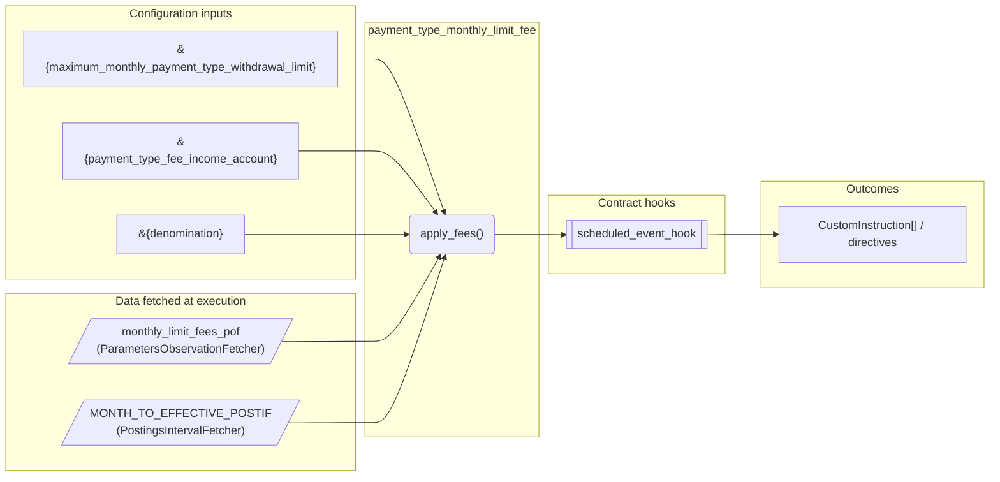
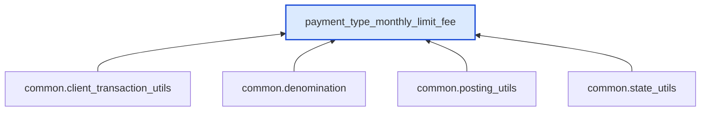

# Payment Type Monthly Limit Fee

> Generated by `python3 -m fl docs`. Curated prose comes from `feature_library/src/feature_library/deposit/fees/withdrawal/payment_type_monthly_limit_fee.okf.yaml`; everything else is derived from the module source. Do not edit by hand.

| Property | Value |
|---|---|
| Module | `feature_library.deposit.fees.withdrawal.payment_type_monthly_limit_fee` |
| Domain | deposit |
| Status | undeclared |
| Version | — |
| Hooks | `scheduled_event_hook` |
| Source | `feature_library/src/feature_library/deposit/fees/withdrawal/payment_type_monthly_limit_fee.py` |

## What it does

_Not yet described._

## Traceability: configuration to outcome

Every input below is a value a bank configures. The diagram shows which function consumes it and which hook turns it into an outcome.

## Inputs — parameters

| Reference | Meaning | Hierarchy level | Constraint | Required | CLU resource |
|---|---|---|---|---|---|
| `&{maximum_monthly_payment_type_withdrawal_limit}` | Triggers pre-parameter change hook? No.  Optional? No. | — | string_constraint | required | `feature_library/src/feature_library/deposit/fees/withdrawal/parameter_resource_defs/maximum_monthly_payment_type_withdrawal_limit.resource.yaml` |
| `&{payment_type_fee_income_account}` | Triggers pre-parameter change hook? No.  Optional? No. | — | account_constraint | required | `feature_library/src/feature_library/deposit/fees/withdrawal/parameter_resource_defs/payment_type_fee_income_account.resource.yaml` |
| `&{denomination}` | _undocumented_ | — | string_constraint | required | `feature_library/src/feature_library/common/parameter_resource_defs/denomination.resource.yaml` |

## Inputs — data fetched at execution

| Fetcher id | Type | Anchor | Filter |
|---|---|---|---|
| `monthly_limit_fees_pof` | ParametersObservationFetcher | DefinedDateTime.EFFECTIVE_DATETIME | ParametersFilter(parameter_ids=[p.id for p in expected_parameters]) |
| `MONTH_TO_EFFECTIVE_POSTIF` | PostingsIntervalFetcher | RelativeDateTime(origin=DefinedDateTime.EFFECTIVE_DATETIME, shift=Shift(days=-31)) | — |

## Public API

| Function | Returns | Purpose |
|---|---|---|
| `get_parameters(vault, param_fetcher_id)` | `dict[str, datetime \| Decimal \| str \| None]` | Retrieves configuration parameters for the payment type monthly limit fee feature. |
| `apply_fees(state, updated_client_transactions, account_type, historic_client_transactions, fetchers_config)` | `List[CustomInstruction]` | Checks client transactions for PAYMENT_TYPE key and returns fee instructions if the |

## Where it sits in the library

## Requirement traceability

_No business requirement is linked to this feature yet, so it cannot be traced back to a stated need._

## Products using it

_None. A feature that no product composes is not yet a proven building block._

## Testing

| Tier | Status | Test modules |
|---|---|---|
| Unit | yes | 1 |
| Simulation | yes | 1 |
| End-to-end | yes | 1 |

<!-- generated:end -->

## Authored notes

_Written by hand before this page was generated; kept verbatim._

# Payment Type Monthly Limit Fee

> Generated by `python3 -m fl docs`. Curated prose comes from `feature_library/src/feature_library/deposit/fees/withdrawal/payment_type_monthly_limit_fee.okf.yaml`; everything else is derived from the module source. Do not edit by hand.

| Property | Value |
|---|---|
| Module | `feature_library.deposit.fees.withdrawal.payment_type_monthly_limit_fee` |
| Domain | deposit |
| Status | undeclared |
| Version | — |
| Hooks | `scheduled_event_hook` |
| Source | `feature_library/src/feature_library/deposit/fees/withdrawal/payment_type_monthly_limit_fee.py` |

## What it does

_Not yet described._

## Traceability: configuration to outcome

Every input below is a value a bank configures. The diagram shows which function consumes it and which hook turns it into an outcome.

## Inputs — parameters

| Reference | Meaning | Hierarchy level | Constraint | Required | CLU resource |
|---|---|---|---|---|---|
| `&{maximum_monthly_payment_type_withdrawal_limit}` | Triggers pre-parameter change hook? No.  Optional? No. | — | string_constraint | required | `feature_library/src/feature_library/deposit/fees/withdrawal/parameter_resource_defs/maximum_monthly_payment_type_withdrawal_limit.resource.yaml` |
| `&{payment_type_fee_income_account}` | Triggers pre-parameter change hook? No.  Optional? No. | — | account_constraint | required | `feature_library/src/feature_library/deposit/fees/withdrawal/parameter_resource_defs/payment_type_fee_income_account.resource.yaml` |
| `&{denomination}` | _undocumented_ | — | string_constraint | required | `feature_library/src/feature_library/common/parameter_resource_defs/denomination.resource.yaml` |

## Inputs — data fetched at execution

| Fetcher id | Type | Anchor | Filter |
|---|---|---|---|
| `monthly_limit_fees_pof` | ParametersObservationFetcher | DefinedDateTime.EFFECTIVE_DATETIME | ParametersFilter(parameter_ids=[p.id for p in expected_parameters]) |
| `MONTH_TO_EFFECTIVE_POSTIF` | PostingsIntervalFetcher | RelativeDateTime(origin=DefinedDateTime.EFFECTIVE_DATETIME, shift=Shift(days=-31)) | — |

## Public API

| Function | Returns | Purpose |
|---|---|---|
| `get_parameters(vault, param_fetcher_id)` | `dict[str, datetime \| Decimal \| str \| None]` | Retrieves configuration parameters for the payment type monthly limit fee feature. |
| `apply_fees(state, updated_client_transactions, account_type, historic_client_transactions, fetchers_config)` | `List[CustomInstruction]` | Checks client transactions for PAYMENT_TYPE key and returns fee instructions if the |

## Where it sits in the library

## Requirement traceability

_No business requirement is linked to this feature yet, so it cannot be traced back to a stated need._

## Products using it

_None. A feature that no product composes is not yet a proven building block._

## Testing

| Tier | Status | Test modules |
|---|---|---|
| Unit | yes | 1 |
| Simulation | yes | 1 |
| End-to-end | yes | 1 |
