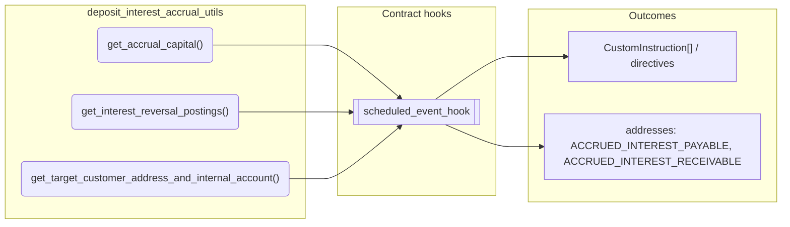
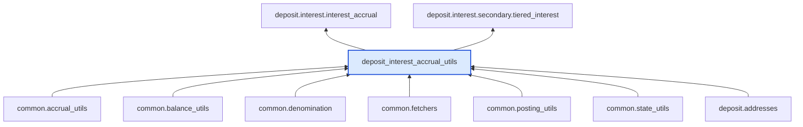

# Deposit Interest Accrual Utils

> Generated by `python3 -m fl docs`. Curated prose comes from `feature_library/src/feature_library/deposit/interest/deposit_interest_accrual_utils.okf.yaml`; everything else is derived from the module source. Do not edit by hand.

| Property | Value |
|---|---|
| Module | `feature_library.deposit.interest.deposit_interest_accrual_utils` |
| Domain | deposit |
| Status | undeclared |
| Version | — |
| Hooks | — |
| Source | `feature_library/src/feature_library/deposit/interest/deposit_interest_accrual_utils.py` |

## What it does

_Not yet described._

## Traceability: configuration to outcome

Every input below is a value a bank configures. The diagram shows which function consumes it and which hook turns it into an outcome.

## Public API

| Function | Returns | Purpose |
|---|---|---|
| `get_accrual_capital(state, denomination_param_id, balances, capital_addresses)` | `Balance` | Get the capital balance to accrue interest on. |
| `get_interest_reversal_postings(state, event_name, account_type, balances, denomination_param_id, accrued_payable_account_param_id, accrued_receivable_account_param_id, accrued_payable_address, accrued_receivable_address)` | `list[CustomInstruction]` | Reverse any accrued interest and apply back to the internal account. |
| `get_target_customer_address_and_internal_account(accrual_amount, accrued_interest_payable_account, accrued_interest_receivable_account)` | `tuple[str, str]` | Return the payable or receivable customer address and internal account based on the |

## Outputs

| Kind | Values | Notes |
|---|---|---|
| Balance addresses | `ACCRUED_INTEREST_PAYABLE`, `ACCRUED_INTEREST_RECEIVABLE` | — |

## Where it sits in the library

## Requirement traceability

_No business requirement is linked to this feature yet, so it cannot be traced back to a stated need._

## Products using it

_None. A feature that no product composes is not yet a proven building block._

## Testing

| Tier | Status | Test modules |
|---|---|---|
| Unit | yes | 1 |
| Simulation | yes | 1 |
| End-to-end | **missing** | 0 |

<!-- generated:end -->

## Authored notes

_Written by hand before this page was generated; kept verbatim._

# Deposit Interest Accrual Utils

> Generated by `python3 -m fl docs`. Curated prose comes from `feature_library/src/feature_library/deposit/interest/deposit_interest_accrual_utils.okf.yaml`; everything else is derived from the module source. Do not edit by hand.

| Property | Value |
|---|---|
| Module | `feature_library.deposit.interest.deposit_interest_accrual_utils` |
| Domain | deposit |
| Status | undeclared |
| Version | — |
| Hooks | — |
| Source | `feature_library/src/feature_library/deposit/interest/deposit_interest_accrual_utils.py` |

## What it does

_Not yet described._

## Traceability: configuration to outcome

Every input below is a value a bank configures. The diagram shows which function consumes it and which hook turns it into an outcome.

## Public API

| Function | Returns | Purpose |
|---|---|---|
| `get_accrual_capital(state, denomination_param_id, balances, capital_addresses)` | `Balance` | Get the capital balance to accrue interest on. |
| `get_interest_reversal_postings(state, event_name, account_type, balances, denomination_param_id, accrued_payable_account_param_id, accrued_receivable_account_param_id, accrued_payable_address, accrued_receivable_address)` | `list[CustomInstruction]` | Reverse any accrued interest and apply back to the internal account. |
| `get_target_customer_address_and_internal_account(accrual_amount, accrued_interest_payable_account, accrued_interest_receivable_account)` | `tuple[str, str]` | Return the payable or receivable customer address and internal account based on the |

## Outputs

| Kind | Values | Notes |
|---|---|---|
| Balance addresses | `ACCRUED_INTEREST_PAYABLE`, `ACCRUED_INTEREST_RECEIVABLE` | — |

## Where it sits in the library

## Requirement traceability

_No business requirement is linked to this feature yet, so it cannot be traced back to a stated need._

## Products using it

_None. A feature that no product composes is not yet a proven building block._

## Testing

| Tier | Status | Test modules |
|---|---|---|
| Unit | yes | 1 |
| Simulation | yes | 1 |
| End-to-end | **missing** | 0 |
