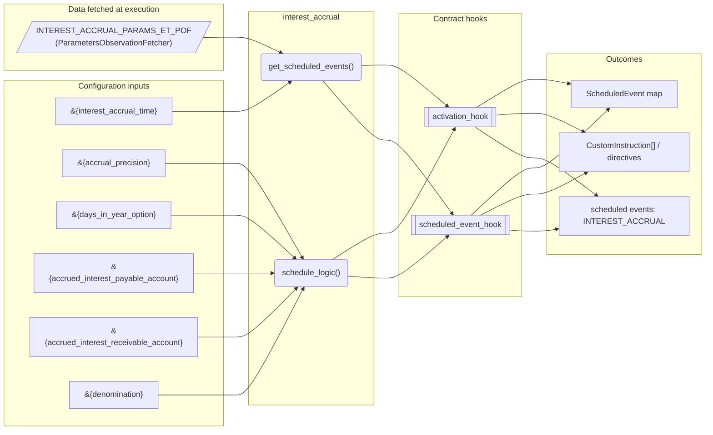

```mermaid
graph BT
  me_interest_accrual["interest_accrual"]:::self
  dep_common_accrual_utils["common.accrual_utils"] --> me_interest_accrual
  dep_common_balance_utils["common.balance_utils"] --> me_interest_accrual
  dep_common_date_and_time["common.date_and_time"] --> me_interest_accrual
  dep_common_denomination["common.denomination"] --> me_interest_accrual
  dep_common_posting_utils["common.posting_utils"] --> me_interest_accrual
  dep_common_state_utils["common.state_utils"] --> me_interest_accrual
  dep_common_tuples["common.tuples"] --> me_interest_accrual
  dep_deposit_interest_deposit_interest_accrual_utils["deposit.interest.deposit_interest_accrual_utils"] --> me_interest_accrual
  dep_deposit_interfaces["deposit.interfaces"] --> me_interest_accrual
  me_interest_accrual --> use_deposit_interest_interest_application["deposit.interest.interest_application"]
  me_interest_accrual --> use_deposit_interest_secondary_flat_interest["deposit.interest.secondary.flat_interest"]
  me_interest_accrual --> use_deposit_interest_secondary_overdraft_interest["deposit.interest.secondary.overdraft_interest"]
  me_interest_accrual --> use_deposit_interest_secondary_tiered_interest["deposit.interest.secondary.tiered_interest"]
  me_interest_accrual ==> prod_corporate_current_account["corporate_current_account"]:::product
  me_interest_accrual ==> prod_personal_current_account["personal_current_account"]:::product
  classDef self fill:#dbeafe,stroke:#1d4ed8,stroke-width:2px;
  classDef product fill:#dcfce7,stroke:#15803d,stroke-width:2px;
```

# Interest Accrual

> Generated by `python3 -m fl docs`. Curated prose comes from `feature_library/src/feature_library/deposit/interest/interest_accrual.okf.yaml`; everything else is derived from the module source. Do not edit by hand.

| Property | Value |
|---|---|
| Module | `feature_library.deposit.interest.interest_accrual` |
| Domain | deposit |
| Status | supported |
| Version | 1.0.0 |
| Hooks | `activation_hook`, `scheduled_event_hook` |
| Source | `feature_library/src/feature_library/deposit/interest/interest_accrual.py` |

## What it does

Accrues interest daily on a deposit account's balance, delegating the rate calculation to any injected interest type so that flat, tiered and overdraft interest all share one accrual engine.

## What the customer experiences

The customer sees interest building up on their account every day rather than only when it is paid. Accrued amounts are held on separate ACCRUED_INTEREST_PAYABLE / ACCRUED_INTEREST_RECEIVABLE addresses, so a statement can show 'interest earned so far this month' before the application date, and closing the account mid-period still settles the interest actually earned. Because the rate is supplied by an injected interest type, the same customer experience is produced whether the bank offers a single rate, balance tiers, or a different rate on overdrawn balances.

## When to use it

**Use it when** the product pays or charges interest that must be earned daily and applied periodically, and you want the rate policy to remain a separate, independently tested feature.

**Do not use it when** interest is charged as a fixed fee, or the product needs interest computed on a statement cycle rather than daily — use the lending credit card accrual feature for revolving balances.

## Traceability: configuration to outcome

Every input below is a value a bank configures. The diagram shows which function consumes it and which hook turns it into an outcome.

## Inputs — parameters

| Reference | Meaning | Hierarchy level | Constraint | Required | CLU resource |
|---|---|---|---|---|---|
| `&{interest_accrual_time}` | The time of day, as HH:mm:ss, at which the daily accrual runs. | template | string_constraint | required | `feature_library/src/feature_library/deposit/interest/parameter_resource_defs/interest_accrual_time.resource.yaml` |
| `&{accrual_precision}` | Number of decimal places accrued interest is rounded to. | template | decimal_constraint | required | `feature_library/src/feature_library/deposit/interest/parameter_resource_defs/accrual_precision.resource.yaml` |
| `&{days_in_year_option}` | Day-count convention: 360, 365, 366 or actual. | template | enumeration_constraint | required | `feature_library/src/feature_library/deposit/interest/parameter_resource_defs/days_in_year_option.resource.yaml` |
| `&{accrued_interest_payable_account}` | Internal account funding interest owed to customers. | template | account_constraint | required | `feature_library/src/feature_library/deposit/interest/parameter_resource_defs/accrued_interest_payable_account.resource.yaml` |
| `&{accrued_interest_receivable_account}` | Internal account receiving interest owed by customers. | template | account_constraint | required | `feature_library/src/feature_library/deposit/interest/parameter_resource_defs/accrued_interest_receivable_account.resource.yaml` |
| `&{denomination}` | The currency the account operates in. | template | string_constraint | required | `feature_library/src/feature_library/common/parameter_resource_defs/denomination.resource.yaml` |

## Inputs — data fetched at execution

| Fetcher id | Type | Anchor | Filter |
|---|---|---|---|
| `INTEREST_ACCRUAL_PARAMS_ET_POF` | ParametersObservationFetcher | DefinedDateTime.EFFECTIVE_DATETIME | ParametersFilter(parameter_ids=[p.id for p in expected_parameters]) |

## Public API

| Function | Returns | Purpose |
|---|---|---|
| `get_parameters(vault, param_fetcher_id)` | `dict[str, datetime \| Decimal \| str \| None]` | Retrieves configuration parameters for the interest accrual feature. |
| `get_scheduled_events(state, fetchers_config)` | `dict[str, ScheduledEvent]` | Get scheduled event for interest accrual. Uses interest accrual time parameter. |
| `schedule_logic(state, interest_types, fetchers_config, event)` | `list[CustomInstruction]` | Schedule logic for handling interest accrual. |

## Outputs

| Kind | Values | Notes |
|---|---|---|
| Scheduled events | `INTEREST_ACCRUAL` | static |

## Where it sits in the library

## Requirement traceability

| Requirement | Statement | Implemented by | Verified by |
|---|---|---|---|
| REQ-DEP-INT-001 | Interest must accrue daily on the customer's cleared balance at the rate applicable to that balance. | `schedule_logic`, `&{fixed_interest_rate}` | `tests/deposit/interest/interest_accrual/unit/test_interest_accrual.py`, `tests/deposit/interest/interest_accrual/simulation/test_interest_accrual.py` |
| REQ-DEP-INT-002 | The bank must be able to configure the day-count convention used to convert an annual rate to a daily rate. | `&{days_in_year_option}` | `tests/deposit/interest/interest_accrual/unit/test_interest_accrual.py` |
| REQ-DEP-INT-003 | Accrued interest must post to the correct internal account depending on whether it is payable to or receivable from the customer. | `&{accrued_interest_payable_account}`, `&{accrued_interest_receivable_account}` | `tests/deposit/interest/interest_accrual/unit/test_interest_accrual.py` |

## Products using it

- `corporate_current_account`
- `personal_current_account`

## Testing

| Tier | Status | Test modules |
|---|---|---|
| Unit | yes | 2 |
| Simulation | yes | 3 |
| End-to-end | yes | 2 |

### Exercising it in a simulation

Compose this feature with an interest type (for example `deposit.interest.secondary.flat_interest`) into a contract that implements `activation_hook` and `scheduled_event_hook`, then assert on the ACCRUED_INTEREST_PAYABLE dimension after advancing the simulation past `interest_accrual_time`. Use `ExpectedSchedule` to assert the INTEREST_ACCRUAL event fires at the configured time, and parameterise the test over timezones to prove processing-group behaviour.

### Determinism

The accrual amount depends only on the effective balance, the injected rate, the `days_in_year_option` convention and `accrual_precision` — never on wall-clock time. The schedule anchors on `interest_accrual_time`, so re-running the same effective datetime produces byte-identical instructions. Zero-value accruals return no instructions at all, which keeps replay idempotent and avoids polluting the ledger.

<!-- generated:end -->

## Authored notes

_Written by hand before this page was generated; kept verbatim._

# Interest Accrual

> Generated by `python3 -m fl docs`. Curated prose comes from `feature_library/src/feature_library/deposit/interest/interest_accrual.okf.yaml`; everything else is derived from the module source. Do not edit by hand.

| Property | Value |
|---|---|
| Module | `feature_library.deposit.interest.interest_accrual` |
| Domain | deposit |
| Status | supported |
| Version | 1.0.0 |
| Hooks | `activation_hook`, `scheduled_event_hook` |
| Source | `feature_library/src/feature_library/deposit/interest/interest_accrual.py` |

## What it does

Accrues interest daily on a deposit account's balance, delegating the rate calculation to any injected interest type so that flat, tiered and overdraft interest all share one accrual engine.

## What the customer experiences

The customer sees interest building up on their account every day rather than only when it is paid. Accrued amounts are held on separate ACCRUED_INTEREST_PAYABLE / ACCRUED_INTEREST_RECEIVABLE addresses, so a statement can show 'interest earned so far this month' before the application date, and closing the account mid-period still settles the interest actually earned. Because the rate is supplied by an injected interest type, the same customer experience is produced whether the bank offers a single rate, balance tiers, or a different rate on overdrawn balances.

## When to use it

**Use it when** the product pays or charges interest that must be earned daily and applied periodically, and you want the rate policy to remain a separate, independently tested feature.

**Do not use it when** interest is charged as a fixed fee, or the product needs interest computed on a statement cycle rather than daily — use the lending credit card accrual feature for revolving balances.

## Traceability: configuration to outcome

Every input below is a value a bank configures. The diagram shows which function consumes it and which hook turns it into an outcome.

## Inputs — parameters

| Reference | Meaning | Hierarchy level | Constraint | Required | CLU resource |
|---|---|---|---|---|---|
| `&{interest_accrual_time}` | The time of day, as HH:mm:ss, at which the daily accrual runs. | template | string_constraint | required | `feature_library/src/feature_library/deposit/interest/parameter_resource_defs/interest_accrual_time.resource.yaml` |
| `&{accrual_precision}` | Number of decimal places accrued interest is rounded to. | template | decimal_constraint | required | `feature_library/src/feature_library/deposit/interest/parameter_resource_defs/accrual_precision.resource.yaml` |
| `&{days_in_year_option}` | Day-count convention: 360, 365, 366 or actual. | template | enumeration_constraint | required | `feature_library/src/feature_library/deposit/interest/parameter_resource_defs/days_in_year_option.resource.yaml` |
| `&{accrued_interest_payable_account}` | Internal account funding interest owed to customers. | template | account_constraint | required | `feature_library/src/feature_library/deposit/interest/parameter_resource_defs/accrued_interest_payable_account.resource.yaml` |
| `&{accrued_interest_receivable_account}` | Internal account receiving interest owed by customers. | template | account_constraint | required | `feature_library/src/feature_library/deposit/interest/parameter_resource_defs/accrued_interest_receivable_account.resource.yaml` |
| `&{denomination}` | The currency the account operates in. | template | string_constraint | required | `feature_library/src/feature_library/common/parameter_resource_defs/denomination.resource.yaml` |

## Inputs — data fetched at execution

| Fetcher id | Type | Anchor | Filter |
|---|---|---|---|
| `INTEREST_ACCRUAL_PARAMS_ET_POF` | ParametersObservationFetcher | DefinedDateTime.EFFECTIVE_DATETIME | ParametersFilter(parameter_ids=[p.id for p in expected_parameters]) |

## Public API

| Function | Returns | Purpose |
|---|---|---|
| `get_parameters(vault, param_fetcher_id)` | `dict[str, datetime \| Decimal \| str \| None]` | Retrieves configuration parameters for the interest accrual feature. |
| `get_scheduled_events(state, fetchers_config)` | `dict[str, ScheduledEvent]` | Get scheduled event for interest accrual. Uses interest accrual time parameter. |
| `schedule_logic(state, interest_types, fetchers_config, event)` | `list[CustomInstruction]` | Schedule logic for handling interest accrual. |

## Outputs

| Kind | Values | Notes |
|---|---|---|
| Scheduled events | `INTEREST_ACCRUAL` | static |

## Where it sits in the library

## Requirement traceability

| Requirement | Statement | Implemented by | Verified by |
|---|---|---|---|
| REQ-DEP-INT-001 | Interest must accrue daily on the customer's cleared balance at the rate applicable to that balance. | `schedule_logic`, `&{fixed_interest_rate}` | `tests/deposit/interest/interest_accrual/unit/test_interest_accrual.py`, `tests/deposit/interest/interest_accrual/simulation/test_interest_accrual.py` |
| REQ-DEP-INT-002 | The bank must be able to configure the day-count convention used to convert an annual rate to a daily rate. | `&{days_in_year_option}` | `tests/deposit/interest/interest_accrual/unit/test_interest_accrual.py` |
| REQ-DEP-INT-003 | Accrued interest must post to the correct internal account depending on whether it is payable to or receivable from the customer. | `&{accrued_interest_payable_account}`, `&{accrued_interest_receivable_account}` | `tests/deposit/interest/interest_accrual/unit/test_interest_accrual.py` |

## Products using it

- `corporate_current_account`
- `personal_current_account`

## Testing

| Tier | Status | Test modules |
|---|---|---|
| Unit | yes | 2 |
| Simulation | yes | 3 |
| End-to-end | yes | 2 |

### Exercising it in a simulation

Compose this feature with an interest type (for example `deposit.interest.secondary.flat_interest`) into a contract that implements `activation_hook` and `scheduled_event_hook`, then assert on the ACCRUED_INTEREST_PAYABLE dimension after advancing the simulation past `interest_accrual_time`. Use `ExpectedSchedule` to assert the INTEREST_ACCRUAL event fires at the configured time, and parameterise the test over timezones to prove processing-group behaviour.

### Determinism

The accrual amount depends only on the effective balance, the injected rate, the `days_in_year_option` convention and `accrual_precision` — never on wall-clock time. The schedule anchors on `interest_accrual_time`, so re-running the same effective datetime produces byte-identical instructions. Zero-value accruals return no instructions at all, which keeps replay idempotent and avoids polluting the ledger.
