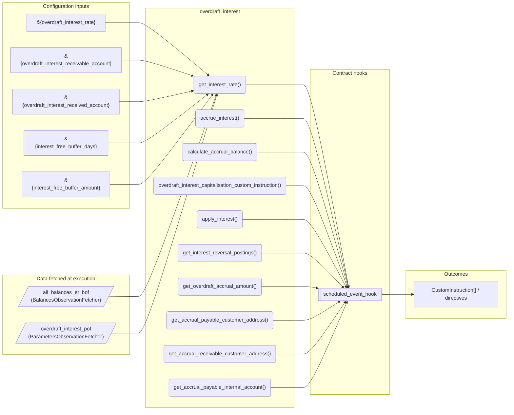

```mermaid
graph BT
  me_overdraft_interest["overdraft_interest"]:::self
  dep_common_accrual_utils["common.accrual_utils"] --> me_overdraft_interest
  dep_common_application_precision["common.application_precision"] --> me_overdraft_interest
  dep_common_balance_utils["common.balance_utils"] --> me_overdraft_interest
  dep_common_denomination["common.denomination"] --> me_overdraft_interest
  dep_common_fetchers["common.fetchers"] --> me_overdraft_interest
  dep_common_parameter_utils["common.parameter_utils"] --> me_overdraft_interest
  dep_common_posting_utils["common.posting_utils"] --> me_overdraft_interest
  dep_common_state_utils["common.state_utils"] --> me_overdraft_interest
  dep_common_tuples["common.tuples"] --> me_overdraft_interest
  dep_common_utils["common.utils"] --> me_overdraft_interest
  dep_deposit_interest_interest_accrual["deposit.interest.interest_accrual"] --> me_overdraft_interest
  dep_deposit_interfaces["deposit.interfaces"] --> me_overdraft_interest
  me_overdraft_interest ==> prod_corporate_current_account["corporate_current_account"]:::product
  me_overdraft_interest ==> prod_personal_current_account["personal_current_account"]:::product
  classDef self fill:#dbeafe,stroke:#1d4ed8,stroke-width:2px;
  classDef product fill:#dcfce7,stroke:#15803d,stroke-width:2px;
```

# Overdraft Interest

> Generated by `python3 -m fl docs`. Curated prose comes from `feature_library/src/feature_library/deposit/interest/secondary/overdraft_interest.okf.yaml`; everything else is derived from the module source. Do not edit by hand.

| Property | Value |
|---|---|
| Module | `feature_library.deposit.interest.secondary.overdraft_interest` |
| Domain | deposit |
| Status | undeclared |
| Version | — |
| Hooks | `scheduled_event_hook` |
| Source | `feature_library/src/feature_library/deposit/interest/secondary/overdraft_interest.py` |

## What it does

_Not yet described._

## Traceability: configuration to outcome

Every input below is a value a bank configures. The diagram shows which function consumes it and which hook turns it into an outcome.

## Inputs — parameters

| Reference | Meaning | Hierarchy level | Constraint | Required | CLU resource |
|---|---|---|---|---|---|
| `&{overdraft_interest_rate}` | _undocumented_ | — | decimal_constraint | required | `feature_library/src/feature_library/deposit/interest/parameter_resource_defs/overdraft_interest_rate.resource.yaml` |
| `&{overdraft_interest_receivable_account}` | _undocumented_ | — | account_constraint | required | `feature_library/src/feature_library/deposit/interest/parameter_resource_defs/overdraft_interest_receivable_account.resource.yaml` |
| `&{overdraft_interest_received_account}` | _undocumented_ | — | account_constraint | required | `feature_library/src/feature_library/deposit/interest/parameter_resource_defs/overdraft_interest_received_account.resource.yaml` |
| `&{interest_free_buffer_days}` | _undocumented_ | — | decimal_constraint | required | `feature_library/src/feature_library/deposit/interest/parameter_resource_defs/interest_free_buffer_days.resource.yaml` |
| `&{interest_free_buffer_amount}` | _undocumented_ | — | decimal_constraint | required | `feature_library/src/feature_library/deposit/interest/parameter_resource_defs/interest_free_buffer_amount.resource.yaml` |

## Inputs — data fetched at execution

| Fetcher id | Type | Anchor | Filter |
|---|---|---|---|
| `all_balances_et_bof` | BalancesObservationFetcher | DefinedDateTime.EFFECTIVE_DATETIME | — |
| `overdraft_interest_pof` | ParametersObservationFetcher | DefinedDateTime.EFFECTIVE_DATETIME | ParametersFilter(parameter_ids=[p.id for p in expected_parameters]) |

## Public API

| Function | Returns | Purpose |
|---|---|---|
| `get_parameters(vault, param_fetcher_id)` | `dict[str, datetime \| Decimal \| str \| None]` | Retrieves configuration parameters for the overdraft interest feature. |
| `get_interest_rate(state, fetchers_config)` | `common_tuples.InterestRateTuple` | Retrieves the overdraft interest rate from the contract state. |
| `accrue_interest(state, account_type, fetchers_config)` | `list[CustomInstruction]` | Creates the posting instructions to accrue overdraft interest on the specified balances. |
| `calculate_accrual_balance(state, fetchers_config)` | `Balance` | Factor in optional interest free buffer days and amount to determine the balance. |
| `overdraft_interest_capitalisation_custom_instruction(customer_account, denomination, application_amount, accrual_amount, instruction_details, accrual_customer_address, accrual_internal_account, application_customer_address, application_internal_account)` | `list[CustomInstruction]` | Create a Custom Instruction for applying (capitalising) accrued overdraft interest. |
| `apply_interest(state, account_type, fetchers_config)` | `list[CustomInstruction]` | Creates the postings instructions to apply the accrued overdraft interest. |
| `get_interest_reversal_postings(state, event_name, account_type, fetchers_config)` | `list[CustomInstruction]` | Reverse any accrued overdraft interest and apply back to the internal account. |
| `get_overdraft_accrual_amount(effective_balance, effective_datetime, interest_rates, days_in_year, precision, state, fetchers_config)` | `common_tuples.AccrualDetail` | Calculates overdraft interest accrual amount using specialized buffer logic. |
| `get_accrual_payable_customer_address()` | `str` | _undocumented_ |
| `get_accrual_receivable_customer_address()` | `str` | _undocumented_ |
| `get_accrual_payable_internal_account(state)` | `str` | Returns the internal account where overdraft interest is accrued. |
| `get_accrual_receivable_internal_account(state)` | `str` | Returns the internal account where overdraft interest is accrued. |

## Composition points

| Provides interface | As constant | Members |
|---|---|---|
| `InterestType` | `InterestType` | `get_interest_rate`, `get_accrual_amount`, `get_accrual_payable_customer_address`, `get_accrual_receivable_customer_address`, `get_accrual_payable_internal_account`, `get_accrual_receivable_internal_account` |

## Where it sits in the library

## Requirement traceability

_No business requirement is linked to this feature yet, so it cannot be traced back to a stated need._

## Products using it

- `corporate_current_account`
- `personal_current_account`

## Testing

| Tier | Status | Test modules |
|---|---|---|
| Unit | yes | 1 |
| Simulation | yes | 2 |
| End-to-end | **missing** | 0 |

<!-- generated:end -->

## Authored notes

_Written by hand before this page was generated; kept verbatim._

# Overdraft Interest

> Generated by `python3 -m fl docs`. Curated prose comes from `feature_library/src/feature_library/deposit/interest/secondary/overdraft_interest.okf.yaml`; everything else is derived from the module source. Do not edit by hand.

| Property | Value |
|---|---|
| Module | `feature_library.deposit.interest.secondary.overdraft_interest` |
| Domain | deposit |
| Status | undeclared |
| Version | — |
| Hooks | `scheduled_event_hook` |
| Source | `feature_library/src/feature_library/deposit/interest/secondary/overdraft_interest.py` |

## What it does

_Not yet described._

## Traceability: configuration to outcome

Every input below is a value a bank configures. The diagram shows which function consumes it and which hook turns it into an outcome.

## Inputs — parameters

| Reference | Meaning | Hierarchy level | Constraint | Required | CLU resource |
|---|---|---|---|---|---|
| `&{overdraft_interest_rate}` | _undocumented_ | — | decimal_constraint | required | `feature_library/src/feature_library/deposit/interest/parameter_resource_defs/overdraft_interest_rate.resource.yaml` |
| `&{overdraft_interest_receivable_account}` | _undocumented_ | — | account_constraint | required | `feature_library/src/feature_library/deposit/interest/parameter_resource_defs/overdraft_interest_receivable_account.resource.yaml` |
| `&{overdraft_interest_received_account}` | _undocumented_ | — | account_constraint | required | `feature_library/src/feature_library/deposit/interest/parameter_resource_defs/overdraft_interest_received_account.resource.yaml` |
| `&{interest_free_buffer_days}` | _undocumented_ | — | decimal_constraint | required | `feature_library/src/feature_library/deposit/interest/parameter_resource_defs/interest_free_buffer_days.resource.yaml` |
| `&{interest_free_buffer_amount}` | _undocumented_ | — | decimal_constraint | required | `feature_library/src/feature_library/deposit/interest/parameter_resource_defs/interest_free_buffer_amount.resource.yaml` |

## Inputs — data fetched at execution

| Fetcher id | Type | Anchor | Filter |
|---|---|---|---|
| `all_balances_et_bof` | BalancesObservationFetcher | DefinedDateTime.EFFECTIVE_DATETIME | — |
| `overdraft_interest_pof` | ParametersObservationFetcher | DefinedDateTime.EFFECTIVE_DATETIME | ParametersFilter(parameter_ids=[p.id for p in expected_parameters]) |

## Public API

| Function | Returns | Purpose |
|---|---|---|
| `get_parameters(vault, param_fetcher_id)` | `dict[str, datetime \| Decimal \| str \| None]` | Retrieves configuration parameters for the overdraft interest feature. |
| `get_interest_rate(state, fetchers_config)` | `common_tuples.InterestRateTuple` | Retrieves the overdraft interest rate from the contract state. |
| `accrue_interest(state, account_type, fetchers_config)` | `list[CustomInstruction]` | Creates the posting instructions to accrue overdraft interest on the specified balances. |
| `calculate_accrual_balance(state, fetchers_config)` | `Balance` | Factor in optional interest free buffer days and amount to determine the balance. |
| `overdraft_interest_capitalisation_custom_instruction(customer_account, denomination, application_amount, accrual_amount, instruction_details, accrual_customer_address, accrual_internal_account, application_customer_address, application_internal_account)` | `list[CustomInstruction]` | Create a Custom Instruction for applying (capitalising) accrued overdraft interest. |
| `apply_interest(state, account_type, fetchers_config)` | `list[CustomInstruction]` | Creates the postings instructions to apply the accrued overdraft interest. |
| `get_interest_reversal_postings(state, event_name, account_type, fetchers_config)` | `list[CustomInstruction]` | Reverse any accrued overdraft interest and apply back to the internal account. |
| `get_overdraft_accrual_amount(effective_balance, effective_datetime, interest_rates, days_in_year, precision, state, fetchers_config)` | `common_tuples.AccrualDetail` | Calculates overdraft interest accrual amount using specialized buffer logic. |
| `get_accrual_payable_customer_address()` | `str` | _undocumented_ |
| `get_accrual_receivable_customer_address()` | `str` | _undocumented_ |
| `get_accrual_payable_internal_account(state)` | `str` | Returns the internal account where overdraft interest is accrued. |
| `get_accrual_receivable_internal_account(state)` | `str` | Returns the internal account where overdraft interest is accrued. |

## Composition points

| Provides interface | As constant | Members |
|---|---|---|
| `InterestType` | `InterestType` | `get_interest_rate`, `get_accrual_amount`, `get_accrual_payable_customer_address`, `get_accrual_receivable_customer_address`, `get_accrual_payable_internal_account`, `get_accrual_receivable_internal_account` |

## Where it sits in the library

## Requirement traceability

_No business requirement is linked to this feature yet, so it cannot be traced back to a stated need._

## Products using it

- `corporate_current_account`
- `personal_current_account`

## Testing

| Tier | Status | Test modules |
|---|---|---|
| Unit | yes | 1 |
| Simulation | yes | 2 |
| End-to-end | **missing** | 0 |
