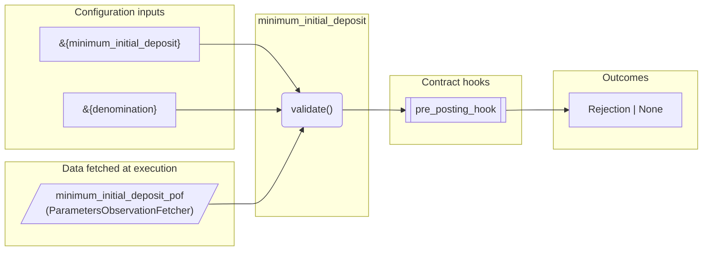
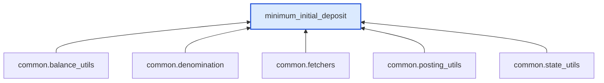

# Minimum Initial Deposit

> Generated by `python3 -m fl docs`. Curated prose comes from `feature_library/src/feature_library/deposit/transaction_limits/deposit_limits/minimum_initial_deposit.okf.yaml`; everything else is derived from the module source. Do not edit by hand.

| Property | Value |
|---|---|
| Module | `feature_library.deposit.transaction_limits.deposit_limits.minimum_initial_deposit` |
| Domain | deposit |
| Status | undeclared |
| Version | — |
| Hooks | `pre_posting_hook` |
| Source | `feature_library/src/feature_library/deposit/transaction_limits/deposit_limits/minimum_initial_deposit.py` |

## What it does

_Not yet described._

## Traceability: configuration to outcome

Every input below is a value a bank configures. The diagram shows which function consumes it and which hook turns it into an outcome.

## Inputs — parameters

| Reference | Meaning | Hierarchy level | Constraint | Required | CLU resource |
|---|---|---|---|---|---|
| `&{minimum_initial_deposit}` | Triggers pre-parameter change hook? No.  Optional? No. | — | decimal_constraint | required | `feature_library/src/feature_library/deposit/transaction_limits/deposit_limits/parameter_resource_defs/minimum_initial_deposit.resource.yaml` |
| `&{denomination}` | _undocumented_ | — | string_constraint | required | `feature_library/src/feature_library/common/parameter_resource_defs/denomination.resource.yaml` |

## Inputs — data fetched at execution

| Fetcher id | Type | Anchor | Filter |
|---|---|---|---|
| `minimum_initial_deposit_pof` | ParametersObservationFetcher | DefinedDateTime.EFFECTIVE_DATETIME | ParametersFilter(parameter_ids=[MIN_INITIAL_DEPOSIT_PARAM.id]) |

## Public API

| Function | Returns | Purpose |
|---|---|---|
| `get_parameters(vault, param_fetcher_id)` | `dict[str, datetime \| Decimal \| str \| None]` | Retrieves configuration parameters from a for the maximum balance limit feature. |
| `validate(state, postings, balance_fetcher_id, param_fetcher_id, denomination_param_id, minimum_initial_deposit_param_id)` | `Rejection \| None` | Reject the list of postings if their net affect does not meet the minimum initial deposit limit |

## Where it sits in the library

## Requirement traceability

_No business requirement is linked to this feature yet, so it cannot be traced back to a stated need._

## Products using it

_None. A feature that no product composes is not yet a proven building block._

## Testing

| Tier | Status | Test modules |
|---|---|---|
| Unit | yes | 1 |
| Simulation | yes | 1 |
| End-to-end | yes | 1 |

<!-- generated:end -->

## Authored notes

_Written by hand before this page was generated; kept verbatim._

# Minimum Initial Deposit

> Generated by `python3 -m fl docs`. Curated prose comes from `feature_library/src/feature_library/deposit/transaction_limits/deposit_limits/minimum_initial_deposit.okf.yaml`; everything else is derived from the module source. Do not edit by hand.

| Property | Value |
|---|---|
| Module | `feature_library.deposit.transaction_limits.deposit_limits.minimum_initial_deposit` |
| Domain | deposit |
| Status | undeclared |
| Version | — |
| Hooks | `pre_posting_hook` |
| Source | `feature_library/src/feature_library/deposit/transaction_limits/deposit_limits/minimum_initial_deposit.py` |

## What it does

_Not yet described._

## Traceability: configuration to outcome

Every input below is a value a bank configures. The diagram shows which function consumes it and which hook turns it into an outcome.

## Inputs — parameters

| Reference | Meaning | Hierarchy level | Constraint | Required | CLU resource |
|---|---|---|---|---|---|
| `&{minimum_initial_deposit}` | Triggers pre-parameter change hook? No.  Optional? No. | — | decimal_constraint | required | `feature_library/src/feature_library/deposit/transaction_limits/deposit_limits/parameter_resource_defs/minimum_initial_deposit.resource.yaml` |
| `&{denomination}` | _undocumented_ | — | string_constraint | required | `feature_library/src/feature_library/common/parameter_resource_defs/denomination.resource.yaml` |

## Inputs — data fetched at execution

| Fetcher id | Type | Anchor | Filter |
|---|---|---|---|
| `minimum_initial_deposit_pof` | ParametersObservationFetcher | DefinedDateTime.EFFECTIVE_DATETIME | ParametersFilter(parameter_ids=[MIN_INITIAL_DEPOSIT_PARAM.id]) |

## Public API

| Function | Returns | Purpose |
|---|---|---|
| `get_parameters(vault, param_fetcher_id)` | `dict[str, datetime \| Decimal \| str \| None]` | Retrieves configuration parameters from a for the maximum balance limit feature. |
| `validate(state, postings, balance_fetcher_id, param_fetcher_id, denomination_param_id, minimum_initial_deposit_param_id)` | `Rejection \| None` | Reject the list of postings if their net affect does not meet the minimum initial deposit limit |

## Where it sits in the library

## Requirement traceability

_No business requirement is linked to this feature yet, so it cannot be traced back to a stated need._

## Products using it

_None. A feature that no product composes is not yet a proven building block._

## Testing

| Tier | Status | Test modules |
|---|---|---|
| Unit | yes | 1 |
| Simulation | yes | 1 |
| End-to-end | yes | 1 |
