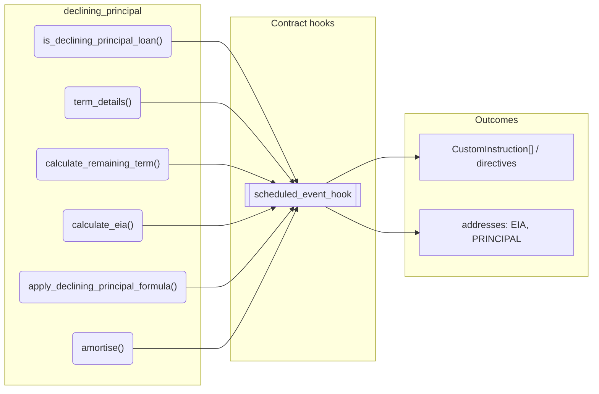

```mermaid
graph BT
  me_declining_principal["declining_principal"]:::self
  dep_common_application_precision["common.application_precision"] --> me_declining_principal
  dep_common_balance_utils["common.balance_utils"] --> me_declining_principal
  dep_common_denomination["common.denomination"] --> me_declining_principal
  dep_common_parameter_utils["common.parameter_utils"] --> me_declining_principal
  dep_common_state_utils["common.state_utils"] --> me_declining_principal
  dep_common_utils["common.utils"] --> me_declining_principal
  dep_lending_addresses["lending.addresses"] --> me_declining_principal
  dep_lending_amortisations_amortisation_methods["lending.amortisations.amortisation_methods"] --> me_declining_principal
  dep_lending_amortisations_eia["lending.amortisations.eia"] --> me_declining_principal
  dep_lending_interfaces["lending.interfaces"] --> me_declining_principal
  dep_lending_principal_principal["lending.principal.principal"] --> me_declining_principal
  dep_lending_term_term["lending.term.term"] --> me_declining_principal
  me_declining_principal --> use_lending_amortisations_amortisation_methods_minimum_repay["lending.amortisations.amortisation_methods.minimum_repayment"]
  me_declining_principal ==> prod_mortgage["mortgage"]:::product
  classDef self fill:#dbeafe,stroke:#1d4ed8,stroke-width:2px;
  classDef product fill:#dcfce7,stroke:#15803d,stroke-width:2px;
```

# Declining Principal

> Generated by `python3 -m fl docs`. Curated prose comes from `feature_library/src/feature_library/lending/amortisations/amortisation_methods/declining_principal.okf.yaml`; everything else is derived from the module source. Do not edit by hand.

| Property | Value |
|---|---|
| Module | `feature_library.lending.amortisations.amortisation_methods.declining_principal` |
| Domain | lending |
| Status | undeclared |
| Version | — |
| Hooks | `scheduled_event_hook` |
| Source | `feature_library/src/feature_library/lending/amortisations/amortisation_methods/declining_principal.py` |

## What it does

Declining principal feature.

## Traceability: configuration to outcome

Every input below is a value a bank configures. The diagram shows which function consumes it and which hook turns it into an outcome.

## Public API

| Function | Returns | Purpose |
|---|---|---|
| `is_declining_principal_loan(amortisation_method)` | `bool` | Return True if the amortisation_method is 'DECLINING_PRINCIPAL'. |
| `term_details(state, get_annual_interest_rate, use_expected_term, principal_adjustments, fetchers_config)` | `TermDetails` | Calculate the elapsed and remaining term for a loan. |
| `calculate_remaining_term(eia, remaining_principal, monthly_interest_rate, decimal_places, rounding)` | `int` | Calculate the remaining term using the amortisation formula. |
| `calculate_eia(state, get_annual_interest_rate, use_expected_term, principal_amount, principal_adjustments, fetchers_config)` | `Decimal` | Extract relevant data required and calculate declining principal EIA. |
| `apply_declining_principal_formula(remaining_principal, interest_rate, remaining_term, fulfillment_precision, lump_sum_amount)` | `Decimal` | Calculate the EIA according to the declining principal formula. |
| `amortise(state, get_annual_interest_rate, use_expected_term, principal_amount, principal_adjustments, event, eia_address, fetchers_config)` | `list[CustomInstruction]` | Amortise a loan by calculating EIA and creating a custom instruction. |

## Outputs

| Kind | Values | Notes |
|---|---|---|
| Balance addresses | `EIA`, `PRINCIPAL` | — |

## Composition points

Accepts: `PrincipalAdjustment`

## Where it sits in the library

## Requirement traceability

_No business requirement is linked to this feature yet, so it cannot be traced back to a stated need._

## Products using it

- `mortgage`

## Testing

| Tier | Status | Test modules |
|---|---|---|
| Unit | yes | 1 |
| Simulation | **missing** | 0 |
| End-to-end | **missing** | 0 |

<!-- generated:end -->

## Authored notes

_Written by hand before this page was generated; kept verbatim._

# Declining Principal

> Generated by `python3 -m fl docs`. Curated prose comes from `feature_library/src/feature_library/lending/amortisations/amortisation_methods/declining_principal.okf.yaml`; everything else is derived from the module source. Do not edit by hand.

| Property | Value |
|---|---|
| Module | `feature_library.lending.amortisations.amortisation_methods.declining_principal` |
| Domain | lending |
| Status | undeclared |
| Version | — |
| Hooks | `scheduled_event_hook` |
| Source | `feature_library/src/feature_library/lending/amortisations/amortisation_methods/declining_principal.py` |

## What it does

Declining principal feature.

## Traceability: configuration to outcome

Every input below is a value a bank configures. The diagram shows which function consumes it and which hook turns it into an outcome.

## Public API

| Function | Returns | Purpose |
|---|---|---|
| `is_declining_principal_loan(amortisation_method)` | `bool` | Return True if the amortisation_method is 'DECLINING_PRINCIPAL'. |
| `term_details(state, get_annual_interest_rate, use_expected_term, principal_adjustments, fetchers_config)` | `TermDetails` | Calculate the elapsed and remaining term for a loan. |
| `calculate_remaining_term(eia, remaining_principal, monthly_interest_rate, decimal_places, rounding)` | `int` | Calculate the remaining term using the amortisation formula. |
| `calculate_eia(state, get_annual_interest_rate, use_expected_term, principal_amount, principal_adjustments, fetchers_config)` | `Decimal` | Extract relevant data required and calculate declining principal EIA. |
| `apply_declining_principal_formula(remaining_principal, interest_rate, remaining_term, fulfillment_precision, lump_sum_amount)` | `Decimal` | Calculate the EIA according to the declining principal formula. |
| `amortise(state, get_annual_interest_rate, use_expected_term, principal_amount, principal_adjustments, event, eia_address, fetchers_config)` | `list[CustomInstruction]` | Amortise a loan by calculating EIA and creating a custom instruction. |

## Outputs

| Kind | Values | Notes |
|---|---|---|
| Balance addresses | `EIA`, `PRINCIPAL` | — |

## Composition points

Accepts: `PrincipalAdjustment`

## Where it sits in the library

## Requirement traceability

_No business requirement is linked to this feature yet, so it cannot be traced back to a stated need._

## Products using it

- `mortgage`

## Testing

| Tier | Status | Test modules |
|---|---|---|
| Unit | yes | 1 |
| Simulation | **missing** | 0 |
| End-to-end | **missing** | 0 |
