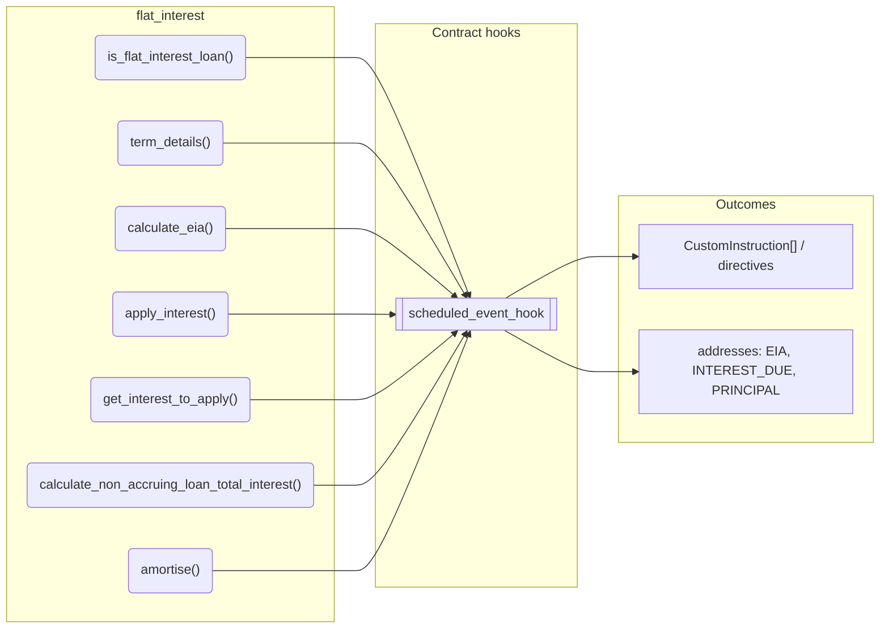

```mermaid
graph BT
  me_flat_interest["flat_interest"]:::self
  dep_common_application_precision["common.application_precision"] --> me_flat_interest
  dep_common_balance_utils["common.balance_utils"] --> me_flat_interest
  dep_common_denomination["common.denomination"] --> me_flat_interest
  dep_common_fees["common.fees"] --> me_flat_interest
  dep_common_parameter_utils["common.parameter_utils"] --> me_flat_interest
  dep_common_state_utils["common.state_utils"] --> me_flat_interest
  dep_common_utils["common.utils"] --> me_flat_interest
  dep_lending_addresses["lending.addresses"] --> me_flat_interest
  dep_lending_amortisations_amortisation_methods["lending.amortisations.amortisation_methods"] --> me_flat_interest
  dep_lending_amortisations_eia["lending.amortisations.eia"] --> me_flat_interest
  dep_lending_interest_interest_application["lending.interest.interest_application"] --> me_flat_interest
  dep_lending_interest_secondary_fixed_rate["lending.interest.secondary.fixed_rate"] --> me_flat_interest
  classDef self fill:#dbeafe,stroke:#1d4ed8,stroke-width:2px;
  classDef product fill:#dcfce7,stroke:#15803d,stroke-width:2px;
```

# Flat Interest

> Generated by `python3 -m fl docs`. Curated prose comes from `feature_library/src/feature_library/lending/amortisations/amortisation_methods/flat_interest.okf.yaml`; everything else is derived from the module source. Do not edit by hand.

| Property | Value |
|---|---|
| Module | `feature_library.lending.amortisations.amortisation_methods.flat_interest` |
| Domain | lending |
| Status | undeclared |
| Version | — |
| Hooks | `scheduled_event_hook` |
| Source | `feature_library/src/feature_library/lending/amortisations/amortisation_methods/flat_interest.py` |

## What it does

Flat interest feature.

## Traceability: configuration to outcome

Every input below is a value a bank configures. The diagram shows which function consumes it and which hook turns it into an outcome.

## Public API

| Function | Returns | Purpose |
|---|---|---|
| `is_flat_interest_loan(amortisation_method)` | `bool` | Return True if the amortisation_method is 'FLAT_INTEREST'. |
| `term_details(state, fetchers_config)` | `TermDetails` | Calculate the elapsed and remaining term for a loan. |
| `calculate_eia(state, get_annual_interest_rate, principal_amount, principal_adjustments, fetchers_config)` | `Decimal` | Calculate the EIA for a flat interest loan. |
| `apply_interest(state, previous_application_datetime, fetchers_config)` | `list[Posting]` | Create the postings needed to apply interest for a flat interest amortised loan. |
| `get_interest_to_apply(state, fetchers_config)` | `lending_interfaces.InterestAmounts` | Determine the interest amount for application using flat interest amortisation. |
| `calculate_non_accruing_loan_total_interest(original_principal, annual_interest_rate, total_term, precision)` | `Decimal` | Return the total loan interest for a flat interest loan. |
| `amortise(state, get_annual_interest_rate, principal_amount, principal_adjustments, event, eia_address, fetchers_config)` | `list[CustomInstruction]` | Amortise a loan by calculating EIA and creating a custom instruction. |

## Outputs

| Kind | Values | Notes |
|---|---|---|
| Balance addresses | `EIA`, `INTEREST_DUE`, `PRINCIPAL` | — |

## Composition points

Accepts: `PrincipalAdjustment`

## Where it sits in the library

## Requirement traceability

_No business requirement is linked to this feature yet, so it cannot be traced back to a stated need._

## Products using it

_None. A feature that no product composes is not yet a proven building block._

## Testing

| Tier | Status | Test modules |
|---|---|---|
| Unit | yes | 1 |
| Simulation | **missing** | 0 |
| End-to-end | **missing** | 0 |

<!-- generated:end -->

## Authored notes

_Written by hand before this page was generated; kept verbatim._

# Flat Interest

> Generated by `python3 -m fl docs`. Curated prose comes from `feature_library/src/feature_library/lending/amortisations/amortisation_methods/flat_interest.okf.yaml`; everything else is derived from the module source. Do not edit by hand.

| Property | Value |
|---|---|
| Module | `feature_library.lending.amortisations.amortisation_methods.flat_interest` |
| Domain | lending |
| Status | undeclared |
| Version | — |
| Hooks | `scheduled_event_hook` |
| Source | `feature_library/src/feature_library/lending/amortisations/amortisation_methods/flat_interest.py` |

## What it does

Flat interest feature.

## Traceability: configuration to outcome

Every input below is a value a bank configures. The diagram shows which function consumes it and which hook turns it into an outcome.

## Public API

| Function | Returns | Purpose |
|---|---|---|
| `is_flat_interest_loan(amortisation_method)` | `bool` | Return True if the amortisation_method is 'FLAT_INTEREST'. |
| `term_details(state, fetchers_config)` | `TermDetails` | Calculate the elapsed and remaining term for a loan. |
| `calculate_eia(state, get_annual_interest_rate, principal_amount, principal_adjustments, fetchers_config)` | `Decimal` | Calculate the EIA for a flat interest loan. |
| `apply_interest(state, previous_application_datetime, fetchers_config)` | `list[Posting]` | Create the postings needed to apply interest for a flat interest amortised loan. |
| `get_interest_to_apply(state, fetchers_config)` | `lending_interfaces.InterestAmounts` | Determine the interest amount for application using flat interest amortisation. |
| `calculate_non_accruing_loan_total_interest(original_principal, annual_interest_rate, total_term, precision)` | `Decimal` | Return the total loan interest for a flat interest loan. |
| `amortise(state, get_annual_interest_rate, principal_amount, principal_adjustments, event, eia_address, fetchers_config)` | `list[CustomInstruction]` | Amortise a loan by calculating EIA and creating a custom instruction. |

## Outputs

| Kind | Values | Notes |
|---|---|---|
| Balance addresses | `EIA`, `INTEREST_DUE`, `PRINCIPAL` | — |

## Composition points

Accepts: `PrincipalAdjustment`

## Where it sits in the library

## Requirement traceability

_No business requirement is linked to this feature yet, so it cannot be traced back to a stated need._

## Products using it

_None. A feature that no product composes is not yet a proven building block._

## Testing

| Tier | Status | Test modules |
|---|---|---|
| Unit | yes | 1 |
| Simulation | **missing** | 0 |
| End-to-end | **missing** | 0 |
