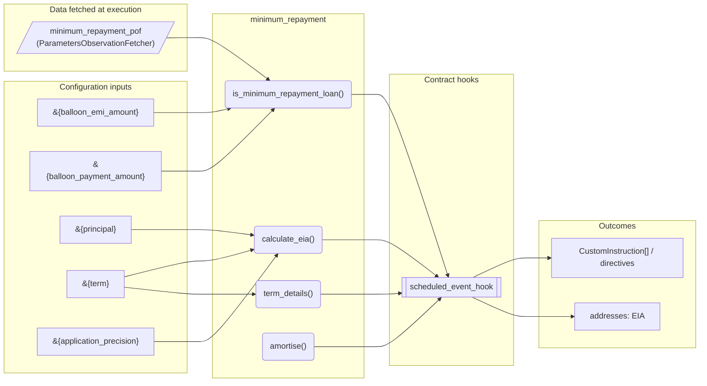

```mermaid
graph BT
  me_minimum_repayment["minimum_repayment"]:::self
  dep_common_application_precision["common.application_precision"] --> me_minimum_repayment
  dep_common_balance_utils["common.balance_utils"] --> me_minimum_repayment
  dep_common_denomination["common.denomination"] --> me_minimum_repayment
  dep_common_state_utils["common.state_utils"] --> me_minimum_repayment
  dep_lending_addresses["lending.addresses"] --> me_minimum_repayment
  dep_lending_amortisations_amortisation_methods["lending.amortisations.amortisation_methods"] --> me_minimum_repayment
  dep_lending_amortisations_amortisation_methods_declining_pri["lending.amortisations.amortisation_methods.declining_principal"] --> me_minimum_repayment
  dep_lending_amortisations_eia["lending.amortisations.eia"] --> me_minimum_repayment
  dep_lending_interfaces["lending.interfaces"] --> me_minimum_repayment
  dep_lending_principal_principal["lending.principal.principal"] --> me_minimum_repayment
  dep_lending_term_term["lending.term.term"] --> me_minimum_repayment
  classDef self fill:#dbeafe,stroke:#1d4ed8,stroke-width:2px;
  classDef product fill:#dcfce7,stroke:#15803d,stroke-width:2px;
```

# Minimum Repayment

> Generated by `python3 -m fl docs`. Curated prose comes from `feature_library/src/feature_library/lending/amortisations/amortisation_methods/minimum_repayment.okf.yaml`; everything else is derived from the module source. Do not edit by hand.

| Property | Value |
|---|---|
| Module | `feature_library.lending.amortisations.amortisation_methods.minimum_repayment` |
| Domain | lending |
| Status | undeclared |
| Version | — |
| Hooks | — |
| Source | `feature_library/src/feature_library/lending/amortisations/amortisation_methods/minimum_repayment.py` |

## What it does

Minimum repayment feature.

## Traceability: configuration to outcome

Every input below is a value a bank configures. The diagram shows which function consumes it and which hook turns it into an outcome.

## Inputs — parameters

| Reference | Meaning | Hierarchy level | Constraint | Required | CLU resource |
|---|---|---|---|---|---|
| `&{balloon_emi_amount}` | The fixed instalment the customer pays each period on a loan that ends with a balloon payment. When set, the balloon payment is derived from it; when zero, the instalment is derived from the balloon payment instead. Triggers pre-parameter change hook? No.  Optional? Yes. | — | decimal_constraint | required | `feature_library/src/feature_library/lending/amortisations/parameter_resource_defs/balloon_emi_amount.resource.yaml` |
| `&{balloon_payment_amount}` | The lump sum of principal deferred to the end of the loan term, payable with the final instalment. Defaults to zero, which amortises the loan fully over its term. Triggers pre-parameter change hook? No.  Optional? Yes. | — | decimal_constraint | required | `feature_library/src/feature_library/lending/amortisations/parameter_resource_defs/balloon_payment_amount.resource.yaml` |
| `&{principal}` | _undocumented_ | — | decimal_constraint | required | `feature_library/src/feature_library/lending/principal/parameter_resource_defs/principal.resource.yaml` |
| `&{term}` | _undocumented_ | — | decimal_constraint | required | `feature_library/src/feature_library/lending/term/parameter_resource_defs/term.resource.yaml` |
| `&{application_precision}` | _undocumented_ | — | decimal_constraint | required | `feature_library/src/feature_library/common/parameter_resource_defs/application_precision.resource.yaml` |

## Inputs — data fetched at execution

| Fetcher id | Type | Anchor | Filter |
|---|---|---|---|
| `minimum_repayment_pof` | ParametersObservationFetcher | DefinedDateTime.EFFECTIVE_DATETIME | ParametersFilter(parameter_ids=[p.id for p in expected_parameters]) |

## Public API

| Function | Returns | Purpose |
|---|---|---|
| `is_minimum_repayment_loan(amortisation_method)` | `bool` | Returns True if the amortisation_method is 'MINIMUM_REPAYMENT_WITH_BALLOON_PAYMENT'. |
| `calculate_eia(state, get_annual_interest_rate, principal_amount, principal_adjustments, fetchers_config)` | `Decimal` | Extract relevant data required and calculate minimum repayment EIA. |
| `term_details(state, fetchers_config)` | `TermDetails` | Calculate the elapsed and remaining term for a loan using a counter-based approach. |
| `amortise(state, get_annual_interest_rate, principal_amount, principal_adjustments, event, eia_address, fetchers_config)` | `list[CustomInstruction]` | Amortise a loan by calculating EIA and creating a custom instruction. |

## Outputs

| Kind | Values | Notes |
|---|---|---|
| Balance addresses | `EIA` | — |

## Composition points

Accepts: `PrincipalAdjustment`

## Where it sits in the library

## Requirement traceability

_No business requirement is linked to this feature yet, so it cannot be traced back to a stated need._

## Products using it

_None. A feature that no product composes is not yet a proven building block._

## Testing

| Tier | Status | Test modules |
|---|---|---|
| Unit | yes | 1 |
| Simulation | **missing** | 0 |
| End-to-end | **missing** | 0 |

<!-- generated:end -->

## Authored notes

_Written by hand before this page was generated; kept verbatim._

# Minimum Repayment

> Generated by `python3 -m fl docs`. Curated prose comes from `feature_library/src/feature_library/lending/amortisations/amortisation_methods/minimum_repayment.okf.yaml`; everything else is derived from the module source. Do not edit by hand.

| Property | Value |
|---|---|
| Module | `feature_library.lending.amortisations.amortisation_methods.minimum_repayment` |
| Domain | lending |
| Status | undeclared |
| Version | — |
| Hooks | — |
| Source | `feature_library/src/feature_library/lending/amortisations/amortisation_methods/minimum_repayment.py` |

## What it does

Minimum repayment feature.

## Traceability: configuration to outcome

Every input below is a value a bank configures. The diagram shows which function consumes it and which hook turns it into an outcome.

## Inputs — parameters

| Reference | Meaning | Hierarchy level | Constraint | Required | CLU resource |
|---|---|---|---|---|---|
| `&{balloon_emi_amount}` | The fixed instalment the customer pays each period on a loan that ends with a balloon payment. When set, the balloon payment is derived from it; when zero, the instalment is derived from the balloon payment instead. Triggers pre-parameter change hook? No.  Optional? Yes. | — | decimal_constraint | required | `feature_library/src/feature_library/lending/amortisations/parameter_resource_defs/balloon_emi_amount.resource.yaml` |
| `&{balloon_payment_amount}` | The lump sum of principal deferred to the end of the loan term, payable with the final instalment. Defaults to zero, which amortises the loan fully over its term. Triggers pre-parameter change hook? No.  Optional? Yes. | — | decimal_constraint | required | `feature_library/src/feature_library/lending/amortisations/parameter_resource_defs/balloon_payment_amount.resource.yaml` |
| `&{principal}` | _undocumented_ | — | decimal_constraint | required | `feature_library/src/feature_library/lending/principal/parameter_resource_defs/principal.resource.yaml` |
| `&{term}` | _undocumented_ | — | decimal_constraint | required | `feature_library/src/feature_library/lending/term/parameter_resource_defs/term.resource.yaml` |
| `&{application_precision}` | _undocumented_ | — | decimal_constraint | required | `feature_library/src/feature_library/common/parameter_resource_defs/application_precision.resource.yaml` |

## Inputs — data fetched at execution

| Fetcher id | Type | Anchor | Filter |
|---|---|---|---|
| `minimum_repayment_pof` | ParametersObservationFetcher | DefinedDateTime.EFFECTIVE_DATETIME | ParametersFilter(parameter_ids=[p.id for p in expected_parameters]) |

## Public API

| Function | Returns | Purpose |
|---|---|---|
| `is_minimum_repayment_loan(amortisation_method)` | `bool` | Returns True if the amortisation_method is 'MINIMUM_REPAYMENT_WITH_BALLOON_PAYMENT'. |
| `calculate_eia(state, get_annual_interest_rate, principal_amount, principal_adjustments, fetchers_config)` | `Decimal` | Extract relevant data required and calculate minimum repayment EIA. |
| `term_details(state, fetchers_config)` | `TermDetails` | Calculate the elapsed and remaining term for a loan using a counter-based approach. |
| `amortise(state, get_annual_interest_rate, principal_amount, principal_adjustments, event, eia_address, fetchers_config)` | `list[CustomInstruction]` | Amortise a loan by calculating EIA and creating a custom instruction. |

## Outputs

| Kind | Values | Notes |
|---|---|---|
| Balance addresses | `EIA` | — |

## Composition points

Accepts: `PrincipalAdjustment`

## Where it sits in the library

## Requirement traceability

_No business requirement is linked to this feature yet, so it cannot be traced back to a stated need._

## Products using it

_None. A feature that no product composes is not yet a proven building block._

## Testing

| Tier | Status | Test modules |
|---|---|---|
| Unit | yes | 1 |
| Simulation | **missing** | 0 |
| End-to-end | **missing** | 0 |
