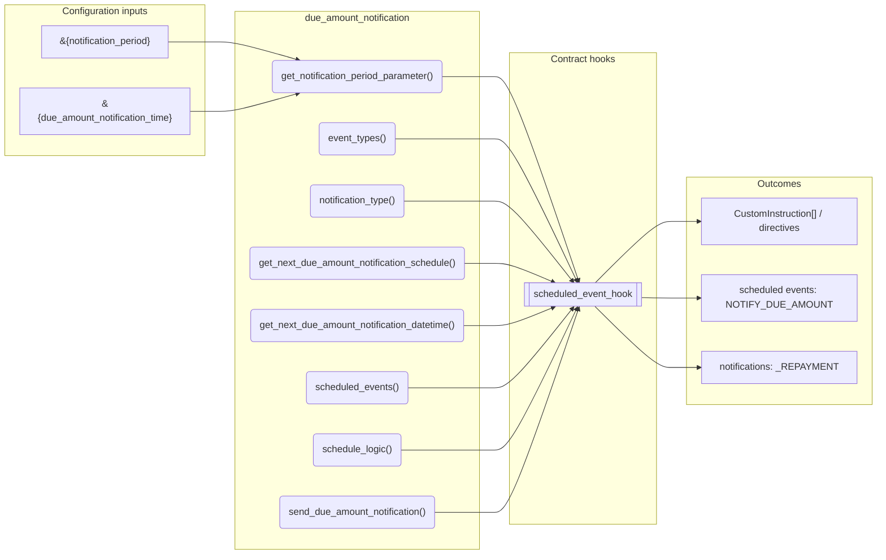
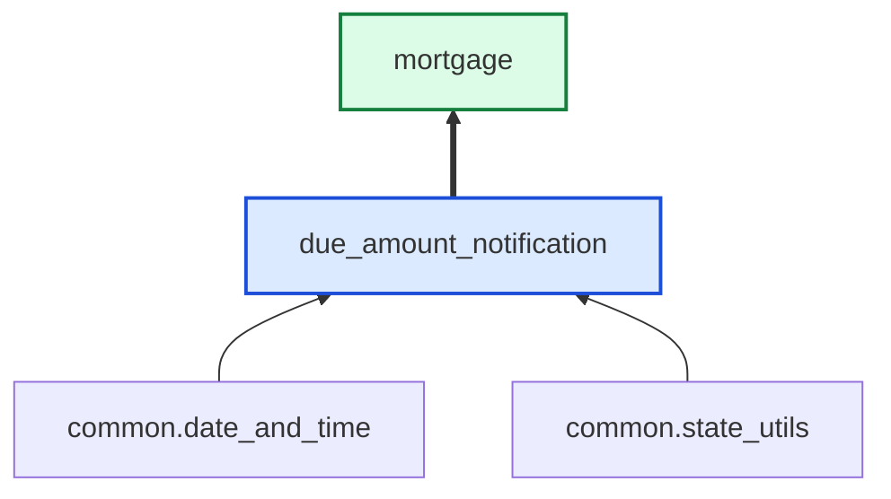

# Due Amount Notification

> Generated by `python3 -m fl docs`. Curated prose comes from `feature_library/src/feature_library/lending/amortisations/due_amount_notification.okf.yaml`; everything else is derived from the module source. Do not edit by hand.

| Property | Value |
|---|---|
| Module | `feature_library.lending.amortisations.due_amount_notification` |
| Domain | lending |
| Status | undeclared |
| Version | — |
| Hooks | `scheduled_event_hook` |
| Source | `feature_library/src/feature_library/lending/amortisations/due_amount_notification.py` |

## What it does

_Not yet described._

## Traceability: configuration to outcome

Every input below is a value a bank configures. The diagram shows which function consumes it and which hook turns it into an outcome.

## Inputs — parameters

| Reference | Meaning | Hierarchy level | Constraint | Required | CLU resource |
|---|---|---|---|---|---|
| `&{notification_period}` | _undocumented_ | — | decimal_constraint | required | `feature_library/src/feature_library/lending/amortisations/parameter_resource_defs/notification_period.resource.yaml` |
| `&{due_amount_notification_time}` | _undocumented_ | — | string_constraint | required | `feature_library/src/feature_library/lending/amortisations/parameter_resource_defs/due_amount_notification_time.resource.yaml` |

## Public API

| Function | Returns | Purpose |
|---|---|---|
| `get_notification_period_parameter(state)` | `int` | Retrieve the notification period parameter. |
| `event_types(product_name)` | `list[SmartContractEventType]` | Create event_types metadata for NOTIFY_DUE_AMOUNT schedule. |
| `notification_type(product_name)` | `str` | Create the notification type. |
| `get_next_due_amount_notification_schedule(state, next_due_amount_calc_datetime)` | `datetime` | Determine the next notification datetime based on schedule parameters. |
| `get_next_due_amount_notification_datetime(state, current_due_amount_notification_datetime, repayment_frequency_delta)` | `datetime` | Return the next due amount notification datetime given the current one. |
| `scheduled_events(state, next_due_amount_calc_datetime)` | `dict[str, ScheduledEvent]` | Create execution schedule for NOTIFY_DUE_AMOUNT. |
| `schedule_logic(state, product_name, overdue_datetime, due_interest, due_principal)` | `list[AccountNotificationDirective]` | Send notification prior to a payment becoming due. |
| `send_due_amount_notification(account_id, due_principal, due_interest, overdue_datetime, product_name)` | `AccountNotificationDirective` | Instruct a notification. |

## Outputs

| Kind | Values | Notes |
|---|---|---|
| Scheduled events | `NOTIFY_DUE_AMOUNT` | per-product factory |
| Notifications | `_REPAYMENT` | — |

## Where it sits in the library

## Requirement traceability

_No business requirement is linked to this feature yet, so it cannot be traced back to a stated need._

## Products using it

- `mortgage`

## Testing

| Tier | Status | Test modules |
|---|---|---|
| Unit | yes | 1 |
| Simulation | **missing** | 0 |
| End-to-end | **missing** | 0 |

<!-- generated:end -->

## Authored notes

_Written by hand before this page was generated; kept verbatim._

# Due Amount Notification

> Generated by `python3 -m fl docs`. Curated prose comes from `feature_library/src/feature_library/lending/amortisations/due_amount_notification.okf.yaml`; everything else is derived from the module source. Do not edit by hand.

| Property | Value |
|---|---|
| Module | `feature_library.lending.amortisations.due_amount_notification` |
| Domain | lending |
| Status | undeclared |
| Version | — |
| Hooks | `scheduled_event_hook` |
| Source | `feature_library/src/feature_library/lending/amortisations/due_amount_notification.py` |

## What it does

_Not yet described._

## Traceability: configuration to outcome

Every input below is a value a bank configures. The diagram shows which function consumes it and which hook turns it into an outcome.

## Inputs — parameters

| Reference | Meaning | Hierarchy level | Constraint | Required | CLU resource |
|---|---|---|---|---|---|
| `&{notification_period}` | _undocumented_ | — | decimal_constraint | required | `feature_library/src/feature_library/lending/amortisations/parameter_resource_defs/notification_period.resource.yaml` |
| `&{due_amount_notification_time}` | _undocumented_ | — | string_constraint | required | `feature_library/src/feature_library/lending/amortisations/parameter_resource_defs/due_amount_notification_time.resource.yaml` |

## Public API

| Function | Returns | Purpose |
|---|---|---|
| `get_notification_period_parameter(state)` | `int` | Retrieve the notification period parameter. |
| `event_types(product_name)` | `list[SmartContractEventType]` | Create event_types metadata for NOTIFY_DUE_AMOUNT schedule. |
| `notification_type(product_name)` | `str` | Create the notification type. |
| `get_next_due_amount_notification_schedule(state, next_due_amount_calc_datetime)` | `datetime` | Determine the next notification datetime based on schedule parameters. |
| `get_next_due_amount_notification_datetime(state, current_due_amount_notification_datetime, repayment_frequency_delta)` | `datetime` | Return the next due amount notification datetime given the current one. |
| `scheduled_events(state, next_due_amount_calc_datetime)` | `dict[str, ScheduledEvent]` | Create execution schedule for NOTIFY_DUE_AMOUNT. |
| `schedule_logic(state, product_name, overdue_datetime, due_interest, due_principal)` | `list[AccountNotificationDirective]` | Send notification prior to a payment becoming due. |
| `send_due_amount_notification(account_id, due_principal, due_interest, overdue_datetime, product_name)` | `AccountNotificationDirective` | Instruct a notification. |

## Outputs

| Kind | Values | Notes |
|---|---|---|
| Scheduled events | `NOTIFY_DUE_AMOUNT` | per-product factory |
| Notifications | `_REPAYMENT` | — |

## Where it sits in the library

## Requirement traceability

_No business requirement is linked to this feature yet, so it cannot be traced back to a stated need._

## Products using it

- `mortgage`

## Testing

| Tier | Status | Test modules |
|---|---|---|
| Unit | yes | 1 |
| Simulation | **missing** | 0 |
| End-to-end | **missing** | 0 |
