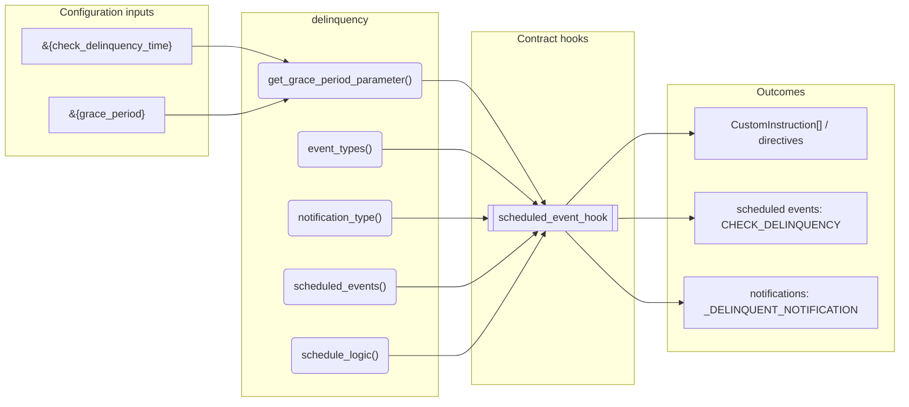
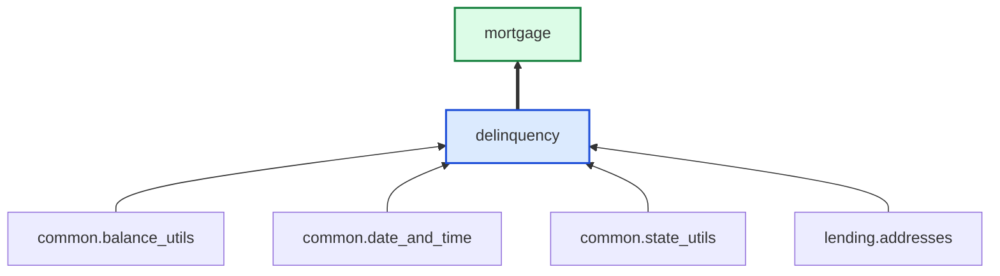

# Delinquency

> Generated by `python3 -m fl docs`. Curated prose comes from `feature_library/src/feature_library/lending/delinquency/delinquency.okf.yaml`; everything else is derived from the module source. Do not edit by hand.

| Property | Value |
|---|---|
| Module | `feature_library.lending.delinquency.delinquency` |
| Domain | lending |
| Status | undeclared |
| Version | — |
| Hooks | `scheduled_event_hook` |
| Source | `feature_library/src/feature_library/lending/delinquency/delinquency.py` |

## What it does

_Not yet described._

## Traceability: configuration to outcome

Every input below is a value a bank configures. The diagram shows which function consumes it and which hook turns it into an outcome.

## Inputs — parameters

| Reference | Meaning | Hierarchy level | Constraint | Required | CLU resource |
|---|---|---|---|---|---|
| `&{check_delinquency_time}` | _undocumented_ | — | string_constraint | required | `feature_library/src/feature_library/lending/delinquency/parameter_resource_defs/check_delinquency_time.resource.yaml` |
| `&{grace_period}` | The number of days from the account creation datetime when a user can make amendments to a deposit account without incurring any fees or penalties. | — | decimal_constraint | required | `feature_library/src/feature_library/deposit/temporal_features/parameter_resource_defs/grace_period.resource.yaml` |

## Public API

| Function | Returns | Purpose |
|---|---|---|
| `get_grace_period_parameter(state)` | `int` | Retrieve the grace period parameter. |
| `event_types(product_name)` | `list[SmartContractEventType]` | Return the event types for delinquency. |
| `notification_type(product_name)` | `str` | Create the notification type. |
| `scheduled_events(state, start_datetime, is_one_off, skip)` | `dict[str, ScheduledEvent]` | Create a check delinquency schedule starting at the specified date. |
| `schedule_logic(state, product_name, denomination, addresses)` | `list[AccountNotificationDirective]` | Instruct a notification to inform the customer of their account delinquency. |

## Outputs

| Kind | Values | Notes |
|---|---|---|
| Scheduled events | `CHECK_DELINQUENCY` | per-product factory |
| Notifications | `_DELINQUENT_NOTIFICATION` | — |

## Where it sits in the library

## Requirement traceability

_No business requirement is linked to this feature yet, so it cannot be traced back to a stated need._

## Products using it

- `mortgage`

## Testing

| Tier | Status | Test modules |
|---|---|---|
| Unit | yes | 1 |
| Simulation | **missing** | 0 |
| End-to-end | **missing** | 0 |

<!-- generated:end -->

## Authored notes

_Written by hand before this page was generated; kept verbatim._

# Delinquency

> Generated by `python3 -m fl docs`. Curated prose comes from `feature_library/src/feature_library/lending/delinquency/delinquency.okf.yaml`; everything else is derived from the module source. Do not edit by hand.

| Property | Value |
|---|---|
| Module | `feature_library.lending.delinquency.delinquency` |
| Domain | lending |
| Status | undeclared |
| Version | — |
| Hooks | `scheduled_event_hook` |
| Source | `feature_library/src/feature_library/lending/delinquency/delinquency.py` |

## What it does

_Not yet described._

## Traceability: configuration to outcome

Every input below is a value a bank configures. The diagram shows which function consumes it and which hook turns it into an outcome.

## Inputs — parameters

| Reference | Meaning | Hierarchy level | Constraint | Required | CLU resource |
|---|---|---|---|---|---|
| `&{check_delinquency_time}` | _undocumented_ | — | string_constraint | required | `feature_library/src/feature_library/lending/delinquency/parameter_resource_defs/check_delinquency_time.resource.yaml` |
| `&{grace_period}` | The number of days from the account creation datetime when a user can make amendments to a deposit account without incurring any fees or penalties. | — | decimal_constraint | required | `feature_library/src/feature_library/deposit/temporal_features/parameter_resource_defs/grace_period.resource.yaml` |

## Public API

| Function | Returns | Purpose |
|---|---|---|
| `get_grace_period_parameter(state)` | `int` | Retrieve the grace period parameter. |
| `event_types(product_name)` | `list[SmartContractEventType]` | Return the event types for delinquency. |
| `notification_type(product_name)` | `str` | Create the notification type. |
| `scheduled_events(state, start_datetime, is_one_off, skip)` | `dict[str, ScheduledEvent]` | Create a check delinquency schedule starting at the specified date. |
| `schedule_logic(state, product_name, denomination, addresses)` | `list[AccountNotificationDirective]` | Instruct a notification to inform the customer of their account delinquency. |

## Outputs

| Kind | Values | Notes |
|---|---|---|
| Scheduled events | `CHECK_DELINQUENCY` | per-product factory |
| Notifications | `_DELINQUENT_NOTIFICATION` | — |

## Where it sits in the library

## Requirement traceability

_No business requirement is linked to this feature yet, so it cannot be traced back to a stated need._

## Products using it

- `mortgage`

## Testing

| Tier | Status | Test modules |
|---|---|---|
| Unit | yes | 1 |
| Simulation | **missing** | 0 |
| End-to-end | **missing** | 0 |
