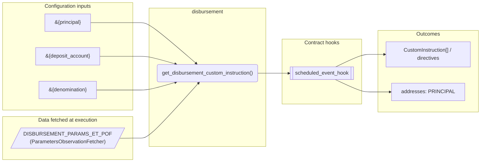
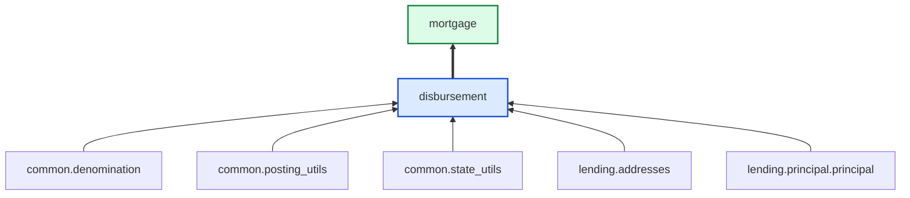
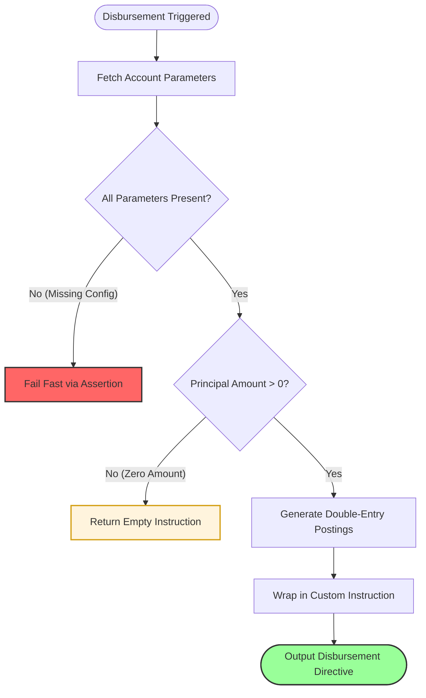
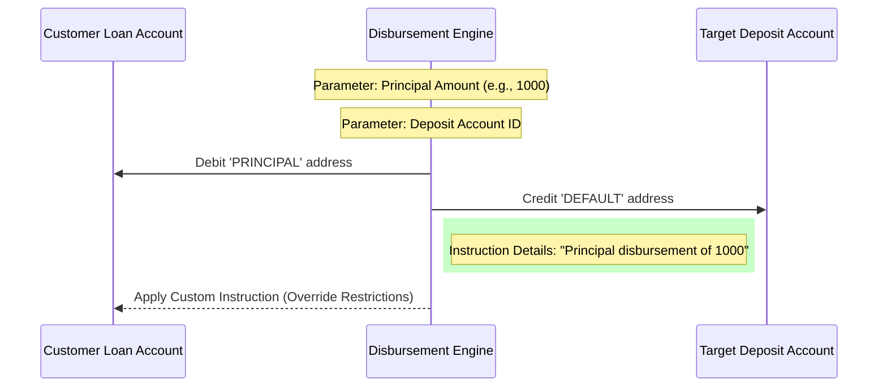

# Disbursement

> Generated by `python3 -m fl docs`. Curated prose comes from `feature_library/src/feature_library/lending/disbursal/disbursement.okf.yaml`; everything else is derived from the module source. Do not edit by hand.

| Property | Value |
|---|---|
| Module | `feature_library.lending.disbursal.disbursement` |
| Domain | lending |
| Status | undeclared |
| Version | — |
| Hooks | — |
| Source | `feature_library/src/feature_library/lending/disbursal/disbursement.py` |

## What it does

_Not yet described._

## Traceability: configuration to outcome

Every input below is a value a bank configures. The diagram shows which function consumes it and which hook turns it into an outcome.

## Inputs — parameters

| Reference | Meaning | Hierarchy level | Constraint | Required | CLU resource |
|---|---|---|---|---|---|
| `&{principal}` | _undocumented_ | — | decimal_constraint | required | `feature_library/src/feature_library/lending/principal/parameter_resource_defs/principal.resource.yaml` |
| `&{deposit_account}` | _undocumented_ | — | account_constraint | required | `feature_library/src/feature_library/lending/disbursal/parameter_resource_defs/deposit_account.resource.yaml` |
| `&{denomination}` | _undocumented_ | — | string_constraint | required | `feature_library/src/feature_library/common/parameter_resource_defs/denomination.resource.yaml` |

## Inputs — data fetched at execution

| Fetcher id | Type | Anchor | Filter |
|---|---|---|---|
| `DISBURSEMENT_PARAMS_ET_POF` | ParametersObservationFetcher | DefinedDateTime.EFFECTIVE_DATETIME | ParametersFilter(parameter_ids=[p.id for p in expected_parameters]) |

## Public API

| Function | Returns | Purpose |
|---|---|---|
| `get_parameters(vault, param_fetcher_id)` | `dict[str, str \| datetime \| Decimal \| None]` | Retrieves configuration parameters for the disbursement feature. |
| `get_disbursement_custom_instruction(state, fetchers_config, principal_address)` | `list[CustomInstruction]` | Create disbursement custom instruction. |

## Outputs

| Kind | Values | Notes |
|---|---|---|
| Balance addresses | `PRINCIPAL` | — |

## Where it sits in the library

## Requirement traceability

_No business requirement is linked to this feature yet, so it cannot be traced back to a stated need._

## Products using it

- `mortgage`

## Testing

| Tier | Status | Test modules |
|---|---|---|
| Unit | yes | 1 |
| Simulation | yes | 1 |
| End-to-end | yes | 1 |

<!-- generated:end -->

## Authored notes

_Written by hand before this page was generated; kept verbatim._

# Disbursement Feature Overview

The **Disbursement** feature is a specialized lending module designed to automate the transfer of loan funds (the "Principal") from the customer's loan account to a designated deposit account upon activation or a specific trigger.

---

### 1. The Core Architecture

The feature follows a structured processing path to ensure funds are moved accurately and safely.

#### A. Decision Logic (Flowchart)
This flowchart shows how the system evaluates parameters before authorizing the fund transfer.

#### B. System Interaction (Sequence Diagram)
This diagram illustrates the flow of data and funds between the Loan Account and the Deposit Account.

---

### 2. Business Logic Summary

| Decision Toggle / Parameter | Business Rule | Impact on Outcome |
| :--- | :--- | :--- |
| **Principal Amount** | The total loan amount to be disbursed. | If $> 0$, triggers a transfer. If $0$, no funds move. |
| **Deposit Account** | The destination account for the funds. | Dictates where the customer receives their loan. |
| **Override Restrictions** | Set to `True`. | Ensures disbursement succeeds even if the account has standard withdrawal limits. |
| **Event Metadata** | Labeled as `PRINCIPAL_DISBURSEMENT`. | Provides a clear audit trail for the transaction. |

---

### 3. Appendix: Technical Logic Trace (AST Mapping)

To ensure high-fidelity execution, the logic trace follows these specific "forks":

1.  **Configuration Integrity Check**: The code uses `check_parameters_exist`. If any required configuration (Principal, Deposit Account, or Currency) is missing, the system terminates the process immediately to prevent incorrect fund movement.
2.  **Zero-Amount Filter**: The logic utilizes `posting_utils.create_postings`. If the principal is zero, the utility returns an empty list, and the entry-point function returns `[]`. This prevents the creation of "empty" transactions that would clutter the ledger.
3.  **Double-Entry Enforcement**: The transfer is atomic; it strictly debits the loan account's `PRINCIPAL` address and credits the target's `DEFAULT` address in a single `CustomInstruction`.
