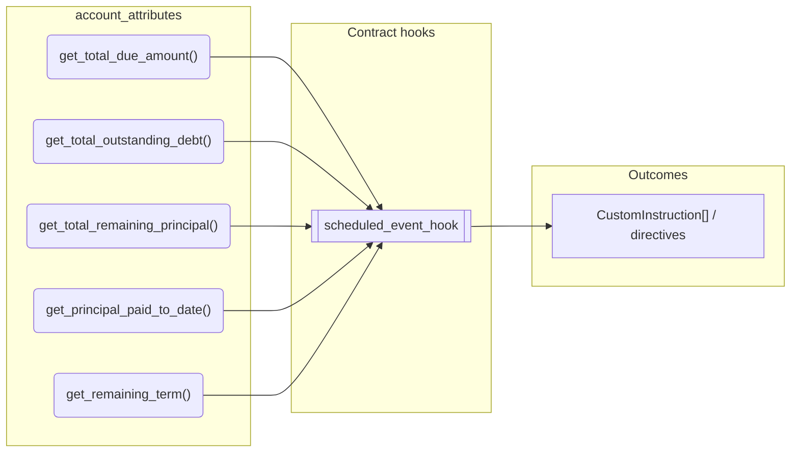
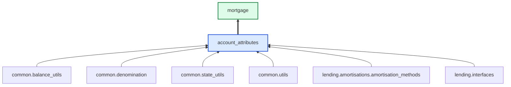

# Account Attributes

> Generated by `python3 -m fl docs`. Curated prose comes from `feature_library/src/feature_library/lending/account_attributes.okf.yaml`; everything else is derived from the module source. Do not edit by hand.

| Property | Value |
|---|---|
| Module | `feature_library.lending.account_attributes` |
| Domain | lending |
| Status | undeclared |
| Version | — |
| Hooks | — |
| Source | `feature_library/src/feature_library/lending/account_attributes.py` |

## What it does

_Not yet described._

## Traceability: configuration to outcome

Every input below is a value a bank configures. The diagram shows which function consumes it and which hook turns it into an outcome.

## Public API

| Function | Returns | Purpose |
|---|---|---|
| `get_total_due_amount(state, due_addresses, fetchers_config)` | `Decimal` | Sums the balances across all due addresses. |
| `get_total_outstanding_debt(state, debt_addresses, fetchers_config)` | `Decimal` | Sums the balances across all outstanding debt addresses. |
| `get_total_remaining_principal(state, principal_addresses, fetchers_config)` | `Decimal` | Sums the balances across all principal addresses. |
| `get_principal_paid_to_date(state, original_principal, principal_addresses, fetchers_config)` | `Decimal` | Returns the amount of the original principal paid off. |
| `get_remaining_term(state, term_details_feature, get_annual_interest_rate, principal_adjustments, use_expected_term)` | `int` | Returns the remaining term. |

## Composition points

Accepts: `PrincipalAdjustment`

## Where it sits in the library

## Requirement traceability

_No business requirement is linked to this feature yet, so it cannot be traced back to a stated need._

## Products using it

- `mortgage`

## Testing

| Tier | Status | Test modules |
|---|---|---|
| Unit | yes | 1 |
| Simulation | **missing** | 0 |
| End-to-end | **missing** | 0 |

<!-- generated:end -->

## Authored notes

_Written by hand before this page was generated; kept verbatim._

# Account Attributes

> Generated by `python3 -m fl docs`. Curated prose comes from `feature_library/src/feature_library/lending/account_attributes.okf.yaml`; everything else is derived from the module source. Do not edit by hand.

| Property | Value |
|---|---|
| Module | `feature_library.lending.account_attributes` |
| Domain | lending |
| Status | undeclared |
| Version | — |
| Hooks | — |
| Source | `feature_library/src/feature_library/lending/account_attributes.py` |

## What it does

_Not yet described._

## Traceability: configuration to outcome

Every input below is a value a bank configures. The diagram shows which function consumes it and which hook turns it into an outcome.

## Public API

| Function | Returns | Purpose |
|---|---|---|
| `get_total_due_amount(state, due_addresses, fetchers_config)` | `Decimal` | Sums the balances across all due addresses. |
| `get_total_outstanding_debt(state, debt_addresses, fetchers_config)` | `Decimal` | Sums the balances across all outstanding debt addresses. |
| `get_total_remaining_principal(state, principal_addresses, fetchers_config)` | `Decimal` | Sums the balances across all principal addresses. |
| `get_principal_paid_to_date(state, original_principal, principal_addresses, fetchers_config)` | `Decimal` | Returns the amount of the original principal paid off. |
| `get_remaining_term(state, term_details_feature, get_annual_interest_rate, principal_adjustments, use_expected_term)` | `int` | Returns the remaining term. |

## Composition points

Accepts: `PrincipalAdjustment`

## Where it sits in the library

## Requirement traceability

_No business requirement is linked to this feature yet, so it cannot be traced back to a stated need._

## Products using it

- `mortgage`

## Testing

| Tier | Status | Test modules |
|---|---|---|
| Unit | yes | 1 |
| Simulation | **missing** | 0 |
| End-to-end | **missing** | 0 |
