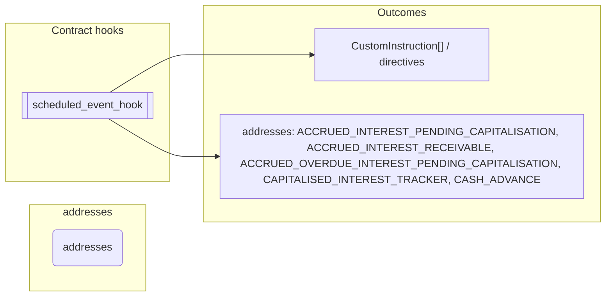

```mermaid
graph BT
  me_addresses["addresses"]:::self
  dep_common_addresses["common.addresses"] --> me_addresses
  me_addresses --> use_lending_amortisations_amortisation_methods_declining_pri["lending.amortisations.amortisation_methods.declining_principal"]
  me_addresses --> use_lending_amortisations_amortisation_methods_flat_interest["lending.amortisations.amortisation_methods.flat_interest"]
  me_addresses --> use_lending_amortisations_amortisation_methods_interest_only["lending.amortisations.amortisation_methods.interest_only"]
  me_addresses --> use_lending_amortisations_amortisation_methods_minimum_repay["lending.amortisations.amortisation_methods.minimum_repayment"]
  me_addresses --> use_lending_amortisations_amortisation_methods_no_repayment["lending.amortisations.amortisation_methods.no_repayment"]
  me_addresses --> use_lending_amortisations_amortisation_methods_rule_of_78["lending.amortisations.amortisation_methods.rule_of_78"]
  me_addresses --> use_lending_amortisations_eia["lending.amortisations.eia"]
  me_addresses --> use_lending_closure_close_loan["lending.closure.close_loan"]
  me_addresses --> use_lending_delinquency_delinquency["lending.delinquency.delinquency"]
  me_addresses --> use_lending_disbursal_disbursement["lending.disbursal.disbursement"]
  me_addresses --> use_lending_fees_annual_fee["lending.fees.annual_fee"]
  me_addresses --> use_lending_fees_cash_advance_fee["lending.fees.cash_advance_fee"]
  classDef self fill:#dbeafe,stroke:#1d4ed8,stroke-width:2px;
  classDef product fill:#dcfce7,stroke:#15803d,stroke-width:2px;
```

# Addresses

> Generated by `python3 -m fl docs`. Curated prose comes from `feature_library/src/feature_library/lending/addresses.okf.yaml`; everything else is derived from the module source. Do not edit by hand.

| Property | Value |
|---|---|
| Module | `feature_library.lending.addresses` |
| Domain | lending |
| Status | undeclared |
| Version | — |
| Hooks | — |
| Source | `feature_library/src/feature_library/lending/addresses.py` |

## What it does

_Not yet described._

## Traceability: configuration to outcome

Every input below is a value a bank configures. The diagram shows which function consumes it and which hook turns it into an outcome.

## Outputs

| Kind | Values | Notes |
|---|---|---|
| Balance addresses | `ACCRUED_INTEREST_PENDING_CAPITALISATION`, `ACCRUED_INTEREST_RECEIVABLE`, `ACCRUED_OVERDUE_INTEREST_PENDING_CAPITALISATION`, `CAPITALISED_INTEREST_TRACKER`, `CASH_ADVANCE`, `EIA`, `FEES`, `INTEREST_ACCRUED_CASH_ADVANCE`, `INTEREST_ACCRUED_PURCHASE`, `INTEREST_CHARGED`, `INTEREST_DUE`, `INTEREST_OVERDUE`, `MINIMUM_PAYMENT_DUE_TRACKER`, `PRINCIPAL`, `PRINCIPAL_DUE`, `PRINCIPAL_OVERDUE`, `PURCHASE`, `REWARDS_POINTS`, `STATEMENT_BALANCE_TRACKER`, `TERM_COUNTER`, `TOTAL_REPAYMENTS_TRACKER`, `WELCOME_BONUS_SPEND_TRACKER` | — |

## Where it sits in the library

## Requirement traceability

_No business requirement is linked to this feature yet, so it cannot be traced back to a stated need._

## Products using it

_None. A feature that no product composes is not yet a proven building block._

## Testing

| Tier | Status | Test modules |
|---|---|---|
| Unit | yes | 21 |
| Simulation | yes | 8 |
| End-to-end | yes | 4 |

<!-- generated:end -->

## Authored notes

_Written by hand before this page was generated; kept verbatim._

# Addresses

> Generated by `python3 -m fl docs`. Curated prose comes from `feature_library/src/feature_library/lending/addresses.okf.yaml`; everything else is derived from the module source. Do not edit by hand.

| Property | Value |
|---|---|
| Module | `feature_library.lending.addresses` |
| Domain | lending |
| Status | undeclared |
| Version | — |
| Hooks | — |
| Source | `feature_library/src/feature_library/lending/addresses.py` |

## What it does

_Not yet described._

## Traceability: configuration to outcome

Every input below is a value a bank configures. The diagram shows which function consumes it and which hook turns it into an outcome.

## Outputs

| Kind | Values | Notes |
|---|---|---|
| Balance addresses | `ACCRUED_INTEREST_PENDING_CAPITALISATION`, `ACCRUED_INTEREST_RECEIVABLE`, `ACCRUED_OVERDUE_INTEREST_PENDING_CAPITALISATION`, `CAPITALISED_INTEREST_TRACKER`, `CASH_ADVANCE`, `EIA`, `FEES`, `INTEREST_ACCRUED_CASH_ADVANCE`, `INTEREST_ACCRUED_PURCHASE`, `INTEREST_CHARGED`, `INTEREST_DUE`, `INTEREST_OVERDUE`, `MINIMUM_PAYMENT_DUE_TRACKER`, `PRINCIPAL`, `PRINCIPAL_DUE`, `PRINCIPAL_OVERDUE`, `PURCHASE`, `REWARDS_POINTS`, `STATEMENT_BALANCE_TRACKER`, `TERM_COUNTER`, `TOTAL_REPAYMENTS_TRACKER`, `WELCOME_BONUS_SPEND_TRACKER` | — |

## Where it sits in the library

## Requirement traceability

_No business requirement is linked to this feature yet, so it cannot be traced back to a stated need._

## Products using it

_None. A feature that no product composes is not yet a proven building block._

## Testing

| Tier | Status | Test modules |
|---|---|---|
| Unit | yes | 21 |
| Simulation | yes | 8 |
| End-to-end | yes | 4 |
