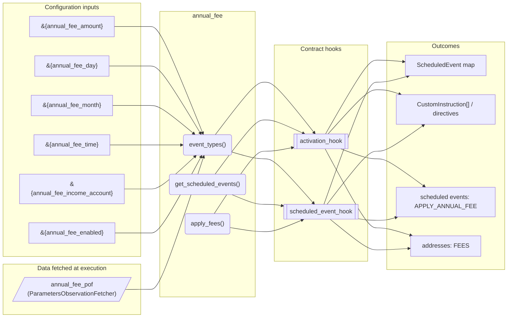
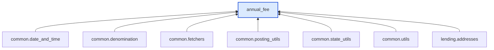

# Annual Fee

> Generated by `python3 -m fl docs`. Curated prose comes from `feature_library/src/feature_library/lending/fees/annual_fee.okf.yaml`; everything else is derived from the module source. Do not edit by hand.

| Property | Value |
|---|---|
| Module | `feature_library.lending.fees.annual_fee` |
| Domain | lending |
| Status | undeclared |
| Version | — |
| Hooks | `activation_hook`, `scheduled_event_hook` |
| Source | `feature_library/src/feature_library/lending/fees/annual_fee.py` |

## What it does

_Not yet described._

## Traceability: configuration to outcome

Every input below is a value a bank configures. The diagram shows which function consumes it and which hook turns it into an outcome.

## Inputs — parameters

| Reference | Meaning | Hierarchy level | Constraint | Required | CLU resource |
|---|---|---|---|---|---|
| `&{annual_fee_amount}` | Annual fee amount charged to the credit card account. | — | decimal_constraint | required | `feature_library/src/feature_library/lending/fees/parameter_resource_defs/annual_fee_amount.resource.yaml` |
| `&{annual_fee_day}` | Day of month when the annual fee is applied. | — | decimal_constraint | required | `feature_library/src/feature_library/lending/fees/parameter_resource_defs/annual_fee_day.resource.yaml` |
| `&{annual_fee_month}` | Month when the annual fee is applied. | — | decimal_constraint | required | `feature_library/src/feature_library/lending/fees/parameter_resource_defs/annual_fee_month.resource.yaml` |
| `&{annual_fee_time}` | Time of day when the annual fee is applied. Format: HH:MM:SS. | — | string_constraint | required | `feature_library/src/feature_library/lending/fees/parameter_resource_defs/annual_fee_time.resource.yaml` |
| `&{annual_fee_income_account}` | Internal account for annual fee income. | — | account_constraint | required | `feature_library/src/feature_library/lending/fees/parameter_resource_defs/annual_fee_income_account.resource.yaml` |
| `&{annual_fee_enabled}` | Whether the annual fee is enabled. | — | enumeration_constraint | required | `feature_library/src/feature_library/lending/fees/parameter_resource_defs/annual_fee_enabled.resource.yaml` |

## Inputs — data fetched at execution

| Fetcher id | Type | Anchor | Filter |
|---|---|---|---|
| `annual_fee_pof` | ParametersObservationFetcher | DefinedDateTime.EFFECTIVE_DATETIME | ParametersFilter(parameter_ids=[p.id for p in expected_parameters]) |

## Public API

| Function | Returns | Purpose |
|---|---|---|
| `event_types(product_name)` | `list[SmartContractEventType]` | Return the event types for the annual fee feature. |
| `get_parameters(vault, param_fetcher_id)` | `dict[str, datetime \| Decimal \| str \| None]` | Retrieves configuration parameters for the annual fee feature. |
| `get_scheduled_events(state, fetchers_config)` | `dict[str, ScheduledEvent]` | Get scheduled event for annual fee application. |
| `apply_fees(state, account_type, fetchers_config)` | `list[CustomInstruction]` | Applies the annual fee if enabled. |

## Outputs

| Kind | Values | Notes |
|---|---|---|
| Scheduled events | `APPLY_ANNUAL_FEE` | per-product factory |
| Balance addresses | `FEES` | — |

## Where it sits in the library

## Requirement traceability

_No business requirement is linked to this feature yet, so it cannot be traced back to a stated need._

## Products using it

_None. A feature that no product composes is not yet a proven building block._

## Testing

| Tier | Status | Test modules |
|---|---|---|
| Unit | yes | 1 |
| Simulation | **missing** | 0 |
| End-to-end | **missing** | 0 |

<!-- generated:end -->

## Authored notes

_Written by hand before this page was generated; kept verbatim._

# Annual Fee

> Generated by `python3 -m fl docs`. Curated prose comes from `feature_library/src/feature_library/lending/fees/annual_fee.okf.yaml`; everything else is derived from the module source. Do not edit by hand.

| Property | Value |
|---|---|
| Module | `feature_library.lending.fees.annual_fee` |
| Domain | lending |
| Status | undeclared |
| Version | — |
| Hooks | `activation_hook`, `scheduled_event_hook` |
| Source | `feature_library/src/feature_library/lending/fees/annual_fee.py` |

## What it does

_Not yet described._

## Traceability: configuration to outcome

Every input below is a value a bank configures. The diagram shows which function consumes it and which hook turns it into an outcome.

## Inputs — parameters

| Reference | Meaning | Hierarchy level | Constraint | Required | CLU resource |
|---|---|---|---|---|---|
| `&{annual_fee_amount}` | Annual fee amount charged to the credit card account. | — | decimal_constraint | required | `feature_library/src/feature_library/lending/fees/parameter_resource_defs/annual_fee_amount.resource.yaml` |
| `&{annual_fee_day}` | Day of month when the annual fee is applied. | — | decimal_constraint | required | `feature_library/src/feature_library/lending/fees/parameter_resource_defs/annual_fee_day.resource.yaml` |
| `&{annual_fee_month}` | Month when the annual fee is applied. | — | decimal_constraint | required | `feature_library/src/feature_library/lending/fees/parameter_resource_defs/annual_fee_month.resource.yaml` |
| `&{annual_fee_time}` | Time of day when the annual fee is applied. Format: HH:MM:SS. | — | string_constraint | required | `feature_library/src/feature_library/lending/fees/parameter_resource_defs/annual_fee_time.resource.yaml` |
| `&{annual_fee_income_account}` | Internal account for annual fee income. | — | account_constraint | required | `feature_library/src/feature_library/lending/fees/parameter_resource_defs/annual_fee_income_account.resource.yaml` |
| `&{annual_fee_enabled}` | Whether the annual fee is enabled. | — | enumeration_constraint | required | `feature_library/src/feature_library/lending/fees/parameter_resource_defs/annual_fee_enabled.resource.yaml` |

## Inputs — data fetched at execution

| Fetcher id | Type | Anchor | Filter |
|---|---|---|---|
| `annual_fee_pof` | ParametersObservationFetcher | DefinedDateTime.EFFECTIVE_DATETIME | ParametersFilter(parameter_ids=[p.id for p in expected_parameters]) |

## Public API

| Function | Returns | Purpose |
|---|---|---|
| `event_types(product_name)` | `list[SmartContractEventType]` | Return the event types for the annual fee feature. |
| `get_parameters(vault, param_fetcher_id)` | `dict[str, datetime \| Decimal \| str \| None]` | Retrieves configuration parameters for the annual fee feature. |
| `get_scheduled_events(state, fetchers_config)` | `dict[str, ScheduledEvent]` | Get scheduled event for annual fee application. |
| `apply_fees(state, account_type, fetchers_config)` | `list[CustomInstruction]` | Applies the annual fee if enabled. |

## Outputs

| Kind | Values | Notes |
|---|---|---|
| Scheduled events | `APPLY_ANNUAL_FEE` | per-product factory |
| Balance addresses | `FEES` | — |

## Where it sits in the library

## Requirement traceability

_No business requirement is linked to this feature yet, so it cannot be traced back to a stated need._

## Products using it

_None. A feature that no product composes is not yet a proven building block._

## Testing

| Tier | Status | Test modules |
|---|---|---|
| Unit | yes | 1 |
| Simulation | **missing** | 0 |
| End-to-end | **missing** | 0 |
