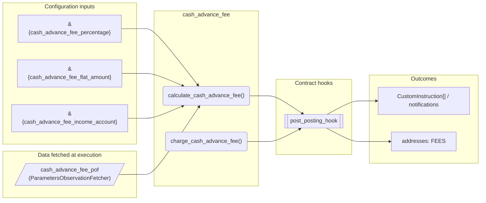
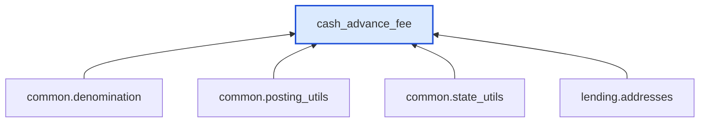

# Cash Advance Fee

> Generated by `python3 -m fl docs`. Curated prose comes from `feature_library/src/feature_library/lending/fees/cash_advance_fee.okf.yaml`; everything else is derived from the module source. Do not edit by hand.

| Property | Value |
|---|---|
| Module | `feature_library.lending.fees.cash_advance_fee` |
| Domain | lending |
| Status | undeclared |
| Version | — |
| Hooks | `post_posting_hook` |
| Source | `feature_library/src/feature_library/lending/fees/cash_advance_fee.py` |

## What it does

_Not yet described._

## Traceability: configuration to outcome

Every input below is a value a bank configures. The diagram shows which function consumes it and which hook turns it into an outcome.

## Inputs — parameters

| Reference | Meaning | Hierarchy level | Constraint | Required | CLU resource |
|---|---|---|---|---|---|
| `&{cash_advance_fee_percentage}` | Cash advance fee as a percentage of the transaction amount (e.g. 0.03 for 3%). | — | decimal_constraint | required | `feature_library/src/feature_library/lending/fees/parameter_resource_defs/cash_advance_fee_percentage.resource.yaml` |
| `&{cash_advance_fee_flat_amount}` | Minimum flat fee for cash advance transactions. | — | decimal_constraint | required | `feature_library/src/feature_library/lending/fees/parameter_resource_defs/cash_advance_fee_flat_amount.resource.yaml` |
| `&{cash_advance_fee_income_account}` | Internal account to receive cash advance fee income. | — | account_constraint | required | `feature_library/src/feature_library/lending/fees/parameter_resource_defs/cash_advance_fee_income_account.resource.yaml` |

## Inputs — data fetched at execution

| Fetcher id | Type | Anchor | Filter |
|---|---|---|---|
| `cash_advance_fee_pof` | ParametersObservationFetcher | DefinedDateTime.LIVE | ParametersFilter(parameter_ids=[p.id for p in expected_parameters]) |

## Public API

| Function | Returns | Purpose |
|---|---|---|
| `get_parameters(vault, param_fetcher_id)` | `dict[str, datetime \| Decimal \| str \| None]` | Get cash advance fee parameters from vault fetcher. |
| `calculate_cash_advance_fee(amount, percentage, flat_amount)` | `Decimal` | Calculates cash advance fee as max(amount * percentage, flat_amount). |
| `charge_cash_advance_fee(state, transaction_amount, account_type, fetchers_config)` | `list[CustomInstruction]` | Charges a cash advance fee on a cash advance transaction (post_posting_hook). |

## Outputs

| Kind | Values | Notes |
|---|---|---|
| Balance addresses | `FEES` | — |

## Where it sits in the library

## Requirement traceability

_No business requirement is linked to this feature yet, so it cannot be traced back to a stated need._

## Products using it

_None. A feature that no product composes is not yet a proven building block._

## Testing

| Tier | Status | Test modules |
|---|---|---|
| Unit | yes | 1 |
| Simulation | **missing** | 0 |
| End-to-end | **missing** | 0 |

<!-- generated:end -->

## Authored notes

_Written by hand before this page was generated; kept verbatim._

# Cash Advance Fee

> Generated by `python3 -m fl docs`. Curated prose comes from `feature_library/src/feature_library/lending/fees/cash_advance_fee.okf.yaml`; everything else is derived from the module source. Do not edit by hand.

| Property | Value |
|---|---|
| Module | `feature_library.lending.fees.cash_advance_fee` |
| Domain | lending |
| Status | undeclared |
| Version | — |
| Hooks | `post_posting_hook` |
| Source | `feature_library/src/feature_library/lending/fees/cash_advance_fee.py` |

## What it does

_Not yet described._

## Traceability: configuration to outcome

Every input below is a value a bank configures. The diagram shows which function consumes it and which hook turns it into an outcome.

## Inputs — parameters

| Reference | Meaning | Hierarchy level | Constraint | Required | CLU resource |
|---|---|---|---|---|---|
| `&{cash_advance_fee_percentage}` | Cash advance fee as a percentage of the transaction amount (e.g. 0.03 for 3%). | — | decimal_constraint | required | `feature_library/src/feature_library/lending/fees/parameter_resource_defs/cash_advance_fee_percentage.resource.yaml` |
| `&{cash_advance_fee_flat_amount}` | Minimum flat fee for cash advance transactions. | — | decimal_constraint | required | `feature_library/src/feature_library/lending/fees/parameter_resource_defs/cash_advance_fee_flat_amount.resource.yaml` |
| `&{cash_advance_fee_income_account}` | Internal account to receive cash advance fee income. | — | account_constraint | required | `feature_library/src/feature_library/lending/fees/parameter_resource_defs/cash_advance_fee_income_account.resource.yaml` |

## Inputs — data fetched at execution

| Fetcher id | Type | Anchor | Filter |
|---|---|---|---|
| `cash_advance_fee_pof` | ParametersObservationFetcher | DefinedDateTime.LIVE | ParametersFilter(parameter_ids=[p.id for p in expected_parameters]) |

## Public API

| Function | Returns | Purpose |
|---|---|---|
| `get_parameters(vault, param_fetcher_id)` | `dict[str, datetime \| Decimal \| str \| None]` | Get cash advance fee parameters from vault fetcher. |
| `calculate_cash_advance_fee(amount, percentage, flat_amount)` | `Decimal` | Calculates cash advance fee as max(amount * percentage, flat_amount). |
| `charge_cash_advance_fee(state, transaction_amount, account_type, fetchers_config)` | `list[CustomInstruction]` | Charges a cash advance fee on a cash advance transaction (post_posting_hook). |

## Outputs

| Kind | Values | Notes |
|---|---|---|
| Balance addresses | `FEES` | — |

## Where it sits in the library

## Requirement traceability

_No business requirement is linked to this feature yet, so it cannot be traced back to a stated need._

## Products using it

_None. A feature that no product composes is not yet a proven building block._

## Testing

| Tier | Status | Test modules |
|---|---|---|
| Unit | yes | 1 |
| Simulation | **missing** | 0 |
| End-to-end | **missing** | 0 |
