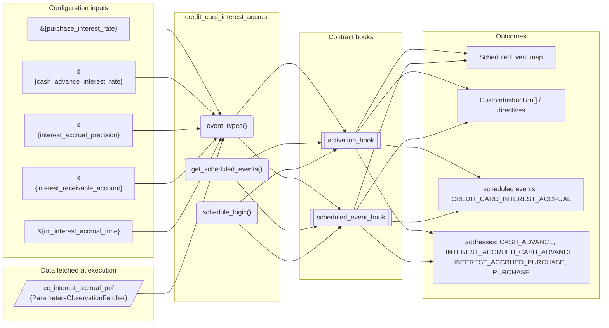

```mermaid
graph BT
  me_credit_card_interest_accrual["credit_card_interest_accrual"]:::self
  dep_common_accrual_utils["common.accrual_utils"] --> me_credit_card_interest_accrual
  dep_common_date_and_time["common.date_and_time"] --> me_credit_card_interest_accrual
  dep_common_denomination["common.denomination"] --> me_credit_card_interest_accrual
  dep_common_fetchers["common.fetchers"] --> me_credit_card_interest_accrual
  dep_common_parameter_utils["common.parameter_utils"] --> me_credit_card_interest_accrual
  dep_common_posting_utils["common.posting_utils"] --> me_credit_card_interest_accrual
  dep_common_state_utils["common.state_utils"] --> me_credit_card_interest_accrual
  dep_lending_addresses["lending.addresses"] --> me_credit_card_interest_accrual
  classDef self fill:#dbeafe,stroke:#1d4ed8,stroke-width:2px;
  classDef product fill:#dcfce7,stroke:#15803d,stroke-width:2px;
```

# Credit Card Interest Accrual

> Generated by `python3 -m fl docs`. Curated prose comes from `feature_library/src/feature_library/lending/interest/credit_card_interest_accrual.okf.yaml`; everything else is derived from the module source. Do not edit by hand.

| Property | Value |
|---|---|
| Module | `feature_library.lending.interest.credit_card_interest_accrual` |
| Domain | lending |
| Status | undeclared |
| Version | — |
| Hooks | `activation_hook`, `scheduled_event_hook` |
| Source | `feature_library/src/feature_library/lending/interest/credit_card_interest_accrual.py` |

## What it does

_Not yet described._

## Traceability: configuration to outcome

Every input below is a value a bank configures. The diagram shows which function consumes it and which hook turns it into an outcome.

## Inputs — parameters

| Reference | Meaning | Hierarchy level | Constraint | Required | CLU resource |
|---|---|---|---|---|---|
| `&{purchase_interest_rate}` | Annual interest rate for purchases (e.g. 0.249 for 24.9% APR). | — | decimal_constraint | required | `feature_library/src/feature_library/lending/interest/parameter_resource_defs/purchase_interest_rate.resource.yaml` |
| `&{cash_advance_interest_rate}` | Annual interest rate for cash advances (e.g. 0.299 for 29.9% APR). | — | decimal_constraint | required | `feature_library/src/feature_library/lending/interest/parameter_resource_defs/cash_advance_interest_rate.resource.yaml` |
| `&{interest_accrual_precision}` | Decimal places for interest accrual rounding. | — | decimal_constraint | required | `feature_library/src/feature_library/lending/interest/parameter_resource_defs/interest_accrual_precision.resource.yaml` |
| `&{interest_receivable_account}` | Internal account for interest receivable. | — | account_constraint | required | `feature_library/src/feature_library/lending/interest/parameter_resource_defs/interest_receivable_account.resource.yaml` |
| `&{cc_interest_accrual_time}` | Time of day for daily interest accrual. Format: HH:MM:SS. | — | string_constraint | required | `feature_library/src/feature_library/lending/interest/parameter_resource_defs/cc_interest_accrual_time.resource.yaml` |

## Inputs — data fetched at execution

| Fetcher id | Type | Anchor | Filter |
|---|---|---|---|
| `cc_interest_accrual_pof` | ParametersObservationFetcher | DefinedDateTime.EFFECTIVE_DATETIME | ParametersFilter(parameter_ids=[p.id for p in expected_parameters]) |

## Public API

| Function | Returns | Purpose |
|---|---|---|
| `event_types(product_name)` | `list[SmartContractEventType]` | Return the event types for the credit card interest accrual feature. |
| `get_parameters(vault, param_fetcher_id)` | `dict[str, datetime \| Decimal \| str \| None]` | Retrieves configuration parameters for the credit card interest accrual feature. |
| `get_scheduled_events(state, fetchers_config)` | `dict[str, ScheduledEvent]` | Get scheduled event for daily credit card interest accrual. |
| `schedule_logic(state, account_type, fetchers_config)` | `list[CustomInstruction]` | Calculates and accrues daily interest on purchase and cash advance balances. |

## Outputs

| Kind | Values | Notes |
|---|---|---|
| Scheduled events | `CREDIT_CARD_INTEREST_ACCRUAL` | per-product factory |
| Balance addresses | `CASH_ADVANCE`, `INTEREST_ACCRUED_CASH_ADVANCE`, `INTEREST_ACCRUED_PURCHASE`, `PURCHASE` | — |

## Where it sits in the library

## Requirement traceability

_No business requirement is linked to this feature yet, so it cannot be traced back to a stated need._

## Products using it

_None. A feature that no product composes is not yet a proven building block._

## Testing

| Tier | Status | Test modules |
|---|---|---|
| Unit | yes | 1 |
| Simulation | **missing** | 0 |
| End-to-end | **missing** | 0 |

<!-- generated:end -->

## Authored notes

_Written by hand before this page was generated; kept verbatim._

# Credit Card Interest Accrual

> Generated by `python3 -m fl docs`. Curated prose comes from `feature_library/src/feature_library/lending/interest/credit_card_interest_accrual.okf.yaml`; everything else is derived from the module source. Do not edit by hand.

| Property | Value |
|---|---|
| Module | `feature_library.lending.interest.credit_card_interest_accrual` |
| Domain | lending |
| Status | undeclared |
| Version | — |
| Hooks | `activation_hook`, `scheduled_event_hook` |
| Source | `feature_library/src/feature_library/lending/interest/credit_card_interest_accrual.py` |

## What it does

_Not yet described._

## Traceability: configuration to outcome

Every input below is a value a bank configures. The diagram shows which function consumes it and which hook turns it into an outcome.

## Inputs — parameters

| Reference | Meaning | Hierarchy level | Constraint | Required | CLU resource |
|---|---|---|---|---|---|
| `&{purchase_interest_rate}` | Annual interest rate for purchases (e.g. 0.249 for 24.9% APR). | — | decimal_constraint | required | `feature_library/src/feature_library/lending/interest/parameter_resource_defs/purchase_interest_rate.resource.yaml` |
| `&{cash_advance_interest_rate}` | Annual interest rate for cash advances (e.g. 0.299 for 29.9% APR). | — | decimal_constraint | required | `feature_library/src/feature_library/lending/interest/parameter_resource_defs/cash_advance_interest_rate.resource.yaml` |
| `&{interest_accrual_precision}` | Decimal places for interest accrual rounding. | — | decimal_constraint | required | `feature_library/src/feature_library/lending/interest/parameter_resource_defs/interest_accrual_precision.resource.yaml` |
| `&{interest_receivable_account}` | Internal account for interest receivable. | — | account_constraint | required | `feature_library/src/feature_library/lending/interest/parameter_resource_defs/interest_receivable_account.resource.yaml` |
| `&{cc_interest_accrual_time}` | Time of day for daily interest accrual. Format: HH:MM:SS. | — | string_constraint | required | `feature_library/src/feature_library/lending/interest/parameter_resource_defs/cc_interest_accrual_time.resource.yaml` |

## Inputs — data fetched at execution

| Fetcher id | Type | Anchor | Filter |
|---|---|---|---|
| `cc_interest_accrual_pof` | ParametersObservationFetcher | DefinedDateTime.EFFECTIVE_DATETIME | ParametersFilter(parameter_ids=[p.id for p in expected_parameters]) |

## Public API

| Function | Returns | Purpose |
|---|---|---|
| `event_types(product_name)` | `list[SmartContractEventType]` | Return the event types for the credit card interest accrual feature. |
| `get_parameters(vault, param_fetcher_id)` | `dict[str, datetime \| Decimal \| str \| None]` | Retrieves configuration parameters for the credit card interest accrual feature. |
| `get_scheduled_events(state, fetchers_config)` | `dict[str, ScheduledEvent]` | Get scheduled event for daily credit card interest accrual. |
| `schedule_logic(state, account_type, fetchers_config)` | `list[CustomInstruction]` | Calculates and accrues daily interest on purchase and cash advance balances. |

## Outputs

| Kind | Values | Notes |
|---|---|---|
| Scheduled events | `CREDIT_CARD_INTEREST_ACCRUAL` | per-product factory |
| Balance addresses | `CASH_ADVANCE`, `INTEREST_ACCRUED_CASH_ADVANCE`, `INTEREST_ACCRUED_PURCHASE`, `PURCHASE` | — |

## Where it sits in the library

## Requirement traceability

_No business requirement is linked to this feature yet, so it cannot be traced back to a stated need._

## Products using it

_None. A feature that no product composes is not yet a proven building block._

## Testing

| Tier | Status | Test modules |
|---|---|---|
| Unit | yes | 1 |
| Simulation | **missing** | 0 |
| End-to-end | **missing** | 0 |
