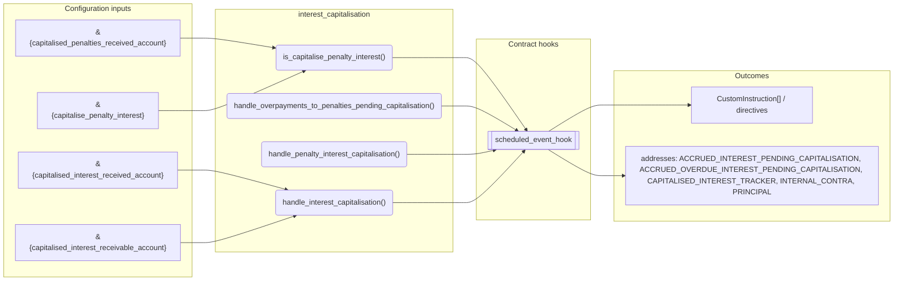
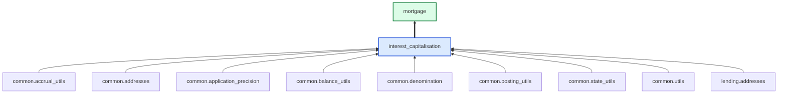

# Interest Capitalisation

> Generated by `python3 -m fl docs`. Curated prose comes from `feature_library/src/feature_library/lending/interest/interest_capitalisation.okf.yaml`; everything else is derived from the module source. Do not edit by hand.

| Property | Value |
|---|---|
| Module | `feature_library.lending.interest.interest_capitalisation` |
| Domain | lending |
| Status | undeclared |
| Version | — |
| Hooks | — |
| Source | `feature_library/src/feature_library/lending/interest/interest_capitalisation.py` |

## What it does

_Not yet described._

## Traceability: configuration to outcome

Every input below is a value a bank configures. The diagram shows which function consumes it and which hook turns it into an outcome.

## Inputs — parameters

| Reference | Meaning | Hierarchy level | Constraint | Required | CLU resource |
|---|---|---|---|---|---|
| `&{capitalised_interest_receivable_account}` | _undocumented_ | — | account_constraint | required | `feature_library/src/feature_library/lending/interest/parameter_resource_defs/capitalised_interest_receivable_account.resource.yaml` |
| `&{capitalised_interest_received_account}` | _undocumented_ | — | account_constraint | required | `feature_library/src/feature_library/lending/interest/parameter_resource_defs/capitalised_interest_received_account.resource.yaml` |
| `&{capitalised_penalties_received_account}` | _undocumented_ | — | account_constraint | required | `feature_library/src/feature_library/lending/interest/parameter_resource_defs/capitalised_penalties_received_account.resource.yaml` |
| `&{capitalise_penalty_interest}` | _undocumented_ | — | enumeration_constraint | required | `feature_library/src/feature_library/lending/interest/parameter_resource_defs/capitalise_penalty_interest.resource.yaml` |

## Public API

| Function | Returns | Purpose |
|---|---|---|
| `is_capitalise_penalty_interest(state)` | `bool` | Return whether penalty interest is configured to be capitalised. |
| `handle_overpayments_to_penalties_pending_capitalisation(state, account_type, accrual_address, target_address)` | `list[CustomInstruction]` | Handle overpayments applied to accrued overdue interest pending capitalisation. |
| `handle_penalty_interest_capitalisation(state, account_type, accrual_address, target_address, fetchers_config)` | `list[CustomInstruction]` | Handle capitalisation of penalty interest if configured to do so. |
| `handle_interest_capitalisation(state, account_type, accrual_address, target_address, fetchers_config)` | `list[CustomInstruction]` | Capitalise any accrued interest pending capitalisation after a repayment holiday ends. |

## Outputs

| Kind | Values | Notes |
|---|---|---|
| Balance addresses | `ACCRUED_INTEREST_PENDING_CAPITALISATION`, `ACCRUED_OVERDUE_INTEREST_PENDING_CAPITALISATION`, `CAPITALISED_INTEREST_TRACKER`, `INTERNAL_CONTRA`, `PRINCIPAL` | — |

## Where it sits in the library

## Requirement traceability

_No business requirement is linked to this feature yet, so it cannot be traced back to a stated need._

## Products using it

- `mortgage`

## Testing

| Tier | Status | Test modules |
|---|---|---|
| Unit | yes | 1 |
| Simulation | **missing** | 0 |
| End-to-end | **missing** | 0 |

<!-- generated:end -->

## Authored notes

_Written by hand before this page was generated; kept verbatim._

# Interest Capitalisation

> Generated by `python3 -m fl docs`. Curated prose comes from `feature_library/src/feature_library/lending/interest/interest_capitalisation.okf.yaml`; everything else is derived from the module source. Do not edit by hand.

| Property | Value |
|---|---|
| Module | `feature_library.lending.interest.interest_capitalisation` |
| Domain | lending |
| Status | undeclared |
| Version | — |
| Hooks | — |
| Source | `feature_library/src/feature_library/lending/interest/interest_capitalisation.py` |

## What it does

_Not yet described._

## Traceability: configuration to outcome

Every input below is a value a bank configures. The diagram shows which function consumes it and which hook turns it into an outcome.

## Inputs — parameters

| Reference | Meaning | Hierarchy level | Constraint | Required | CLU resource |
|---|---|---|---|---|---|
| `&{capitalised_interest_receivable_account}` | _undocumented_ | — | account_constraint | required | `feature_library/src/feature_library/lending/interest/parameter_resource_defs/capitalised_interest_receivable_account.resource.yaml` |
| `&{capitalised_interest_received_account}` | _undocumented_ | — | account_constraint | required | `feature_library/src/feature_library/lending/interest/parameter_resource_defs/capitalised_interest_received_account.resource.yaml` |
| `&{capitalised_penalties_received_account}` | _undocumented_ | — | account_constraint | required | `feature_library/src/feature_library/lending/interest/parameter_resource_defs/capitalised_penalties_received_account.resource.yaml` |
| `&{capitalise_penalty_interest}` | _undocumented_ | — | enumeration_constraint | required | `feature_library/src/feature_library/lending/interest/parameter_resource_defs/capitalise_penalty_interest.resource.yaml` |

## Public API

| Function | Returns | Purpose |
|---|---|---|
| `is_capitalise_penalty_interest(state)` | `bool` | Return whether penalty interest is configured to be capitalised. |
| `handle_overpayments_to_penalties_pending_capitalisation(state, account_type, accrual_address, target_address)` | `list[CustomInstruction]` | Handle overpayments applied to accrued overdue interest pending capitalisation. |
| `handle_penalty_interest_capitalisation(state, account_type, accrual_address, target_address, fetchers_config)` | `list[CustomInstruction]` | Handle capitalisation of penalty interest if configured to do so. |
| `handle_interest_capitalisation(state, account_type, accrual_address, target_address, fetchers_config)` | `list[CustomInstruction]` | Capitalise any accrued interest pending capitalisation after a repayment holiday ends. |

## Outputs

| Kind | Values | Notes |
|---|---|---|
| Balance addresses | `ACCRUED_INTEREST_PENDING_CAPITALISATION`, `ACCRUED_OVERDUE_INTEREST_PENDING_CAPITALISATION`, `CAPITALISED_INTEREST_TRACKER`, `INTERNAL_CONTRA`, `PRINCIPAL` | — |

## Where it sits in the library

## Requirement traceability

_No business requirement is linked to this feature yet, so it cannot be traced back to a stated need._

## Products using it

- `mortgage`

## Testing

| Tier | Status | Test modules |
|---|---|---|
| Unit | yes | 1 |
| Simulation | **missing** | 0 |
| End-to-end | **missing** | 0 |
