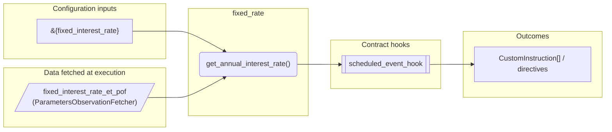
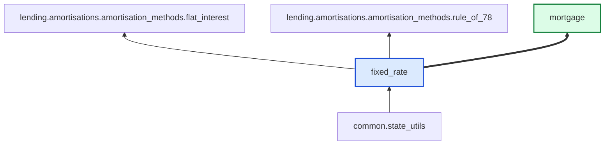

# Fixed Rate

> Generated by `python3 -m fl docs`. Curated prose comes from `feature_library/src/feature_library/lending/interest/secondary/fixed_rate.okf.yaml`; everything else is derived from the module source. Do not edit by hand.

| Property | Value |
|---|---|
| Module | `feature_library.lending.interest.secondary.fixed_rate` |
| Domain | lending |
| Status | undeclared |
| Version | — |
| Hooks | — |
| Source | `feature_library/src/feature_library/lending/interest/secondary/fixed_rate.py` |

## What it does

Fixed rate feature.

## Traceability: configuration to outcome

Every input below is a value a bank configures. The diagram shows which function consumes it and which hook turns it into an outcome.

## Inputs — parameters

| Reference | Meaning | Hierarchy level | Constraint | Required | CLU resource |
|---|---|---|---|---|---|
| `&{fixed_interest_rate}` | _undocumented_ | — | decimal_constraint | required | `feature_library/src/feature_library/deposit/interest/parameter_resource_defs/fixed_interest_rate.resource.yaml` |

## Inputs — data fetched at execution

| Fetcher id | Type | Anchor | Filter |
|---|---|---|---|
| `fixed_interest_rate_et_pof` | ParametersObservationFetcher | DefinedDateTime.EFFECTIVE_DATETIME | ParametersFilter(parameter_ids=[p.id for p in expected_parameters]) |

## Public API

| Function | Returns | Purpose |
|---|---|---|
| `get_parameters(vault, param_fetcher_id)` | `dict[str, datetime \| Decimal \| str \| None]` | Get the fixed interest parameters from the specified fetcher. |
| `get_annual_interest_rate(state, fetchers_config)` | `Decimal` | Get the annual fixed interest rate from the smart contract state. |

## Where it sits in the library

## Requirement traceability

_No business requirement is linked to this feature yet, so it cannot be traced back to a stated need._

## Products using it

- `mortgage`

## Testing

| Tier | Status | Test modules |
|---|---|---|
| Unit | yes | 3 |
| Simulation | yes | 1 |
| End-to-end | yes | 1 |

<!-- generated:end -->

## Authored notes

_Written by hand before this page was generated; kept verbatim._

# Fixed Rate

> Generated by `python3 -m fl docs`. Curated prose comes from `feature_library/src/feature_library/lending/interest/secondary/fixed_rate.okf.yaml`; everything else is derived from the module source. Do not edit by hand.

| Property | Value |
|---|---|
| Module | `feature_library.lending.interest.secondary.fixed_rate` |
| Domain | lending |
| Status | undeclared |
| Version | — |
| Hooks | — |
| Source | `feature_library/src/feature_library/lending/interest/secondary/fixed_rate.py` |

## What it does

Fixed rate feature.

## Traceability: configuration to outcome

Every input below is a value a bank configures. The diagram shows which function consumes it and which hook turns it into an outcome.

## Inputs — parameters

| Reference | Meaning | Hierarchy level | Constraint | Required | CLU resource |
|---|---|---|---|---|---|
| `&{fixed_interest_rate}` | _undocumented_ | — | decimal_constraint | required | `feature_library/src/feature_library/deposit/interest/parameter_resource_defs/fixed_interest_rate.resource.yaml` |

## Inputs — data fetched at execution

| Fetcher id | Type | Anchor | Filter |
|---|---|---|---|
| `fixed_interest_rate_et_pof` | ParametersObservationFetcher | DefinedDateTime.EFFECTIVE_DATETIME | ParametersFilter(parameter_ids=[p.id for p in expected_parameters]) |

## Public API

| Function | Returns | Purpose |
|---|---|---|
| `get_parameters(vault, param_fetcher_id)` | `dict[str, datetime \| Decimal \| str \| None]` | Get the fixed interest parameters from the specified fetcher. |
| `get_annual_interest_rate(state, fetchers_config)` | `Decimal` | Get the annual fixed interest rate from the smart contract state. |

## Where it sits in the library

## Requirement traceability

_No business requirement is linked to this feature yet, so it cannot be traced back to a stated need._

## Products using it

- `mortgage`

## Testing

| Tier | Status | Test modules |
|---|---|---|
| Unit | yes | 3 |
| Simulation | yes | 1 |
| End-to-end | yes | 1 |
