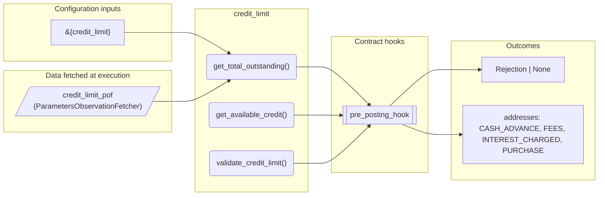
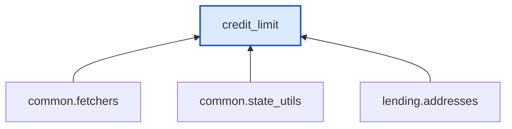

# Credit Limit

> Generated by `python3 -m fl docs`. Curated prose comes from `feature_library/src/feature_library/lending/limits/credit_limit.okf.yaml`; everything else is derived from the module source. Do not edit by hand.

| Property | Value |
|---|---|
| Module | `feature_library.lending.limits.credit_limit` |
| Domain | lending |
| Status | undeclared |
| Version | — |
| Hooks | `pre_posting_hook` |
| Source | `feature_library/src/feature_library/lending/limits/credit_limit.py` |

## What it does

_Not yet described._

## Traceability: configuration to outcome

Every input below is a value a bank configures. The diagram shows which function consumes it and which hook turns it into an outcome.

## Inputs — parameters

| Reference | Meaning | Hierarchy level | Constraint | Required | CLU resource |
|---|---|---|---|---|---|
| `&{credit_limit}` | Maximum credit limit for the account. | — | decimal_constraint | required | `feature_library/src/feature_library/lending/limits/parameter_resource_defs/credit_limit.resource.yaml` |

## Inputs — data fetched at execution

| Fetcher id | Type | Anchor | Filter |
|---|---|---|---|
| `credit_limit_pof` | ParametersObservationFetcher | DefinedDateTime.LIVE | ParametersFilter(parameter_ids=[p.id for p in expected_parameters]) |

## Public API

| Function | Returns | Purpose |
|---|---|---|
| `get_parameters(vault, param_fetcher_id)` | `dict[str, datetime \| Decimal \| str \| None]` | Retrieves configuration parameters for the credit limit feature. |
| `get_total_outstanding(balances, denomination)` | `Decimal` | Calculates the total outstanding balance across all relevant addresses. |
| `get_available_credit(state, denomination)` | `Decimal` | Calculates the available credit on the account. |
| `validate_credit_limit(state, denomination, posting_amount)` | `Rejection \| None` | Validates that a proposed posting does not exceed the credit limit. |

## Outputs

| Kind | Values | Notes |
|---|---|---|
| Balance addresses | `CASH_ADVANCE`, `FEES`, `INTEREST_CHARGED`, `PURCHASE` | — |

## Where it sits in the library

## Requirement traceability

_No business requirement is linked to this feature yet, so it cannot be traced back to a stated need._

## Products using it

_None. A feature that no product composes is not yet a proven building block._

## Testing

| Tier | Status | Test modules |
|---|---|---|
| Unit | yes | 1 |
| Simulation | yes | 1 |
| End-to-end | **missing** | 0 |

<!-- generated:end -->

## Authored notes

_Written by hand before this page was generated; kept verbatim._

# Credit Limit

> Generated by `python3 -m fl docs`. Curated prose comes from `feature_library/src/feature_library/lending/limits/credit_limit.okf.yaml`; everything else is derived from the module source. Do not edit by hand.

| Property | Value |
|---|---|
| Module | `feature_library.lending.limits.credit_limit` |
| Domain | lending |
| Status | undeclared |
| Version | — |
| Hooks | `pre_posting_hook` |
| Source | `feature_library/src/feature_library/lending/limits/credit_limit.py` |

## What it does

_Not yet described._

## Traceability: configuration to outcome

Every input below is a value a bank configures. The diagram shows which function consumes it and which hook turns it into an outcome.

## Inputs — parameters

| Reference | Meaning | Hierarchy level | Constraint | Required | CLU resource |
|---|---|---|---|---|---|
| `&{credit_limit}` | Maximum credit limit for the account. | — | decimal_constraint | required | `feature_library/src/feature_library/lending/limits/parameter_resource_defs/credit_limit.resource.yaml` |

## Inputs — data fetched at execution

| Fetcher id | Type | Anchor | Filter |
|---|---|---|---|
| `credit_limit_pof` | ParametersObservationFetcher | DefinedDateTime.LIVE | ParametersFilter(parameter_ids=[p.id for p in expected_parameters]) |

## Public API

| Function | Returns | Purpose |
|---|---|---|
| `get_parameters(vault, param_fetcher_id)` | `dict[str, datetime \| Decimal \| str \| None]` | Retrieves configuration parameters for the credit limit feature. |
| `get_total_outstanding(balances, denomination)` | `Decimal` | Calculates the total outstanding balance across all relevant addresses. |
| `get_available_credit(state, denomination)` | `Decimal` | Calculates the available credit on the account. |
| `validate_credit_limit(state, denomination, posting_amount)` | `Rejection \| None` | Validates that a proposed posting does not exceed the credit limit. |

## Outputs

| Kind | Values | Notes |
|---|---|---|
| Balance addresses | `CASH_ADVANCE`, `FEES`, `INTEREST_CHARGED`, `PURCHASE` | — |

## Where it sits in the library

## Requirement traceability

_No business requirement is linked to this feature yet, so it cannot be traced back to a stated need._

## Products using it

_None. A feature that no product composes is not yet a proven building block._

## Testing

| Tier | Status | Test modules |
|---|---|---|
| Unit | yes | 1 |
| Simulation | yes | 1 |
| End-to-end | **missing** | 0 |
