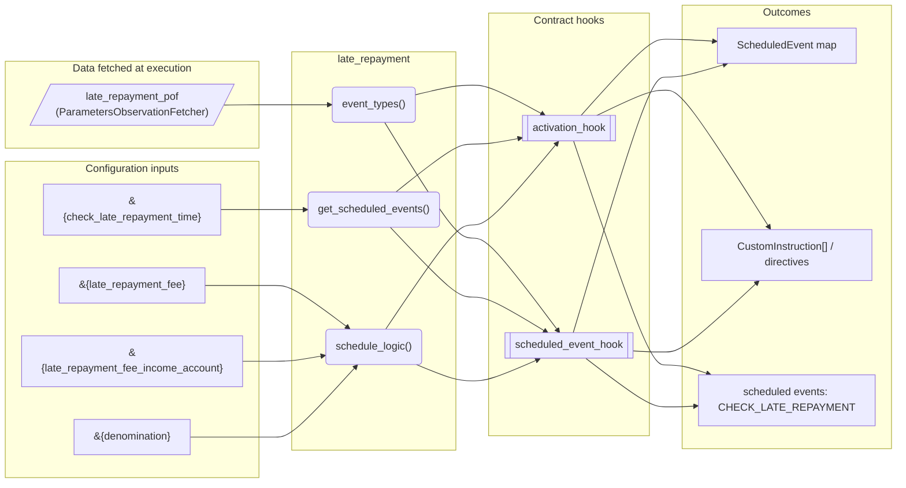
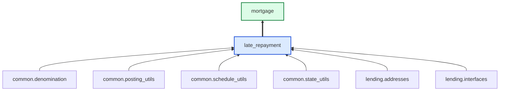

# Late Repayment

> Generated by `python3 -m fl docs`. Curated prose comes from `feature_library/src/feature_library/lending/repayments/late_repayment.okf.yaml`; everything else is derived from the module source. Do not edit by hand.

| Property | Value |
|---|---|
| Module | `feature_library.lending.repayments.late_repayment` |
| Domain | lending |
| Status | undeclared |
| Version | — |
| Hooks | `activation_hook`, `scheduled_event_hook` |
| Source | `feature_library/src/feature_library/lending/repayments/late_repayment.py` |

## What it does

_Not yet described._

## Traceability: configuration to outcome

Every input below is a value a bank configures. The diagram shows which function consumes it and which hook turns it into an outcome.

## Inputs — parameters

| Reference | Meaning | Hierarchy level | Constraint | Required | CLU resource |
|---|---|---|---|---|---|
| `&{late_repayment_fee}` | _undocumented_ | — | decimal_constraint | required | `feature_library/src/feature_library/lending/repayments/parameter_resource_defs/late_repayment_fee.resource.yaml` |
| `&{late_repayment_fee_income_account}` | _undocumented_ | — | account_constraint | required | `feature_library/src/feature_library/lending/repayments/parameter_resource_defs/late_repayment_fee_income_account.resource.yaml` |
| `&{check_late_repayment_time}` | _undocumented_ | — | string_constraint | required | `feature_library/src/feature_library/lending/repayments/parameter_resource_defs/check_late_repayment_time.resource.yaml` |
| `&{denomination}` | _undocumented_ | — | string_constraint | required | `feature_library/src/feature_library/common/parameter_resource_defs/denomination.resource.yaml` |

## Inputs — data fetched at execution

| Fetcher id | Type | Anchor | Filter |
|---|---|---|---|
| `late_repayment_pof` | ParametersObservationFetcher | DefinedDateTime.EFFECTIVE_DATETIME | ParametersFilter(parameter_ids=[LATE_REPAYMENT_FEE_PARAM_ID, LATE_REPAYMENT_FEE_ |

## Public API

| Function | Returns | Purpose |
|---|---|---|
| `get_parameters(vault, param_fetcher_id)` | `dict[str, str \| Decimal \| datetime \| None]` | Retrieves configuration parameters for the late repayment feature from the vault. |
| `event_types(product_name)` | `list[SmartContractEventType]` | Returns the list of event types required by the late repayment feature. |
| `get_scheduled_events(state, start_datetime, skip, fetchers_config)` | `dict[str, ScheduledEvent]` | Generates the schedule for late repayment checks. |
| `schedule_logic(state, account_type, check_total_overdue_amount, repayment_hierarchy_config, fetchers_config)` | `list[CustomInstruction]` | Calculates and returns postings to charge a late repayment fee if applicable. |

## Outputs

| Kind | Values | Notes |
|---|---|---|
| Scheduled events | `CHECK_LATE_REPAYMENT` | per-product factory |

## Composition points

Accepts: `RepaymentHierarchyConfig`

## Where it sits in the library

## Requirement traceability

_No business requirement is linked to this feature yet, so it cannot be traced back to a stated need._

## Products using it

- `mortgage`

## Testing

| Tier | Status | Test modules |
|---|---|---|
| Unit | yes | 1 |
| Simulation | yes | 1 |
| End-to-end | yes | 1 |

<!-- generated:end -->

## Authored notes

_Written by hand before this page was generated; kept verbatim._

# Late Repayment

> Generated by `python3 -m fl docs`. Curated prose comes from `feature_library/src/feature_library/lending/repayments/late_repayment.okf.yaml`; everything else is derived from the module source. Do not edit by hand.

| Property | Value |
|---|---|
| Module | `feature_library.lending.repayments.late_repayment` |
| Domain | lending |
| Status | undeclared |
| Version | — |
| Hooks | `activation_hook`, `scheduled_event_hook` |
| Source | `feature_library/src/feature_library/lending/repayments/late_repayment.py` |

## What it does

_Not yet described._

## Traceability: configuration to outcome

Every input below is a value a bank configures. The diagram shows which function consumes it and which hook turns it into an outcome.

## Inputs — parameters

| Reference | Meaning | Hierarchy level | Constraint | Required | CLU resource |
|---|---|---|---|---|---|
| `&{late_repayment_fee}` | _undocumented_ | — | decimal_constraint | required | `feature_library/src/feature_library/lending/repayments/parameter_resource_defs/late_repayment_fee.resource.yaml` |
| `&{late_repayment_fee_income_account}` | _undocumented_ | — | account_constraint | required | `feature_library/src/feature_library/lending/repayments/parameter_resource_defs/late_repayment_fee_income_account.resource.yaml` |
| `&{check_late_repayment_time}` | _undocumented_ | — | string_constraint | required | `feature_library/src/feature_library/lending/repayments/parameter_resource_defs/check_late_repayment_time.resource.yaml` |
| `&{denomination}` | _undocumented_ | — | string_constraint | required | `feature_library/src/feature_library/common/parameter_resource_defs/denomination.resource.yaml` |

## Inputs — data fetched at execution

| Fetcher id | Type | Anchor | Filter |
|---|---|---|---|
| `late_repayment_pof` | ParametersObservationFetcher | DefinedDateTime.EFFECTIVE_DATETIME | ParametersFilter(parameter_ids=[LATE_REPAYMENT_FEE_PARAM_ID, LATE_REPAYMENT_FEE_ |

## Public API

| Function | Returns | Purpose |
|---|---|---|
| `get_parameters(vault, param_fetcher_id)` | `dict[str, str \| Decimal \| datetime \| None]` | Retrieves configuration parameters for the late repayment feature from the vault. |
| `event_types(product_name)` | `list[SmartContractEventType]` | Returns the list of event types required by the late repayment feature. |
| `get_scheduled_events(state, start_datetime, skip, fetchers_config)` | `dict[str, ScheduledEvent]` | Generates the schedule for late repayment checks. |
| `schedule_logic(state, account_type, check_total_overdue_amount, repayment_hierarchy_config, fetchers_config)` | `list[CustomInstruction]` | Calculates and returns postings to charge a late repayment fee if applicable. |

## Outputs

| Kind | Values | Notes |
|---|---|---|
| Scheduled events | `CHECK_LATE_REPAYMENT` | per-product factory |

## Composition points

Accepts: `RepaymentHierarchyConfig`

## Where it sits in the library

## Requirement traceability

_No business requirement is linked to this feature yet, so it cannot be traced back to a stated need._

## Products using it

- `mortgage`

## Testing

| Tier | Status | Test modules |
|---|---|---|
| Unit | yes | 1 |
| Simulation | yes | 1 |
| End-to-end | yes | 1 |
