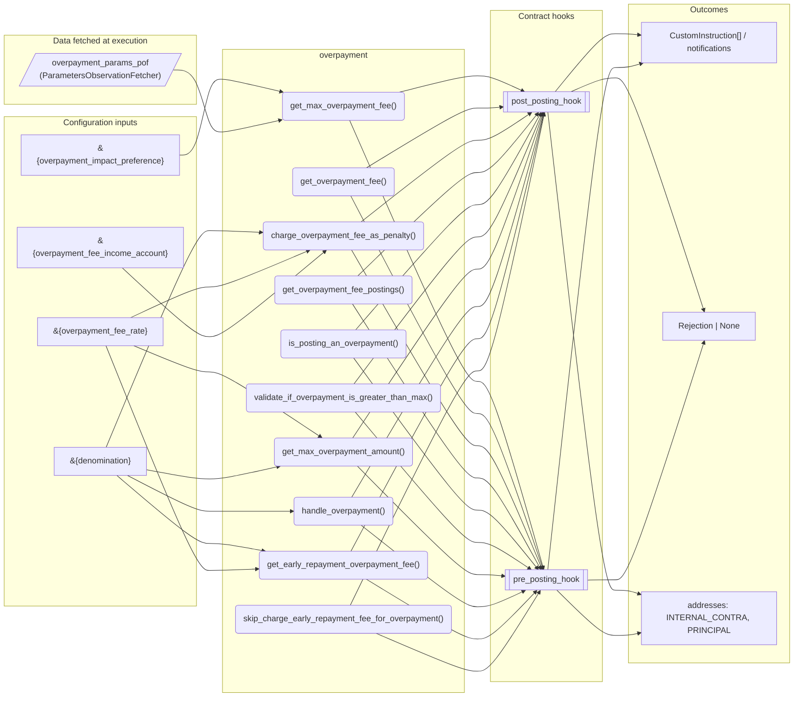
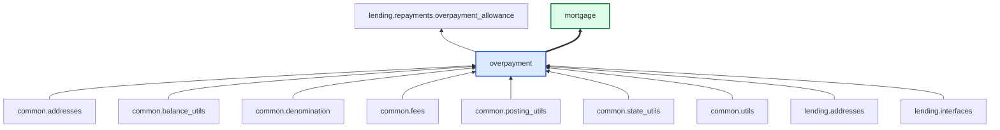

# Overpayment

> Generated by `python3 -m fl docs`. Curated prose comes from `feature_library/src/feature_library/lending/repayments/overpayment.okf.yaml`; everything else is derived from the module source. Do not edit by hand.

| Property | Value |
|---|---|
| Module | `feature_library.lending.repayments.overpayment` |
| Domain | lending |
| Status | undeclared |
| Version | — |
| Hooks | `post_posting_hook`, `pre_posting_hook` |
| Source | `feature_library/src/feature_library/lending/repayments/overpayment.py` |

## What it does

_Not yet described._

## Traceability: configuration to outcome

Every input below is a value a bank configures. The diagram shows which function consumes it and which hook turns it into an outcome.

## Inputs — parameters

| Reference | Meaning | Hierarchy level | Constraint | Required | CLU resource |
|---|---|---|---|---|---|
| `&{overpayment_fee_rate}` | _undocumented_ | — | decimal_constraint | required | `feature_library/src/feature_library/lending/repayments/parameter_resource_defs/overpayment_fee_rate.resource.yaml` |
| `&{overpayment_fee_income_account}` | _undocumented_ | — | account_constraint | required | `feature_library/src/feature_library/lending/repayments/parameter_resource_defs/overpayment_fee_income_account.resource.yaml` |
| `&{overpayment_impact_preference}` | _undocumented_ | — | string_constraint | required | `feature_library/src/feature_library/lending/repayments/parameter_resource_defs/overpayment_impact_preference.resource.yaml` |
| `&{denomination}` | _undocumented_ | — | string_constraint | required | `feature_library/src/feature_library/common/parameter_resource_defs/denomination.resource.yaml` |

## Inputs — data fetched at execution

| Fetcher id | Type | Anchor | Filter |
|---|---|---|---|
| `overpayment_params_pof` | ParametersObservationFetcher | DefinedDateTime.EFFECTIVE_DATETIME | ParametersFilter(parameter_ids=[p.id for p in expected_parameters]) |

## Public API

| Function | Returns | Purpose |
|---|---|---|
| `get_parameters(vault, param_fetcher_id)` | `dict[str, str \| Decimal \| datetime \| None]` | Retrieves configuration parameters for the overpayment feature from the vault. |
| `get_max_overpayment_fee(fee_rate, balances, denomination, precision, principal_address)` | `Decimal` | The maximum overpayment fee is the maximum_overpayment_amount * overpayment_fee_rate. |
| `get_overpayment_fee(principal_repaid, overpayment_fee_rate, precision)` | `Decimal` | Determines the overpayment fee for a given amount of principal being repaid. |
| `charge_overpayment_fee_as_penalty(state, vault, overpayment_amount, precision, fetchers_config)` | `list[CustomInstruction]` | Calculates and generates instructions to charge an overpayment fee as a penalty. |
| `get_overpayment_fee_postings(overpayment_fee, denomination, customer_account_id, customer_account_address, internal_account)` | `list[Posting]` | Creates postings to charge the overpayment fee. |
| `is_posting_an_overpayment(state, repayment_hierarchy_config, repayment_amount, fetchers_config)` | `bool` | Checks whether the given posting involves an overpayment amount. |
| `validate_if_overpayment_is_greater_than_max(state, repayment_amount, repayment_hierarchy_config, fetchers_config)` | `Rejection \| None` | Rejects repayments if the amount exceeds total owed, including Principal, + overpayment fee. |
| `get_max_overpayment_amount(state, repayment_hierarchy_config, fetchers_config)` | `Decimal` | Calculates the maximum allowed overpayment amount. |
| `handle_overpayment(state, overpayment_amount, repay_accrued_interest_callable, principal_address, overpayment_address, fetchers_config)` | `list[Posting]` | Creates postings to handle standard overpayments to principal and accrued interest. |
| `get_early_repayment_overpayment_fee(state, precision, fetchers_config)` | `Decimal` | Get the early repayment overpayment fee amount. |
| `skip_charge_early_repayment_fee_for_overpayment(state, amount_to_charge, fee_name, fetchers_config)` | `list[CustomInstruction]` | Skip the charge for the overpayment fee within an early repayment. |
| `get_residual_cleanup_postings(balances, account_id, denomination)` | `list[Posting]` | Generates postings to net out the overpayment tracker balance. |

## Outputs

| Kind | Values | Notes |
|---|---|---|
| Balance addresses | `INTERNAL_CONTRA`, `PRINCIPAL` | — |

## Composition points

| Provides interface | As constant | Members |
|---|---|---|
| `Overpayment` | `OverpaymentFeature` | `handle_overpayment` |
| `EarlyRepaymentFee` | `EarlyRepaymentOverpaymentFee` | `get_early_repayment_fee_amount`, `charge_early_repayment_fee`, `fee_name` |
| `ResidualCleanup` | `OverpaymentResidualCleanupFeature` | `get_residual_cleanup_postings` |

Accepts: `RepaymentHierarchyConfig`

## Where it sits in the library

## Requirement traceability

_No business requirement is linked to this feature yet, so it cannot be traced back to a stated need._

## Products using it

- `mortgage`

## Testing

| Tier | Status | Test modules |
|---|---|---|
| Unit | yes | 1 |
| Simulation | yes | 3 |
| End-to-end | **missing** | 0 |

<!-- generated:end -->

## Authored notes

_Written by hand before this page was generated; kept verbatim._

# Overpayment

> Generated by `python3 -m fl docs`. Curated prose comes from `feature_library/src/feature_library/lending/repayments/overpayment.okf.yaml`; everything else is derived from the module source. Do not edit by hand.

| Property | Value |
|---|---|
| Module | `feature_library.lending.repayments.overpayment` |
| Domain | lending |
| Status | undeclared |
| Version | — |
| Hooks | `post_posting_hook`, `pre_posting_hook` |
| Source | `feature_library/src/feature_library/lending/repayments/overpayment.py` |

## What it does

_Not yet described._

## Traceability: configuration to outcome

Every input below is a value a bank configures. The diagram shows which function consumes it and which hook turns it into an outcome.

## Inputs — parameters

| Reference | Meaning | Hierarchy level | Constraint | Required | CLU resource |
|---|---|---|---|---|---|
| `&{overpayment_fee_rate}` | _undocumented_ | — | decimal_constraint | required | `feature_library/src/feature_library/lending/repayments/parameter_resource_defs/overpayment_fee_rate.resource.yaml` |
| `&{overpayment_fee_income_account}` | _undocumented_ | — | account_constraint | required | `feature_library/src/feature_library/lending/repayments/parameter_resource_defs/overpayment_fee_income_account.resource.yaml` |
| `&{overpayment_impact_preference}` | _undocumented_ | — | string_constraint | required | `feature_library/src/feature_library/lending/repayments/parameter_resource_defs/overpayment_impact_preference.resource.yaml` |
| `&{denomination}` | _undocumented_ | — | string_constraint | required | `feature_library/src/feature_library/common/parameter_resource_defs/denomination.resource.yaml` |

## Inputs — data fetched at execution

| Fetcher id | Type | Anchor | Filter |
|---|---|---|---|
| `overpayment_params_pof` | ParametersObservationFetcher | DefinedDateTime.EFFECTIVE_DATETIME | ParametersFilter(parameter_ids=[p.id for p in expected_parameters]) |

## Public API

| Function | Returns | Purpose |
|---|---|---|
| `get_parameters(vault, param_fetcher_id)` | `dict[str, str \| Decimal \| datetime \| None]` | Retrieves configuration parameters for the overpayment feature from the vault. |
| `get_max_overpayment_fee(fee_rate, balances, denomination, precision, principal_address)` | `Decimal` | The maximum overpayment fee is the maximum_overpayment_amount * overpayment_fee_rate. |
| `get_overpayment_fee(principal_repaid, overpayment_fee_rate, precision)` | `Decimal` | Determines the overpayment fee for a given amount of principal being repaid. |
| `charge_overpayment_fee_as_penalty(state, vault, overpayment_amount, precision, fetchers_config)` | `list[CustomInstruction]` | Calculates and generates instructions to charge an overpayment fee as a penalty. |
| `get_overpayment_fee_postings(overpayment_fee, denomination, customer_account_id, customer_account_address, internal_account)` | `list[Posting]` | Creates postings to charge the overpayment fee. |
| `is_posting_an_overpayment(state, repayment_hierarchy_config, repayment_amount, fetchers_config)` | `bool` | Checks whether the given posting involves an overpayment amount. |
| `validate_if_overpayment_is_greater_than_max(state, repayment_amount, repayment_hierarchy_config, fetchers_config)` | `Rejection \| None` | Rejects repayments if the amount exceeds total owed, including Principal, + overpayment fee. |
| `get_max_overpayment_amount(state, repayment_hierarchy_config, fetchers_config)` | `Decimal` | Calculates the maximum allowed overpayment amount. |
| `handle_overpayment(state, overpayment_amount, repay_accrued_interest_callable, principal_address, overpayment_address, fetchers_config)` | `list[Posting]` | Creates postings to handle standard overpayments to principal and accrued interest. |
| `get_early_repayment_overpayment_fee(state, precision, fetchers_config)` | `Decimal` | Get the early repayment overpayment fee amount. |
| `skip_charge_early_repayment_fee_for_overpayment(state, amount_to_charge, fee_name, fetchers_config)` | `list[CustomInstruction]` | Skip the charge for the overpayment fee within an early repayment. |
| `get_residual_cleanup_postings(balances, account_id, denomination)` | `list[Posting]` | Generates postings to net out the overpayment tracker balance. |

## Outputs

| Kind | Values | Notes |
|---|---|---|
| Balance addresses | `INTERNAL_CONTRA`, `PRINCIPAL` | — |

## Composition points

| Provides interface | As constant | Members |
|---|---|---|
| `Overpayment` | `OverpaymentFeature` | `handle_overpayment` |
| `EarlyRepaymentFee` | `EarlyRepaymentOverpaymentFee` | `get_early_repayment_fee_amount`, `charge_early_repayment_fee`, `fee_name` |
| `ResidualCleanup` | `OverpaymentResidualCleanupFeature` | `get_residual_cleanup_postings` |

Accepts: `RepaymentHierarchyConfig`

## Where it sits in the library

## Requirement traceability

_No business requirement is linked to this feature yet, so it cannot be traced back to a stated need._

## Products using it

- `mortgage`

## Testing

| Tier | Status | Test modules |
|---|---|---|
| Unit | yes | 1 |
| Simulation | yes | 3 |
| End-to-end | **missing** | 0 |
