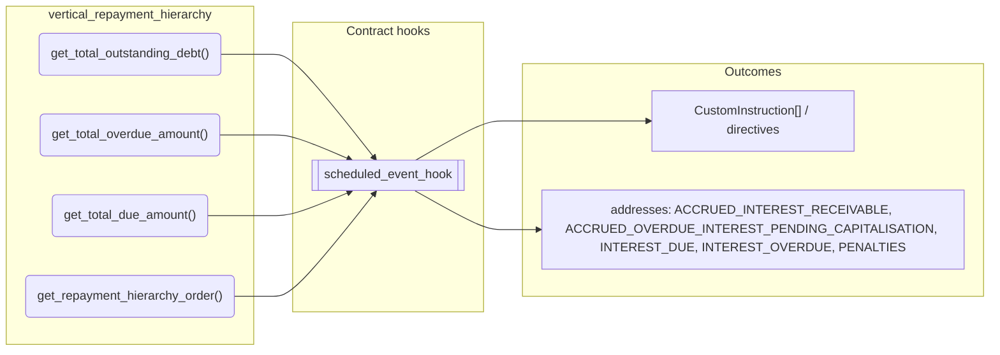
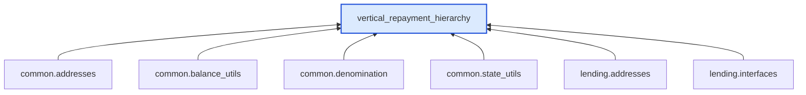

# Vertical Repayment Hierarchy

> Generated by `python3 -m fl docs`. Curated prose comes from `feature_library/src/feature_library/lending/repayments/secondary/vertical_repayment_hierarchy.okf.yaml`; everything else is derived from the module source. Do not edit by hand.

| Property | Value |
|---|---|
| Module | `feature_library.lending.repayments.secondary.vertical_repayment_hierarchy` |
| Domain | lending |
| Status | undeclared |
| Version | — |
| Hooks | — |
| Source | `feature_library/src/feature_library/lending/repayments/secondary/vertical_repayment_hierarchy.py` |

## What it does

_Not yet described._

## Traceability: configuration to outcome

Every input below is a value a bank configures. The diagram shows which function consumes it and which hook turns it into an outcome.

## Public API

| Function | Returns | Purpose |
|---|---|---|
| `get_total_outstanding_debt(state, fetchers_config)` | `Decimal` | Returns the total outstanding debt by summing the balances of all outstanding addresses. |
| `get_total_overdue_amount(state, fetchers_config)` | `Decimal` | Returns the total overdue amount by summing the balances of all overdue addresses. |
| `get_total_due_amount(state, fetchers_config)` | `Decimal` | Get the total due amount by summing the balances of all due and overdue addresses. |
| `get_repayment_hierarchy_order(state, fetchers_config)` | `list[str]` | Returns the repayment hierarchy order. |

## Outputs

| Kind | Values | Notes |
|---|---|---|
| Balance addresses | `ACCRUED_INTEREST_RECEIVABLE`, `ACCRUED_OVERDUE_INTEREST_PENDING_CAPITALISATION`, `INTEREST_DUE`, `INTEREST_OVERDUE`, `PENALTIES`, `PRINCIPAL`, `PRINCIPAL_DUE`, `PRINCIPAL_OVERDUE` | — |

## Composition points

| Provides interface | As constant | Members |
|---|---|---|
| `RepaymentHierarchy` | `VerticalRepaymentHierarchy` | `get_total_outstanding_debt`, `get_total_overdue_amount`, `get_total_due_amount`, `get_repayment_hierarchy_order` |

## Where it sits in the library

## Requirement traceability

_No business requirement is linked to this feature yet, so it cannot be traced back to a stated need._

## Products using it

_None. A feature that no product composes is not yet a proven building block._

## Testing

| Tier | Status | Test modules |
|---|---|---|
| Unit | yes | 1 |
| Simulation | yes | 4 |
| End-to-end | yes | 3 |

<!-- generated:end -->

## Authored notes

_Written by hand before this page was generated; kept verbatim._

# Vertical Repayment Hierarchy

> Generated by `python3 -m fl docs`. Curated prose comes from `feature_library/src/feature_library/lending/repayments/secondary/vertical_repayment_hierarchy.okf.yaml`; everything else is derived from the module source. Do not edit by hand.

| Property | Value |
|---|---|
| Module | `feature_library.lending.repayments.secondary.vertical_repayment_hierarchy` |
| Domain | lending |
| Status | undeclared |
| Version | — |
| Hooks | — |
| Source | `feature_library/src/feature_library/lending/repayments/secondary/vertical_repayment_hierarchy.py` |

## What it does

_Not yet described._

## Traceability: configuration to outcome

Every input below is a value a bank configures. The diagram shows which function consumes it and which hook turns it into an outcome.

## Public API

| Function | Returns | Purpose |
|---|---|---|
| `get_total_outstanding_debt(state, fetchers_config)` | `Decimal` | Returns the total outstanding debt by summing the balances of all outstanding addresses. |
| `get_total_overdue_amount(state, fetchers_config)` | `Decimal` | Returns the total overdue amount by summing the balances of all overdue addresses. |
| `get_total_due_amount(state, fetchers_config)` | `Decimal` | Get the total due amount by summing the balances of all due and overdue addresses. |
| `get_repayment_hierarchy_order(state, fetchers_config)` | `list[str]` | Returns the repayment hierarchy order. |

## Outputs

| Kind | Values | Notes |
|---|---|---|
| Balance addresses | `ACCRUED_INTEREST_RECEIVABLE`, `ACCRUED_OVERDUE_INTEREST_PENDING_CAPITALISATION`, `INTEREST_DUE`, `INTEREST_OVERDUE`, `PENALTIES`, `PRINCIPAL`, `PRINCIPAL_DUE`, `PRINCIPAL_OVERDUE` | — |

## Composition points

| Provides interface | As constant | Members |
|---|---|---|
| `RepaymentHierarchy` | `VerticalRepaymentHierarchy` | `get_total_outstanding_debt`, `get_total_overdue_amount`, `get_total_due_amount`, `get_repayment_hierarchy_order` |

## Where it sits in the library

## Requirement traceability

_No business requirement is linked to this feature yet, so it cannot be traced back to a stated need._

## Products using it

_None. A feature that no product composes is not yet a proven building block._

## Testing

| Tier | Status | Test modules |
|---|---|---|
| Unit | yes | 1 |
| Simulation | yes | 4 |
| End-to-end | yes | 3 |
