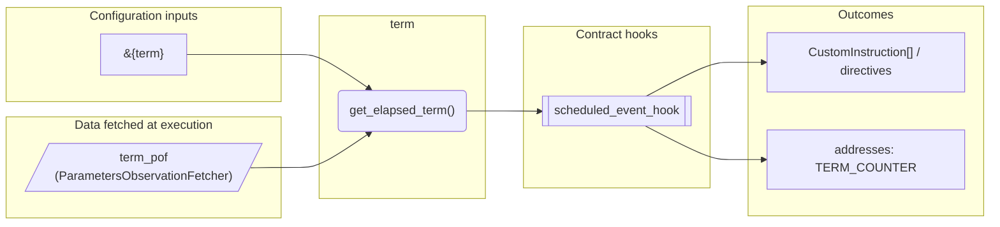

```mermaid
graph BT
  me_term["term"]:::self
  dep_common_balance_utils["common.balance_utils"] --> me_term
  dep_lending_addresses["lending.addresses"] --> me_term
  me_term --> use_lending_amortisations_amortisation_methods_declining_pri["lending.amortisations.amortisation_methods.declining_principal"]
  me_term --> use_lending_amortisations_amortisation_methods_flat_interest["lending.amortisations.amortisation_methods.flat_interest"]
  me_term --> use_lending_amortisations_amortisation_methods_interest_only["lending.amortisations.amortisation_methods.interest_only"]
  me_term --> use_lending_amortisations_amortisation_methods_minimum_repay["lending.amortisations.amortisation_methods.minimum_repayment"]
  me_term --> use_lending_amortisations_amortisation_methods_no_repayment["lending.amortisations.amortisation_methods.no_repayment"]
  me_term --> use_lending_amortisations_amortisation_methods_rule_of_78["lending.amortisations.amortisation_methods.rule_of_78"]
  me_term ==> prod_mortgage["mortgage"]:::product
  classDef self fill:#dbeafe,stroke:#1d4ed8,stroke-width:2px;
  classDef product fill:#dcfce7,stroke:#15803d,stroke-width:2px;
```

# Term

> Generated by `python3 -m fl docs`. Curated prose comes from `feature_library/src/feature_library/lending/term/term.okf.yaml`; everything else is derived from the module source. Do not edit by hand.

| Property | Value |
|---|---|
| Module | `feature_library.lending.term.term` |
| Domain | lending |
| Status | undeclared |
| Version | — |
| Hooks | — |
| Source | `feature_library/src/feature_library/lending/term/term.py` |

## What it does

_Not yet described._

## Traceability: configuration to outcome

Every input below is a value a bank configures. The diagram shows which function consumes it and which hook turns it into an outcome.

## Inputs — parameters

| Reference | Meaning | Hierarchy level | Constraint | Required | CLU resource |
|---|---|---|---|---|---|
| `&{term}` | _undocumented_ | — | decimal_constraint | required | `feature_library/src/feature_library/lending/term/parameter_resource_defs/term.resource.yaml` |

## Inputs — data fetched at execution

| Fetcher id | Type | Anchor | Filter |
|---|---|---|---|
| `term_pof` | ParametersObservationFetcher | DefinedDateTime.EFFECTIVE_DATETIME | ParametersFilter(parameter_ids=[p.id for p in expected_parameters]) |

## Public API

| Function | Returns | Purpose |
|---|---|---|
| `get_parameters(vault, param_fetcher_id)` | `dict[str, datetime \| Decimal \| str \| None]` | Retrieves configuration parameters for the lending term feature. |
| `get_elapsed_term(balances, denomination, repayment_count_address)` | `int` | Gets the elapsed term from the term counter address. |

## Outputs

| Kind | Values | Notes |
|---|---|---|
| Balance addresses | `TERM_COUNTER` | — |

## Where it sits in the library

## Requirement traceability

_No business requirement is linked to this feature yet, so it cannot be traced back to a stated need._

## Products using it

- `mortgage`

## Testing

| Tier | Status | Test modules |
|---|---|---|
| Unit | yes | 7 |
| Simulation | **missing** | 0 |
| End-to-end | **missing** | 0 |

<!-- generated:end -->

## Authored notes

_Written by hand before this page was generated; kept verbatim._

# Term

> Generated by `python3 -m fl docs`. Curated prose comes from `feature_library/src/feature_library/lending/term/term.okf.yaml`; everything else is derived from the module source. Do not edit by hand.

| Property | Value |
|---|---|
| Module | `feature_library.lending.term.term` |
| Domain | lending |
| Status | undeclared |
| Version | — |
| Hooks | — |
| Source | `feature_library/src/feature_library/lending/term/term.py` |

## What it does

_Not yet described._

## Traceability: configuration to outcome

Every input below is a value a bank configures. The diagram shows which function consumes it and which hook turns it into an outcome.

## Inputs — parameters

| Reference | Meaning | Hierarchy level | Constraint | Required | CLU resource |
|---|---|---|---|---|---|
| `&{term}` | _undocumented_ | — | decimal_constraint | required | `feature_library/src/feature_library/lending/term/parameter_resource_defs/term.resource.yaml` |

## Inputs — data fetched at execution

| Fetcher id | Type | Anchor | Filter |
|---|---|---|---|
| `term_pof` | ParametersObservationFetcher | DefinedDateTime.EFFECTIVE_DATETIME | ParametersFilter(parameter_ids=[p.id for p in expected_parameters]) |

## Public API

| Function | Returns | Purpose |
|---|---|---|
| `get_parameters(vault, param_fetcher_id)` | `dict[str, datetime \| Decimal \| str \| None]` | Retrieves configuration parameters for the lending term feature. |
| `get_elapsed_term(balances, denomination, repayment_count_address)` | `int` | Gets the elapsed term from the term counter address. |

## Outputs

| Kind | Values | Notes |
|---|---|---|
| Balance addresses | `TERM_COUNTER` | — |

## Where it sits in the library

## Requirement traceability

_No business requirement is linked to this feature yet, so it cannot be traced back to a stated need._

## Products using it

- `mortgage`

## Testing

| Tier | Status | Test modules |
|---|---|---|
| Unit | yes | 7 |
| Simulation | **missing** | 0 |
| End-to-end | **missing** | 0 |
