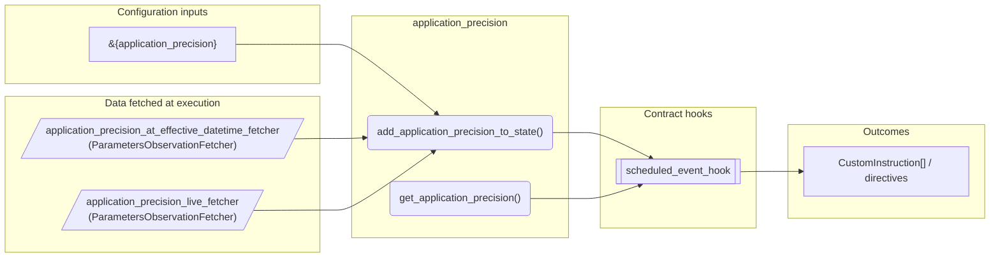

# Application Precision

> Generated by `python3 -m fl docs`. Curated prose comes from `feature_library/src/feature_library/common/application_precision.okf.yaml`; everything else is derived from the module source. Do not edit by hand.

| Property | Value |
|---|---|
| Module | `feature_library.common.application_precision` |
| Domain | common |
| Status | undeclared |
| Version | — |
| Hooks | — |
| Source | `feature_library/src/feature_library/common/application_precision.py` |

## What it does

_Not yet described._

## Traceability: configuration to outcome

Every input below is a value a bank configures. The diagram shows which function consumes it and which hook turns it into an outcome.

## Inputs — parameters

| Reference | Meaning | Hierarchy level | Constraint | Required | CLU resource |
|---|---|---|---|---|---|
| `&{application_precision}` | _undocumented_ | — | decimal_constraint | required | `feature_library/src/feature_library/common/parameter_resource_defs/application_precision.resource.yaml` |

## Inputs — data fetched at execution

| Fetcher id | Type | Anchor | Filter |
|---|---|---|---|
| `application_precision_at_effective_datetime_fetcher` | ParametersObservationFetcher | DefinedDateTime.EFFECTIVE_DATETIME | ParametersFilter(parameter_ids=[APPLICATION_PRECISION_PARAM_ID]) |
| `application_precision_live_fetcher` | ParametersObservationFetcher | DefinedDateTime.LIVE | ParametersFilter(parameter_ids=[APPLICATION_PRECISION_PARAM_ID]) |

## Public API

| Function | Returns | Purpose |
|---|---|---|
| `get_parameters(vault, fetcher_id)` | `dict[str, str \| datetime \| Decimal \| None]` | Retrieves the application precision parameters from a vault parameter observation. |
| `add_application_precision_to_state(state, param_fetcher_id)` | `state_utils.SmartContractState` | Updates the contract state with application precision parameters fetched from the vault. |
| `get_application_precision(state, application_precision_param_id)` | `int` | Retrieves the application precision from the state. |

## Where it sits in the library

```mermaid
graph BT
  me_application_precision["application_precision"]:::self
  dep_common_state_utils["common.state_utils"] --> me_application_precision
  me_application_precision --> use_deposit_interest_secondary_overdraft_interest["deposit.interest.secondary.overdraft_interest"]
  me_application_precision --> use_lending_amortisations_amortisation_methods_declining_pri["lending.amortisations.amortisation_methods.declining_principal"]
  me_application_precision --> use_lending_amortisations_amortisation_methods_flat_interest["lending.amortisations.amortisation_methods.flat_interest"]
  me_application_precision --> use_lending_amortisations_amortisation_methods_minimum_repay["lending.amortisations.amortisation_methods.minimum_repayment"]
  me_application_precision --> use_lending_amortisations_amortisation_methods_rule_of_78["lending.amortisations.amortisation_methods.rule_of_78"]
  me_application_precision --> use_lending_amortisations_eia["lending.amortisations.eia"]
  me_application_precision --> use_lending_interest_interest_application["lending.interest.interest_application"]
  me_application_precision --> use_lending_interest_interest_capitalisation["lending.interest.interest_capitalisation"]
  classDef self fill:#dbeafe,stroke:#1d4ed8,stroke-width:2px;
  classDef product fill:#dcfce7,stroke:#15803d,stroke-width:2px;
```

## Requirement traceability

_No business requirement is linked to this feature yet, so it cannot be traced back to a stated need._

## Products using it

_None. A feature that no product composes is not yet a proven building block._

## Testing

| Tier | Status | Test modules |
|---|---|---|
| Unit | yes | 4 |
| Simulation | yes | 2 |
| End-to-end | **missing** | 0 |

<!-- generated:end -->
