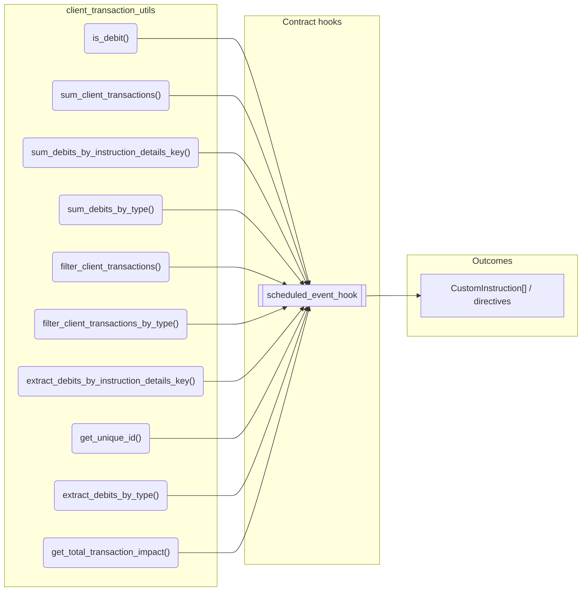
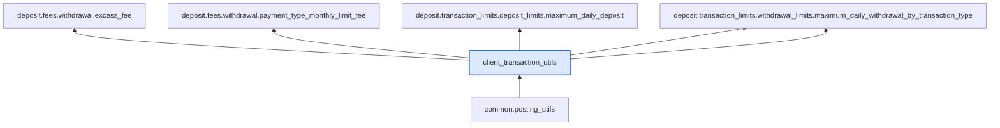

# Client Transaction Utils

> Generated by `python3 -m fl docs`. Curated prose comes from `feature_library/src/feature_library/common/client_transaction_utils.okf.yaml`; everything else is derived from the module source. Do not edit by hand.

| Property | Value |
|---|---|
| Module | `feature_library.common.client_transaction_utils` |
| Domain | common |
| Status | undeclared |
| Version | — |
| Hooks | — |
| Source | `feature_library/src/feature_library/common/client_transaction_utils.py` |

## What it does

_Not yet described._

## Traceability: configuration to outcome

Every input below is a value a bank configures. The diagram shows which function consumes it and which hook turns it into an outcome.

## Public API

| Function | Returns | Purpose |
|---|---|---|
| `is_debit(tx, posting)` | `bool` | Checks if a specific posting reduced the transaction impact. |
| `sum_client_transactions(cutoff_datetime, client_transactions, denomination)` | `Balance` | Sum the net amount credited to and debited from an account by the given client_transactions |
| `sum_debits_by_instruction_details_key(denomination, client_transactions, cutoff_datetime, key, value, client_transaction_ids_to_ignore)` | `Decimal` | Determines the net debit amount for a given transaction type since the cut off: |
| `sum_debits_by_type(denomination, client_transactions, cutoff_datetime, key, values, client_transaction_ids_to_ignore)` | `dict[str, Decimal]` | Determines the total debit amount for the specified transaction types since the cut off: |
| `filter_client_transactions(client_transactions, denomination, key, value, client_transaction_ids_to_ignore)` | `dict[str, ClientTransaction]` | Filters client transactions to only include client transactions with: |
| `filter_client_transactions_by_type(client_transactions, denomination, key, values, client_transaction_ids_to_ignore)` | `dict[str, dict[str, ClientTransaction]]` | Filters client transactions to only include the desired client transactions: |
| `extract_debits_by_instruction_details_key(denomination, client_transactions, cutoff_datetime, key, value, client_transaction_ids_to_ignore)` | `posting_utils.PostingInstructionListAlias` | Extracts all posting instructions in the client transactions that resulted in a net debit |
| `get_unique_id(posting)` | `str` | _undocumented_ |
| `extract_debits_by_type(denomination, client_transactions, cutoff_datetime, key, values, client_transaction_ids_to_ignore)` | `dict[str, dict[str, posting_utils.PostingInstructionListAlias]]` | Extracts all posting instructions in the client transactions that resulted in a net debit |
| `get_total_transaction_impact(transaction, effective_datetime)` | `Decimal` | For any financial movement, the total effect a ClientTransaction has had on the balances can be |
| `extract_interval_and_proposed_debits(denomination, proposed_transactions, interval_transactions, transaction_type_key, transaction_types, interval_start, effective_datetime)` | `tuple[dict[str, dict[str, posting_utils.PostingInstructionListAlias]], dict[str, dict[str, posting_utils.PostingInstructionListAlias]]]` | Extract debit posting instructions from proposed and interval transactions, deduplicating |

## Where it sits in the library

## Requirement traceability

_No business requirement is linked to this feature yet, so it cannot be traced back to a stated need._

## Products using it

_None. A feature that no product composes is not yet a proven building block._

## Testing

| Tier | Status | Test modules |
|---|---|---|
| Unit | yes | 1 |
| Simulation | **missing** | 0 |
| End-to-end | **missing** | 0 |

<!-- generated:end -->
