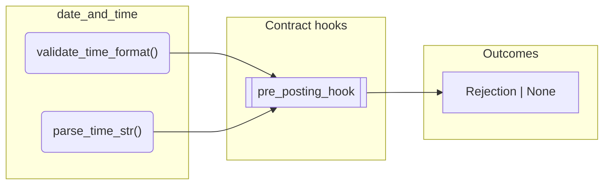

# Date And Time

> Generated by `python3 -m fl docs`. Curated prose comes from `feature_library/src/feature_library/common/date_and_time.okf.yaml`; everything else is derived from the module source. Do not edit by hand.

| Property | Value |
|---|---|
| Module | `feature_library.common.date_and_time` |
| Domain | common |
| Status | undeclared |
| Version | — |
| Hooks | `pre_posting_hook` |
| Source | `feature_library/src/feature_library/common/date_and_time.py` |

## What it does

_Not yet described._

## Traceability: configuration to outcome

Every input below is a value a bank configures. The diagram shows which function consumes it and which hook turns it into an outcome.

## Public API

| Function | Returns | Purpose |
|---|---|---|
| `validate_time_format(time_str)` | `Rejection \| None` | Validates that a string matches the HH:MM:SS format. |
| `parse_time_str(time_str)` | `Time` | Parses a time string in HH:MM:SS format into a Time named tuple. |

## Where it sits in the library

```mermaid
graph BT
  me_date_and_time["date_and_time"]:::self
  me_date_and_time --> use_deposit_fees_inactivity_fee["deposit.fees.inactivity_fee"]
  me_date_and_time --> use_deposit_fees_maintenance_fees["deposit.fees.maintenance_fees"]
  me_date_and_time --> use_deposit_fees_minimum_monthly_balance["deposit.fees.minimum_monthly_balance"]
  me_date_and_time --> use_deposit_fees_paper_statement_fee["deposit.fees.paper_statement_fee"]
  me_date_and_time --> use_deposit_fees_unarranged_overdraft_fee["deposit.fees.unarranged_overdraft_fee"]
  me_date_and_time --> use_deposit_interest_interest_accrual["deposit.interest.interest_accrual"]
  me_date_and_time --> use_lending_amortisations_due_amount_notification["lending.amortisations.due_amount_notification"]
  me_date_and_time --> use_lending_delinquency_delinquency["lending.delinquency.delinquency"]
  me_date_and_time --> use_lending_fees_annual_fee["lending.fees.annual_fee"]
  me_date_and_time --> use_lending_fees_credit_card_late_payment_fee["lending.fees.credit_card_late_payment_fee"]
  me_date_and_time --> use_lending_interest_credit_card_interest_accrual["lending.interest.credit_card_interest_accrual"]
  me_date_and_time --> use_lending_interest_interest_accrual["lending.interest.interest_accrual"]
  classDef self fill:#dbeafe,stroke:#1d4ed8,stroke-width:2px;
  classDef product fill:#dcfce7,stroke:#15803d,stroke-width:2px;
```

## Requirement traceability

_No business requirement is linked to this feature yet, so it cannot be traced back to a stated need._

## Products using it

_None. A feature that no product composes is not yet a proven building block._

## Testing

| Tier | Status | Test modules |
|---|---|---|
| Unit | yes | 1 |
| Simulation | **missing** | 0 |
| End-to-end | **missing** | 0 |

<!-- generated:end -->
