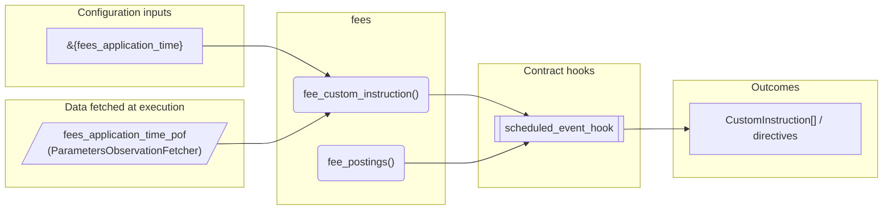
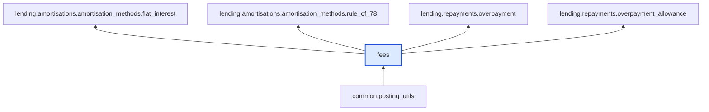

# Fees

> Generated by `python3 -m fl docs`. Curated prose comes from `feature_library/src/feature_library/common/fees.okf.yaml`; everything else is derived from the module source. Do not edit by hand.

| Property | Value |
|---|---|
| Module | `feature_library.common.fees` |
| Domain | common |
| Status | undeclared |
| Version | — |
| Hooks | — |
| Source | `feature_library/src/feature_library/common/fees.py` |

## What it does

_Not yet described._

## Traceability: configuration to outcome

Every input below is a value a bank configures. The diagram shows which function consumes it and which hook turns it into an outcome.

## Inputs — parameters

| Reference | Meaning | Hierarchy level | Constraint | Required | CLU resource |
|---|---|---|---|---|---|
| `&{fees_application_time}` | Format "HH:mm:ss".  Triggers pre-parameter change hook? No.  Optional? No. | — | string_constraint | required | `feature_library/src/feature_library/common/parameter_resource_defs/fees_application_time.resource.yaml` |

## Inputs — data fetched at execution

| Fetcher id | Type | Anchor | Filter |
|---|---|---|---|
| `fees_application_time_pof` | ParametersObservationFetcher | DefinedDateTime.EFFECTIVE_DATETIME | ParametersFilter(parameter_ids=[p.id for p in expected_parameters]) |

## Public API

| Function | Returns | Purpose |
|---|---|---|
| `get_parameters(vault, param_fetcher_id)` | `dict[str, datetime \| Decimal \| str \| None]` | Retrieves configuration parameters for the fees application time feature. |
| `fee_custom_instruction(customer_account_id, denomination, amount, internal_account, customer_account_address, instruction_details, reversal)` | `list[CustomInstruction]` | Create a Custom Instruction containing customer and internal account postings for a fee. |
| `fee_postings(customer_account_id, customer_account_address, denomination, amount, internal_account, reversal)` | `list[Posting]` | Create customer and internal account postings for applying a fee. |

## Where it sits in the library

## Requirement traceability

_No business requirement is linked to this feature yet, so it cannot be traced back to a stated need._

## Products using it

_None. A feature that no product composes is not yet a proven building block._

## Testing

| Tier | Status | Test modules |
|---|---|---|
| Unit | yes | 1 |
| Simulation | yes | 1 |
| End-to-end | **missing** | 0 |

<!-- generated:end -->
