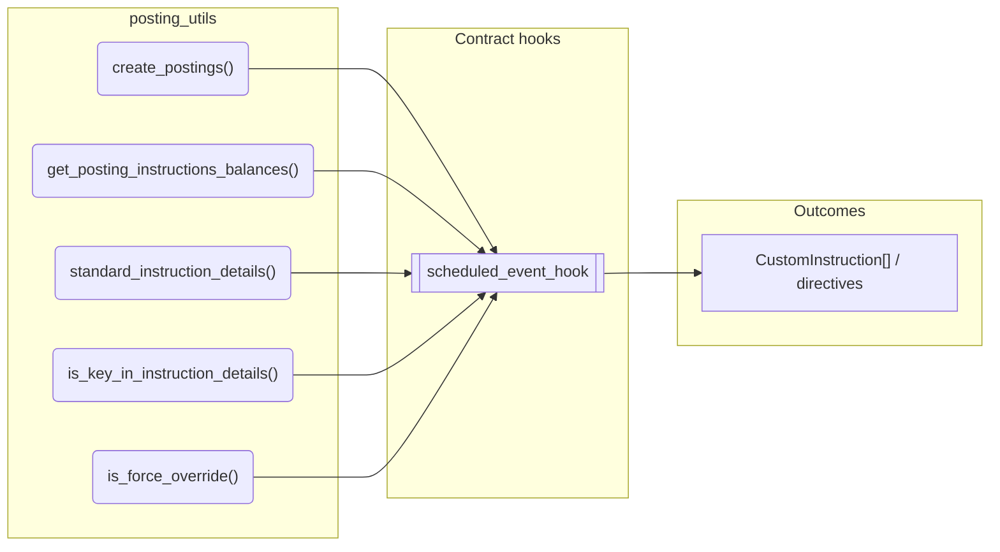

# Posting Utils

> Generated by `python3 -m fl docs`. Curated prose comes from `feature_library/src/feature_library/common/posting_utils.okf.yaml`; everything else is derived from the module source. Do not edit by hand.

| Property | Value |
|---|---|
| Module | `feature_library.common.posting_utils` |
| Domain | common |
| Status | undeclared |
| Version | — |
| Hooks | — |
| Source | `feature_library/src/feature_library/common/posting_utils.py` |

## What it does

_Not yet described._

## Traceability: configuration to outcome

Every input below is a value a bank configures. The diagram shows which function consumes it and which hook turns it into an outcome.

## Public API

| Function | Returns | Purpose |
|---|---|---|
| `create_postings(amount, debit_account, credit_account, denomination, debit_address, credit_address, asset)` | `list[Posting]` | Creates a pair of postings to debit the debit_address on debit_account. |
| `get_posting_instructions_balances(posting_instructions, account_id, tside)` | `BalanceDefaultDict` | Gets the combined balances for a list of posting instructions. |
| `standard_instruction_details(description, event_type, gl_impacted, account_type)` | `dict[str, str]` | Generates standard posting instruction details. |
| `is_key_in_instruction_details(key, posting_instructions)` | `bool` | Checks if a key is present and evaluates to true. |
| `is_force_override(posting_instructions)` | `bool` | Checks if 'force_override' is set to true. |

## Where it sits in the library

```mermaid
graph BT
  me_posting_utils["posting_utils"]:::self
  dep_common_utils["common.utils"] --> me_posting_utils
  me_posting_utils --> use_common_accrual_utils["common.accrual_utils"]
  me_posting_utils --> use_common_balance_utils["common.balance_utils"]
  me_posting_utils --> use_common_client_transaction_utils["common.client_transaction_utils"]
  me_posting_utils --> use_common_denomination["common.denomination"]
  me_posting_utils --> use_common_fees["common.fees"]
  me_posting_utils --> use_deposit_fees_early_closure_fee["deposit.fees.early_closure_fee"]
  me_posting_utils --> use_deposit_fees_inactivity_fee["deposit.fees.inactivity_fee"]
  me_posting_utils --> use_deposit_fees_maintenance_fees["deposit.fees.maintenance_fees"]
  me_posting_utils --> use_deposit_fees_minimum_monthly_balance["deposit.fees.minimum_monthly_balance"]
  me_posting_utils --> use_deposit_fees_overdraft_limit["deposit.fees.overdraft_limit"]
  me_posting_utils --> use_deposit_fees_paper_statement_fee["deposit.fees.paper_statement_fee"]
  me_posting_utils --> use_deposit_fees_partial_fee["deposit.fees.partial_fee"]
  classDef self fill:#dbeafe,stroke:#1d4ed8,stroke-width:2px;
  classDef product fill:#dcfce7,stroke:#15803d,stroke-width:2px;
```

## Requirement traceability

_No business requirement is linked to this feature yet, so it cannot be traced back to a stated need._

## Products using it

_None. A feature that no product composes is not yet a proven building block._

## Testing

| Tier | Status | Test modules |
|---|---|---|
| Unit | yes | 8 |
| Simulation | yes | 5 |
| End-to-end | yes | 2 |

<!-- generated:end -->
