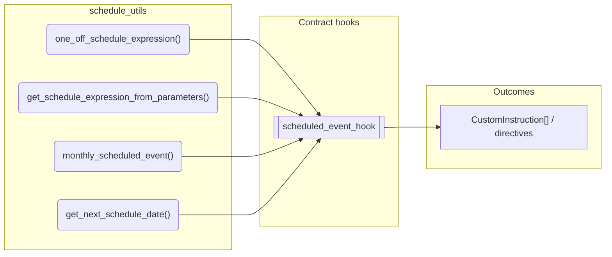
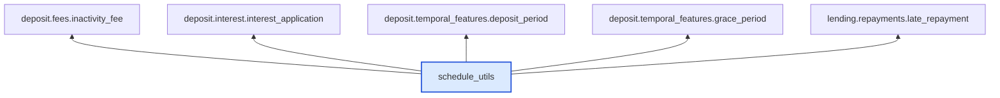

# Schedule Utils

> Generated by `python3 -m fl docs`. Curated prose comes from `feature_library/src/feature_library/common/schedule_utils.okf.yaml`; everything else is derived from the module source. Do not edit by hand.

| Property | Value |
|---|---|
| Module | `feature_library.common.schedule_utils` |
| Domain | common |
| Status | undeclared |
| Version | — |
| Hooks | — |
| Source | `feature_library/src/feature_library/common/schedule_utils.py` |

## What it does

_Not yet described._

## Traceability: configuration to outcome

Every input below is a value a bank configures. The diagram shows which function consumes it and which hook turns it into an outcome.

## Public API

| Function | Returns | Purpose |
|---|---|---|
| `one_off_schedule_expression(schedule_datetime)` | `ScheduleExpression` | Creates a ScheduleExpression for a one-off event. |
| `get_schedule_expression_from_parameters(time, day, month, year, day_of_week)` | `ScheduleExpression` | _undocumented_ |
| `monthly_scheduled_event(vault, start_datetime, time, day, failover)` | `ScheduledEvent` | Creates a monthly scheduled event, using values provided from relevant day and time parameters. |
| `get_next_schedule_date(start_date, schedule_frequency, intended_day)` | `datetime` | Calculate next valid date for schedule based on required frequency and day of month. |

## Where it sits in the library

## Requirement traceability

_No business requirement is linked to this feature yet, so it cannot be traced back to a stated need._

## Products using it

_None. A feature that no product composes is not yet a proven building block._

## Testing

| Tier | Status | Test modules |
|---|---|---|
| Unit | yes | 4 |
| Simulation | **missing** | 0 |
| End-to-end | **missing** | 0 |

<!-- generated:end -->
