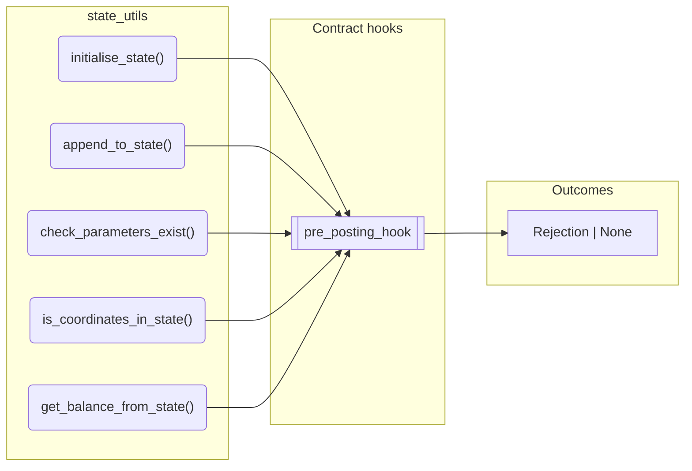

# State Utils

> Generated by `python3 -m fl docs`. Curated prose comes from `feature_library/src/feature_library/common/state_utils.okf.yaml`; everything else is derived from the module source. Do not edit by hand.

| Property | Value |
|---|---|
| Module | `feature_library.common.state_utils` |
| Domain | common |
| Status | undeclared |
| Version | — |
| Hooks | `pre_posting_hook` |
| Source | `feature_library/src/feature_library/common/state_utils.py` |

## What it does

_Not yet described._

## Traceability: configuration to outcome

Every input below is a value a bank configures. The diagram shows which function consumes it and which hook turns it into an outcome.

## Public API

| Function | Returns | Purpose |
|---|---|---|
| `initialise_state(vault, effective_datetime, parameters, balances, inflight_postings)` | `SmartContractState` | Initialises a SmartContractState object with the provided vault and values. |
| `append_to_state(state, vault, effective_datetime, parameters, balances, inflight_postings)` | `SmartContractState` | Creates a new SmartContractState by merging provided values with an existing state. |
| `check_parameters_exist(state, param_ids)` | `Rejection \| None` | Validates that the required parameter IDs are present in the SmartContractState. |
| `is_coordinates_in_state(state, coordinates)` | `bool` | Checks if all specified balance coordinates are present in the state's balances. |
| `get_balance_from_state(state, fetcher_id, account_address, denomination, asset, phase)` | `Decimal` | Attempts to get Balance Observation Value from State object. |

## Where it sits in the library

```mermaid
graph BT
  me_state_utils["state_utils"]:::self
  dep_common_balance_utils["common.balance_utils"] --> me_state_utils
  me_state_utils --> use_common_application_precision["common.application_precision"]
  me_state_utils --> use_common_denomination["common.denomination"]
  me_state_utils --> use_common_fetchers["common.fetchers"]
  me_state_utils --> use_deposit_dormancy_dormancy["deposit.dormancy.dormancy"]
  me_state_utils --> use_deposit_fees_early_closure_fee["deposit.fees.early_closure_fee"]
  me_state_utils --> use_deposit_fees_inactivity_fee["deposit.fees.inactivity_fee"]
  me_state_utils --> use_deposit_fees_maintenance_fees["deposit.fees.maintenance_fees"]
  me_state_utils --> use_deposit_fees_minimum_monthly_balance["deposit.fees.minimum_monthly_balance"]
  me_state_utils --> use_deposit_fees_overdraft_limit["deposit.fees.overdraft_limit"]
  me_state_utils --> use_deposit_fees_paper_statement_fee["deposit.fees.paper_statement_fee"]
  me_state_utils --> use_deposit_fees_partial_fee["deposit.fees.partial_fee"]
  me_state_utils --> use_deposit_fees_unarranged_overdraft_fee["deposit.fees.unarranged_overdraft_fee"]
  classDef self fill:#dbeafe,stroke:#1d4ed8,stroke-width:2px;
  classDef product fill:#dcfce7,stroke:#15803d,stroke-width:2px;
```

## Requirement traceability

_No business requirement is linked to this feature yet, so it cannot be traced back to a stated need._

## Products using it

_None. A feature that no product composes is not yet a proven building block._

## Testing

| Tier | Status | Test modules |
|---|---|---|
| Unit | yes | 16 |
| Simulation | yes | 42 |
| End-to-end | yes | 39 |

<!-- generated:end -->
