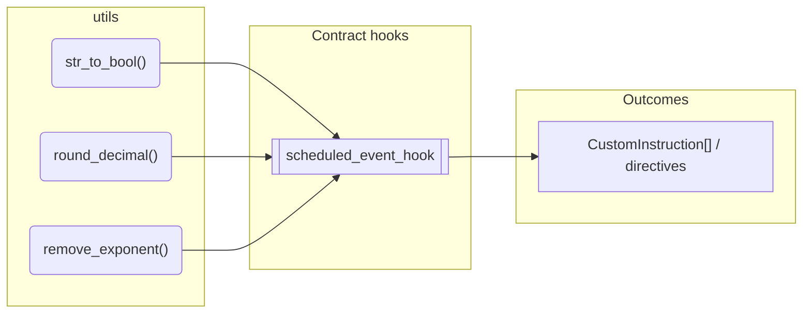

# Utils

> Generated by `python3 -m fl docs`. Curated prose comes from `feature_library/src/feature_library/common/utils.okf.yaml`; everything else is derived from the module source. Do not edit by hand.

| Property | Value |
|---|---|
| Module | `feature_library.common.utils` |
| Domain | common |
| Status | undeclared |
| Version | — |
| Hooks | — |
| Source | `feature_library/src/feature_library/common/utils.py` |

## What it does

_Not yet described._

## Traceability: configuration to outcome

Every input below is a value a bank configures. The diagram shows which function consumes it and which hook turns it into an outcome.

## Public API

| Function | Returns | Purpose |
|---|---|---|
| `str_to_bool(string)` | `bool` | Convert a string true to bool True, default value of False. |
| `round_decimal(amount, decimal_places, rounding)` | `Decimal` | Round to specified number of decimal places. |
| `remove_exponent(d)` | `Decimal` | Safely remove trailing zeros when dealing with exponents. |

## Where it sits in the library

```mermaid
graph BT
  me_utils["utils"]:::self
  me_utils --> use_common_balance_utils["common.balance_utils"]
  me_utils --> use_common_parameter_utils["common.parameter_utils"]
  me_utils --> use_common_posting_utils["common.posting_utils"]
  me_utils --> use_deposit_fees_inactivity_fee["deposit.fees.inactivity_fee"]
  me_utils --> use_deposit_fees_maintenance_fees["deposit.fees.maintenance_fees"]
  me_utils --> use_deposit_fees_minimum_monthly_balance["deposit.fees.minimum_monthly_balance"]
  me_utils --> use_deposit_fees_paper_statement_fee["deposit.fees.paper_statement_fee"]
  me_utils --> use_deposit_fees_withdrawal_early_withdrawal_fees["deposit.fees.withdrawal.early_withdrawal_fees"]
  me_utils --> use_deposit_interest_interest_application["deposit.interest.interest_application"]
  me_utils --> use_deposit_interest_secondary_flat_interest["deposit.interest.secondary.flat_interest"]
  me_utils --> use_deposit_interest_secondary_overdraft_interest["deposit.interest.secondary.overdraft_interest"]
  me_utils --> use_deposit_interest_secondary_tiered_interest["deposit.interest.secondary.tiered_interest"]
  classDef self fill:#dbeafe,stroke:#1d4ed8,stroke-width:2px;
  classDef product fill:#dcfce7,stroke:#15803d,stroke-width:2px;
```

## Requirement traceability

_No business requirement is linked to this feature yet, so it cannot be traced back to a stated need._

## Products using it

_None. A feature that no product composes is not yet a proven building block._

## Testing

| Tier | Status | Test modules |
|---|---|---|
| Unit | yes | 1 |
| Simulation | **missing** | 0 |
| End-to-end | **missing** | 0 |

<!-- generated:end -->
