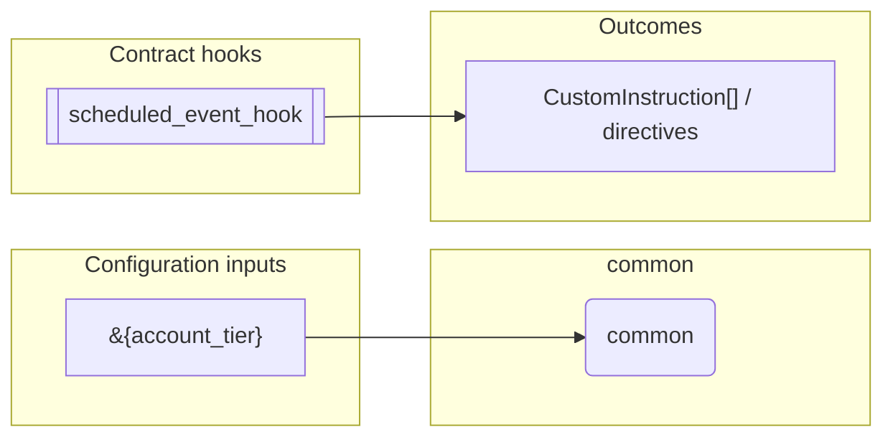
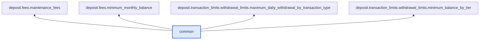

# Common

> Generated by `python3 -m fl docs`. Curated prose comes from `feature_library/src/feature_library/deposit/common.okf.yaml`; everything else is derived from the module source. Do not edit by hand.

| Property | Value |
|---|---|
| Module | `feature_library.deposit.common` |
| Domain | deposit |
| Status | undeclared |
| Version | — |
| Hooks | — |
| Source | `feature_library/src/feature_library/deposit/common.py` |

## What it does

Common parameters for withdrawal limits features.

## Traceability: configuration to outcome

Every input below is a value a bank configures. The diagram shows which function consumes it and which hook turns it into an outcome.

## Inputs — parameters

| Reference | Meaning | Hierarchy level | Constraint | Required | CLU resource |
|---|---|---|---|---|---|
| `&{account_tier}` | Triggers pre-parameter change hook? No.  Optional? No. | — | string_constraint | optional | `feature_library/src/feature_library/deposit/fees/parameter_resource_defs/account_tier.resource.yaml` |

## Where it sits in the library

## Requirement traceability

_No business requirement is linked to this feature yet, so it cannot be traced back to a stated need._

## Products using it

_None. A feature that no product composes is not yet a proven building block._

## Testing

| Tier | Status | Test modules |
|---|---|---|
| Unit | yes | 2 |
| Simulation | **missing** | 0 |
| End-to-end | **missing** | 0 |

<!-- generated:end -->
