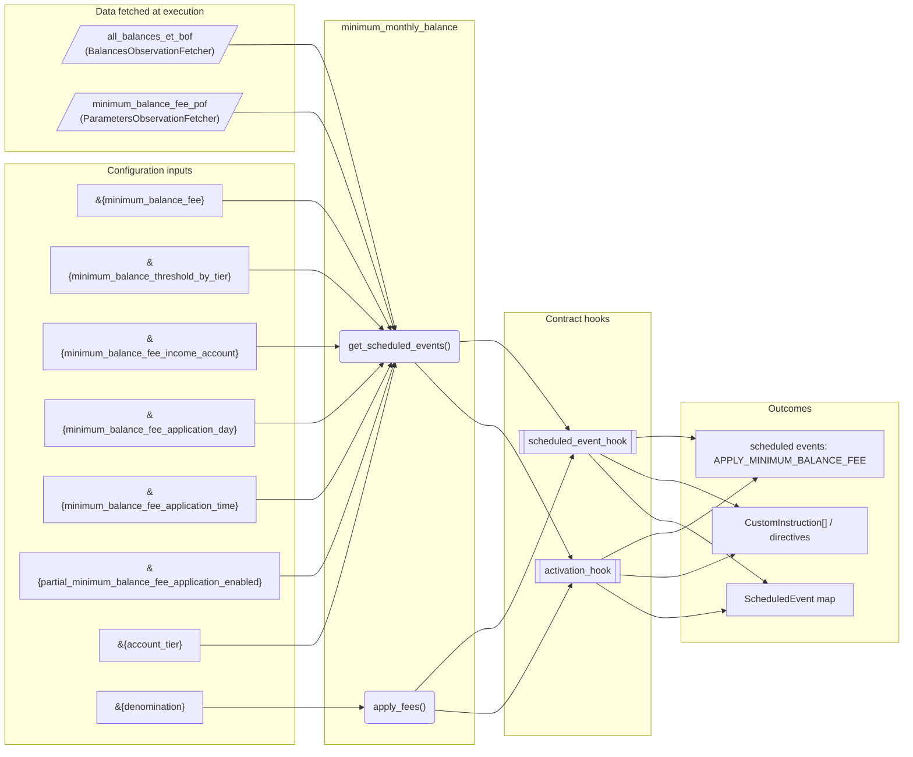

# Minimum Monthly Balance

> Generated by `python3 -m fl docs`. Curated prose comes from `feature_library/src/feature_library/deposit/fees/minimum_monthly_balance.okf.yaml`; everything else is derived from the module source. Do not edit by hand.

| Property | Value |
|---|---|
| Module | `feature_library.deposit.fees.minimum_monthly_balance` |
| Domain | deposit |
| Status | undeclared |
| Version | — |
| Hooks | `activation_hook`, `scheduled_event_hook` |
| Source | `feature_library/src/feature_library/deposit/fees/minimum_monthly_balance.py` |

## What it does

_Not yet described._

## Traceability: configuration to outcome

Every input below is a value a bank configures. The diagram shows which function consumes it and which hook turns it into an outcome.

## Inputs — parameters

| Reference | Meaning | Hierarchy level | Constraint | Required | CLU resource |
|---|---|---|---|---|---|
| `&{minimum_balance_fee}` | Triggers pre-parameter change hook? No.  Optional? No. | — | decimal_constraint | required | `feature_library/src/feature_library/deposit/fees/parameter_resource_defs/minimum_balance_fee.resource.yaml` |
| `&{minimum_balance_threshold_by_tier}` | Triggers pre-parameter change hook? No.  Optional? No. | — | string_constraint | required | `feature_library/src/feature_library/deposit/fees/parameter_resource_defs/minimum_balance_threshold_by_tier.resource.yaml` |
| `&{minimum_balance_fee_income_account}` | Triggers pre-parameter change hook? No.  Optional? No. | — | account_constraint | required | `feature_library/src/feature_library/deposit/fees/parameter_resource_defs/minimum_balance_fee_income_account.resource.yaml` |
| `&{minimum_balance_fee_application_day}` | Triggers pre-parameter change hook? No.  Optional? No. | — | decimal_constraint | required | `feature_library/src/feature_library/deposit/fees/parameter_resource_defs/minimum_balance_fee_application_day.resource.yaml` |
| `&{minimum_balance_fee_application_time}` | Format "HH:mm:ss".  Triggers pre-parameter change hook? No.  Optional? No. | — | string_constraint | required | `feature_library/src/feature_library/deposit/fees/parameter_resource_defs/minimum_balance_fee_application_time.resource.yaml` |
| `&{partial_minimum_balance_fee_application_enabled}` | Triggers pre-parameter change hook? No.  Optional? No. | — | enumeration_constraint | optional | `feature_library/src/feature_library/deposit/fees/parameter_resource_defs/partial_minimum_balance_fee_application_enabled.resource.yaml` |
| `&{account_tier}` | Triggers pre-parameter change hook? No.  Optional? No. | — | string_constraint | optional | `feature_library/src/feature_library/deposit/fees/parameter_resource_defs/account_tier.resource.yaml` |
| `&{denomination}` | _undocumented_ | — | string_constraint | required | `feature_library/src/feature_library/common/parameter_resource_defs/denomination.resource.yaml` |

## Inputs — data fetched at execution

| Fetcher id | Type | Anchor | Filter |
|---|---|---|---|
| `all_balances_et_bof` | BalancesObservationFetcher | DefinedDateTime.EFFECTIVE_DATETIME | — |
| `minimum_balance_fee_pof` | ParametersObservationFetcher | DefinedDateTime.EFFECTIVE_DATETIME | ParametersFilter(parameter_ids=[p.id for p in expected_parameters]) |

## Public API

| Function | Returns | Purpose |
|---|---|---|
| `get_parameters(vault, param_fetcher_id)` | `dict[str, datetime \| Decimal \| str \| None]` | Retrieves configuration parameters for the minimum monthly balance fee feature. |
| `get_scheduled_events(state, fetchers_config)` | `dict[str, ScheduledEvent]` | Returns the scheduled events for applying the minimum monthly balance fee. |
| `apply_fees(state, account_type, fetchers_config, available_balance_feature)` | `list[CustomInstruction]` | Calculates and applies minimum monthly balance fees if mean balance is below threshold. |

## Outputs

| Kind | Values | Notes |
|---|---|---|
| Scheduled events | `APPLY_MINIMUM_BALANCE_FEE` | static |

## Composition points

| Provides interface | As constant | Members |
|---|---|---|
| `PartialFeeCollection` | `PARTIAL_FEE_DETAILS` | `outstanding_fee_address`, `fee_type`, `internal_account_parameter_id` |

Accepts: `AvailableBalance`

## Where it sits in the library

```mermaid
graph BT
  me_minimum_monthly_balance["minimum_monthly_balance"]:::self
  dep_common_balance_utils["common.balance_utils"] --> me_minimum_monthly_balance
  dep_common_date_and_time["common.date_and_time"] --> me_minimum_monthly_balance
  dep_common_denomination["common.denomination"] --> me_minimum_monthly_balance
  dep_common_fetchers["common.fetchers"] --> me_minimum_monthly_balance
  dep_common_posting_utils["common.posting_utils"] --> me_minimum_monthly_balance
  dep_common_state_utils["common.state_utils"] --> me_minimum_monthly_balance
  dep_common_utils["common.utils"] --> me_minimum_monthly_balance
  dep_deposit_common["deposit.common"] --> me_minimum_monthly_balance
  dep_deposit_fees_partial_fee["deposit.fees.partial_fee"] --> me_minimum_monthly_balance
  dep_deposit_interfaces["deposit.interfaces"] --> me_minimum_monthly_balance
  me_minimum_monthly_balance ==> prod_corporate_current_account["corporate_current_account"]:::product
  me_minimum_monthly_balance ==> prod_personal_current_account["personal_current_account"]:::product
  classDef self fill:#dbeafe,stroke:#1d4ed8,stroke-width:2px;
  classDef product fill:#dcfce7,stroke:#15803d,stroke-width:2px;
```

## Requirement traceability

_No business requirement is linked to this feature yet, so it cannot be traced back to a stated need._

## Products using it

- `corporate_current_account`
- `personal_current_account`

## Testing

| Tier | Status | Test modules |
|---|---|---|
| Unit | yes | 1 |
| Simulation | yes | 1 |
| End-to-end | yes | 1 |

<!-- generated:end -->
