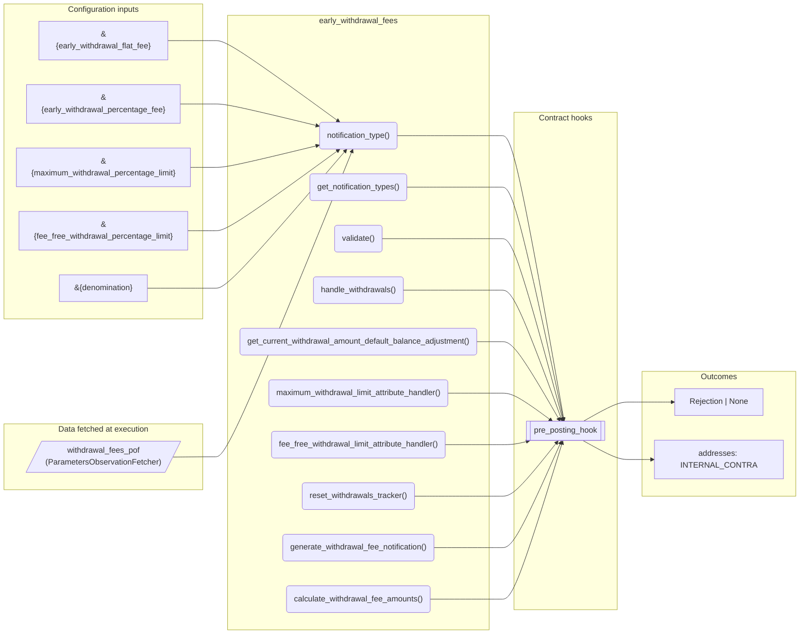

# Early Withdrawal Fees

> Generated by `python3 -m fl docs`. Curated prose comes from `feature_library/src/feature_library/deposit/fees/withdrawal/early_withdrawal_fees.okf.yaml`; everything else is derived from the module source. Do not edit by hand.

| Property | Value |
|---|---|
| Module | `feature_library.deposit.fees.withdrawal.early_withdrawal_fees` |
| Domain | deposit |
| Status | undeclared |
| Version | — |
| Hooks | `pre_posting_hook` |
| Source | `feature_library/src/feature_library/deposit/fees/withdrawal/early_withdrawal_fees.py` |

## What it does

_Not yet described._

## Traceability: configuration to outcome

Every input below is a value a bank configures. The diagram shows which function consumes it and which hook turns it into an outcome.

## Inputs — parameters

| Reference | Meaning | Hierarchy level | Constraint | Required | CLU resource |
|---|---|---|---|---|---|
| `&{early_withdrawal_flat_fee}` | Triggers pre-parameter change hook? No.  Optional? No. | — | decimal_constraint | required | `feature_library/src/feature_library/deposit/fees/withdrawal/parameter_resource_defs/early_withdrawal_flat_fee.resource.yaml` |
| `&{early_withdrawal_percentage_fee}` | Triggers pre-parameter change hook? No.  Optional? No. | — | decimal_constraint | required | `feature_library/src/feature_library/deposit/fees/withdrawal/parameter_resource_defs/early_withdrawal_percentage_fee.resource.yaml` |
| `&{maximum_withdrawal_percentage_limit}` | Triggers pre-parameter change hook? No.  Optional? No. | — | decimal_constraint | required | `feature_library/src/feature_library/deposit/fees/withdrawal/parameter_resource_defs/maximum_withdrawal_percentage_limit.resource.yaml` |
| `&{fee_free_withdrawal_percentage_limit}` | Triggers pre-parameter change hook? No.  Optional? No. | — | decimal_constraint | required | `feature_library/src/feature_library/deposit/fees/withdrawal/parameter_resource_defs/fee_free_withdrawal_percentage_limit.resource.yaml` |
| `&{denomination}` | _undocumented_ | — | string_constraint | required | `feature_library/src/feature_library/common/parameter_resource_defs/denomination.resource.yaml` |

## Inputs — data fetched at execution

| Fetcher id | Type | Anchor | Filter |
|---|---|---|---|
| `withdrawal_fees_pof` | ParametersObservationFetcher | DefinedDateTime.EFFECTIVE_DATETIME | ParametersFilter(parameter_ids=[p.id for p in expected_parameters]) |

## Public API

| Function | Returns | Purpose |
|---|---|---|
| `notification_type(product_name)` | `str` | Returns a notification type. |
| `get_notification_types(product_name)` | `list[str]` | Generates all the notification types for this Feature module. |
| `get_parameters(vault, param_fetcher_id)` | `dict[str, datetime \| Decimal \| str \| None]` | Retrieves configuration parameters for the withdrawal fees feature. |
| `validate(state, posting_instructions, balance_adjustments, fetchers_config)` | `Rejection \| None` | For use in the pre_posting_hook. |
| `handle_withdrawals(state, posting_instructions, product_name, balance_adjustments, fetchers_config)` | `HandleWithdrawalsResult` | For use in the post_posting_hook. |
| `get_current_withdrawal_amount_default_balance_adjustment(withdrawal_amount)` | `deposit_interfaces.DefaultBalanceAdjustment` | The customer deposited amount is the sum of the DEFAULT balance. |
| `maximum_withdrawal_limit_attribute_handler(vault, hook_arguments, fetchers_config)` | `AttributeHookResult` | Get the maximum withdrawal limit for the derived parameter value. |
| `fee_free_withdrawal_limit_attribute_handler(vault, hook_arguments, fetchers_config)` | `AttributeHookResult` | Get the fee free withdrawal limit for the derived parameter value. |
| `reset_withdrawals_tracker(state, balance_fetcher_id, param_fetcher_id, denomination_param_id)` | `list[CustomInstruction]` | Create postings to net-off the withdrawals tracker balance. |
| `generate_withdrawal_fee_notification(account_id, denomination, withdrawal_amount, flat_fee_amount, percentage_fee_amount, product_name, client_batch_id, precision)` | `AccountNotificationDirective` | Generate the notification containing the respective fee amounts for a withdrawal. |
| `calculate_withdrawal_fee_amounts(state, withdrawal_amount, balance_adjustments, precision)` | `WithdrawalFeeAmounts` | Calculate the flat fee and percentage fee amounts that are chargeable against a withdrawal. |
| `get_customer_deposit_amount(state, balance_adjustments, fetchers_config)` | `Decimal` | Calculate the amount the customer has deposited in the account. |

## Outputs

| Kind | Values | Notes |
|---|---|---|
| Balance addresses | `INTERNAL_CONTRA` | — |

## Composition points

Accepts: `DefaultBalanceAdjustment`

## Where it sits in the library

```mermaid
graph BT
  me_early_withdrawal_fees["early_withdrawal_fees"]:::self
  dep_common_addresses["common.addresses"] --> me_early_withdrawal_fees
  dep_common_balance_utils["common.balance_utils"] --> me_early_withdrawal_fees
  dep_common_calendar_utils["common.calendar_utils"] --> me_early_withdrawal_fees
  dep_common_denomination["common.denomination"] --> me_early_withdrawal_fees
  dep_common_fetchers["common.fetchers"] --> me_early_withdrawal_fees
  dep_common_posting_utils["common.posting_utils"] --> me_early_withdrawal_fees
  dep_common_state_utils["common.state_utils"] --> me_early_withdrawal_fees
  dep_common_utils["common.utils"] --> me_early_withdrawal_fees
  dep_deposit_interfaces["deposit.interfaces"] --> me_early_withdrawal_fees
  classDef self fill:#dbeafe,stroke:#1d4ed8,stroke-width:2px;
  classDef product fill:#dcfce7,stroke:#15803d,stroke-width:2px;
```

## Requirement traceability

_No business requirement is linked to this feature yet, so it cannot be traced back to a stated need._

## Products using it

_None. A feature that no product composes is not yet a proven building block._

## Testing

| Tier | Status | Test modules |
|---|---|---|
| Unit | yes | 1 |
| Simulation | yes | 1 |
| End-to-end | yes | 1 |

<!-- generated:end -->
